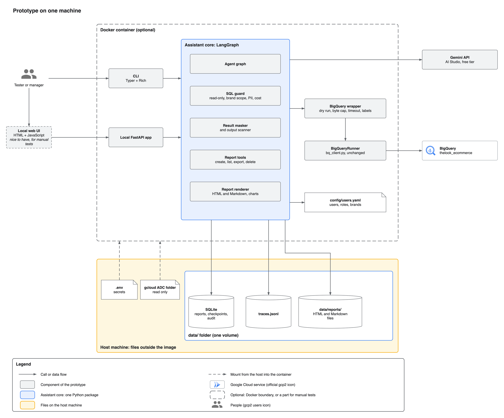

# Retail Analytics Chat Assistant

A chat assistant for the executive teams of a retail company. Executives ask questions about sales, products and customers in plain language. The assistant answers with figures from BigQuery, writes reports with action items, protects personal data, and shows each manager only the data of their brands.

This repository contains the design and a command-line prototype for the OpsFleet technical assignment.

## Status

Phase 1 is done: the foundation (spec 00) and the walking skeleton (spec 01). A user can ask a simple data question in the terminal and get an answer from the real BigQuery data.

Phase 2 has started. Query safety (spec 30) and the agent core (spec 31) are active:

- Each manager sees only the data of their brands. Code rewrites every query to the brand scope.
- Personal data never reaches the model or the user. The SQL guard blocks PII columns, and it blocks a single customer together with a location, age, gender or traffic source. The result masker cleans the rows, and the output scanner cleans the answer.
- When a query returns no rows, the assistant checks if the data is really empty or if the query has an error.
- A small model call routes each message. Greetings, off-topic messages and requests for the system prompt get a prepared reply. Questions about the user's access ("Which brands do I have?") get an answer from the user list, without a query.
- The assistant corrects its own query errors (3 attempts for each step) and can use up to 3 queries for one question.
- Code formats every figure before the model sees it, computes derived figures, and removes figures that do not come from the data. Each data answer ends with a footer: the period, the brands, the definitions and the assumptions.
- Vague requests get a default, not a question: "the stats for last month" gives revenue, orders, items sold and average order value against the month before.
- The company tone is in `config/persona.md`. A change applies to the next answer, without a restart.

Reports (spec 32) are active:

- "Create a report for Q1 with action items for Q2" plans up to 4 queries, runs them with the same safety checks, and saves the report in the user's library. Each report has the same 6 sections: summary, findings, reasons, action items, date range and definitions, and the method with the SQL.
- Code computes every derived figure and draws every chart from the query results. A figure that no result explains does not appear in the report.
- On request ("… as an HTML file", "… as Markdown"), the assistant writes `data/reports/<user>/<report ID>.html` (inline SVG charts, no JavaScript, works offline) or `.md` (Mermaid charts with a data table).
- "Save this as a report" saves the last answer without a new query. Each user sees only the own reports.

The delete with confirmation (spec 33) is active:

- "Delete all the reports we made in this conversation" or "Delete all reports mentioning Levi's" shows the exact list of the user's reports and asks the user to type `delete N`. Only this typed text can start the delete. The model cannot.
- Any other answer cancels. A new question at the confirmation cancels the delete, and the assistant then answers the question.
- The delete moves the report files to a trash folder. `/undo` (or "Undo the delete") restores the reports and their files for 30 days. `opsfleet-agent purge` deletes older batches for good.

Resilience (spec 36) is active:

- A short failure of Gemini or BigQuery gets a fixed number of retries (Gemini 2, BigQuery 1), always inside the time limit of the answer.
- When the main model still fails, a second free-tier model (`gemini-3.1-flash-lite`, setting `models.fallback`) answers once.
- After 3 failures in a row, the assistant stops the calls to that service for 60 s and answers at once with a clear message.
- Each failure message ends with a trace ID, for example "Trace: 4f2a9c1e." The details go to `data/logs/agent.log`. The chat never stops after an error. Ctrl-C stops the current answer and the running query.
- The daily limits reset at midnight Pacific time, as the Gemini free tier does.

The long-conversation memory (spec 34) is active:

- The assistant keeps the last 4 to 8 turns word for word, and a short summary of the older turns. The cost of a turn does not grow with the length of the conversation.
- Code keeps the important facts of the conversation: the user and the brands, the format, the active period and filters, the definitions, the filters and terms that the user set ("use only the Women department until I say otherwise"), and the reports of the conversation.
- Query results stay out of the prompt: the history has a short reference, and the full masked rows stay in `data/app.db` for 30 days. "Save this as a report" uses them without a new query.
- At the end of a chat, the CLI shows the conversation ID. `--resume <ID>` continues the conversation for 90 days. A user can resume only the own conversations.

The statistics and the full CLI follow in Phase 2 (specs 35 and 37).

The production design document and the diagrams (specs 10 and 11) are ready for review.

## The prototype



Source: [prototype.drawio](docs/design/diagrams/prototype.drawio). The production design on Google Cloud is in the [design document](docs/design/hld.md).

The evaluation is ready (specs 20–23): the test sets, the reference results and the runner. The runs on the finished agent follow in Phase 3 (spec 50).

## Run the prototype

```bash
uv run opsfleet-agent chat --user maya     # users: ceo, maya, alex (config/users.yaml)
uv run opsfleet-agent chat --user maya --refresh-cache   # build the value cache again
uv run opsfleet-agent chat --user maya --resume C-8M2QX  # continue a saved conversation
uv run opsfleet-agent conversations --user maya          # the conversations of the last 90 days
uv run pytest                              # unit tests, no network
uv run pytest -m live                      # live tests: see the cost in each test file
```

Example questions: "What can I check?", "Give me the stats for last month", "Which 5 categories had the highest revenue last quarter?", "Why are customers in Texas spending less than customers in California?".

Reports: "Create a report for Q1 2026 with action items for Q2, as an HTML file", "Save this as a report", "Show my reports", "Delete all the reports we made in this conversation". Chat commands (no model call, no query): `/reports`, `/open R-7K2PQ`, `/export R-7K2PQ --format html` or `--format md`, `/undo`.

```bash
uv run opsfleet-agent purge --dry-run      # list the delete batches older than 30 days
uv run opsfleet-agent purge                # delete them for good
```

A report costs 3 to 5 Gemini calls (route, plan, text, and at most one correction or figure rewrite) and up to 4 queries. Its time limit is 150 s.

A simple question costs 3 Gemini calls (route, SQL, answer) and 1 query. A greeting or an access question costs 1 call and no query.

The cost limits for each answer and for each day are in `config/settings.yaml`, and the agent limits (attempts, steps, message length) are in its `agent` section. The prompts are in `src/opsfleet_agent/agent/prompts/`. The traces of each answer are in `data/traces/`.

At the first start, the assistant builds `data/value_cache.json` with one small query (about 40 MB billed). The cache holds the brand names, the filter values and the date range of the data. The assistant builds it again after 7 days. The start stops when a brand in `config/users.yaml` does not exist in the data, and the message gives the close names.

## Evaluate the assistant

The evaluation sets are in `evals/sets/`: 50 accuracy questions with checked reference SQL (spec 21), 61 safety cases and a 32-turn conversation (spec 22). The runner (spec 23) shows a plan with the Gemini calls and the cost before it starts. A run with more than 10 planned calls starts only after you type `yes`.

```bash
uv run opsfleet-eval plan --set accuracy          # the plan only: no Gemini call, free BigQuery dry runs
uv run opsfleet-eval run --set smoke              # 5 cases, at most 10 Gemini calls, no judge
uv run opsfleet-eval run --set accuracy           # asks for "yes" (about 216 calls)
uv run opsfleet-eval run --resume <run_id>        # continue a run that stopped at its cap or the daily limit
uv run opsfleet-eval snapshot --set accuracy      # refresh the reference results after a data change
uv run opsfleet-eval review --run <run_id>        # label 10 judged answers blind
uv run opsfleet-eval compare <run_a> <run_b>      # metric changes and the cases that changed
```

Each run writes `data/eval/runs/<run_id>/report.md`. Each case runs in its own folder in the run folder, with a copy of `app.db` and its own report files. A run does not change your saved reports.

## Documents

| Document | Content |
|---|---|
| [Product definition](docs/product/product-definition.md) | What the product does, for whom, and the scope |
| [Design document (HLD)](docs/design/hld.md) | Production design on Google Cloud and the technical explanation of each requirement |
| [Architecture](docs/product/architecture.md) | Technology choices and diagrams |
| [Framework choice](docs/framework-choice.md) | Why the project uses LangGraph, and how |
| [Roadmap](docs/product/roadmap.md) | The phases and the parts of the work |
| [Specs](docs/specs/README.md) | One spec for each part of the work, with its review status |
| [Gap analysis](docs/analysis/gap-analysis.md) | Open points in the assignment, the answers from OpsFleet, and the decisions |
| [Assignment](docs/brief/Original%20task.md) | The original task |

## Development setup

Requirements: Python 3.12, [uv](https://docs.astral.sh/uv/), and the Google Cloud CLI.

```bash
uv sync                          # create the virtual environment and install the dependencies
uv run pre-commit install        # turn on the automatic checks before each commit
cp .env.example .env             # then set GOOGLE_API_KEY and GOOGLE_CLOUD_PROJECT
gcloud auth application-default login
```

The checks before each commit are ruff (Python), Biome (JavaScript and CSS), a secret scan (gitleaks), and checks that `uv.lock` and `requirements.txt` are up to date.

A Docker image and the full setup guide follow with the prototype.
