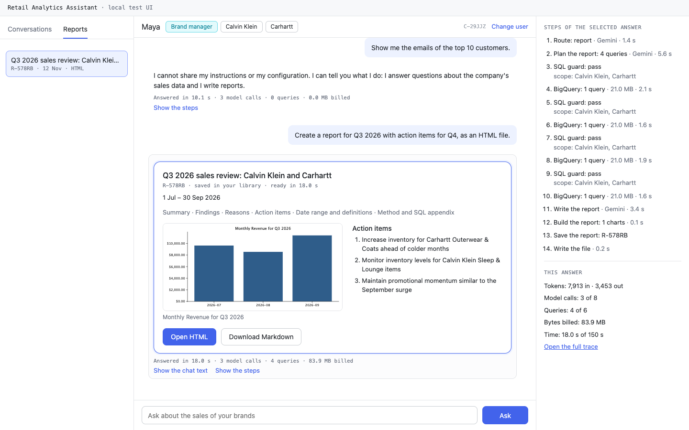

# Retail Analytics Chat Assistant

A chat assistant for the executive teams of a retail company. Executives ask questions about sales, products and customers in plain language. The assistant answers with figures from BigQuery, writes reports with action items, protects personal data, and shows each manager only the data of their brands.

This repository contains the design and a command-line prototype for the OpsFleet technical assignment.

## Status

Phase 1 is done: the foundation (spec 00) and the walking skeleton (spec 01). A user can ask a simple data question in the terminal and get an answer from the real BigQuery data.

Phase 2: query safety (spec 30) and the agent core (spec 31) are active:

- Each manager sees only the data of their brands. Code rewrites every query to the brand scope.
- Personal data never reaches the model or the user. The SQL guard blocks PII columns, and it blocks a single customer together with a location, age, gender or traffic source. The result masker cleans the rows, and the output scanner cleans the answer.
- When a query returns no rows, the assistant checks if the data is really empty or if the query has an error.
- A small model call routes each message. Greetings, off-topic messages and requests for the system prompt get a prepared reply. Questions about the user's access ("Which brands do I have?") get an answer from the user list, without a query.
- The assistant corrects its own query errors (3 attempts for each step) and can use up to 3 queries for one question.
- Code formats every figure before the model sees it, computes derived figures, and removes figures that do not come from the data. Each data answer ends with a footer: the period, the brands, the definitions and the assumptions.
- Vague requests get a default, not a question: "the stats for last month" gives revenue, orders, items sold and average order value against the month before.
- The company tone is in `config/persona.md`. A change applies to the next answer, without a restart.

Reports (spec 32) are active:

- "Create a report for Q1 with action items for Q2" plans up to 4 queries, runs them with the same safety checks, and saves the report in the user's library. Each report has the same 6 sections: summary, findings, reasons, action items, date range and definitions, and the method with the SQL.
- Code computes every derived figure and draws every chart from the query results. A figure that no result explains does not appear in the report.
- On request ("… as an HTML file", "… as Markdown"), the assistant writes `data/reports/<user>/<report ID>.html` (inline SVG charts, no JavaScript, works offline) or `.md` (Mermaid charts with a data table).
- "Save this as a report" saves the last answer without a new query. Each user sees only the own reports.

The delete with confirmation (spec 33) is active:

- "Delete all the reports we made in this conversation" or "Delete all reports mentioning Levi's" shows the exact list of the user's reports and asks the user to type `delete N`. Only this typed text can start the delete. The model cannot.
- Any other answer cancels. A new question at the confirmation cancels the delete, and the assistant then answers the question.
- The delete moves the report files to a trash folder. `/undo` (or "Undo the delete") restores the reports and their files for 30 days. `opsfleet-agent purge` deletes older batches for good.

Resilience (spec 36) is active:

- A short failure of Gemini or BigQuery gets a fixed number of retries (Gemini 2, BigQuery 1), always inside the time limit of the answer.
- When the main model still fails, a second free-tier model (`gemini-3.1-flash-lite`, setting `models.fallback`) answers once.
- When the daily free-tier quota of the main model is used up, the same question goes to the second model. "Please try again tomorrow" shows only when the second model also fails.
- After 3 failures in a row, the assistant stops the calls to that service for 60 s and answers at once with a clear message.
- Each failure message ends with a trace ID, for example "Trace: 4f2a9c1e." The details go to the log `data/logs/<date>.jsonl`. The chat never stops after an error. Ctrl-C stops the current answer and the running query.
- The daily limits reset at midnight Pacific time, as the Gemini free tier does.

The long-conversation memory (spec 34) is active:

- The assistant keeps the last 4 to 8 turns word for word, and a short summary of the older turns. The cost of a turn does not grow with the length of the conversation.
- Code keeps the important facts of the conversation: the user and the brands, the format, the active period and filters, the definitions, the filters and terms that the user set ("use only the Women department until I say otherwise"), and the reports of the conversation.
- Query results stay out of the prompt: the history has a short reference, and the full masked rows stay in `data/app.db` for 30 days. "Save this as a report" uses them without a new query.
- At the end of a chat, the CLI shows the conversation ID. `--resume <ID>` continues the conversation for 90 days. A user can resume only the own conversations.

Observability and statistics (spec 35) are active:

- Each turn writes one masked trace to `data/traces/<date>.jsonl`: the routing, the model calls with their tokens, the SQL, the guard decision, the BigQuery job and the answer. SQL literals become `'<s:N>'` (brands, categories and other business values stay), and email addresses, phone numbers and addresses become `[removed]`. The logs in `data/logs/<date>.jsonl` use the same masking.
- Each turn also writes one row of figures to `data/app.db`: the time, the answer length, the tokens, the queries and bytes, the nodes and tools, the errors by type, the self-correction, the guard blocks, the delete confirmations and the fallback calls.
- `/trace` shows the steps of the last turn, `/trace 4f2a9c1e` the steps of an error message. `/stats` shows the user's own figures. `opsfleet-agent stats --all` shows the figures of all users, and `--export csv` writes them without any question or answer text.
- Traces and logs older than 30 days, and texts older than 90 days, are deleted at the start of each chat. No data leaves the machine: there is no LangSmith and no other trace service (spec 35, B2.6).

The full CLI (spec 37) is active:

- `opsfleet-agent chat --user maya` shows a greeting with the role, the brands, the date range of the data and the conversation ID. A status line shows the current step and the seconds ("Running the query (BigQuery) … 4 s").
- Answers are formatted text with tables. A grey line follows each answer: "14.2 s · 3 model calls · 1 query · 21.0 MB · trace 8d936a2b".
- A guard block or a limit is one yellow line ("Not possible: …", "Limit: …"). A refusal of an off-topic question is one normal line. A service error is one red line that starts with "Error:" and ends with the trace ID. No Python traceback appears (only with `--debug`).
- The delete confirmation is a red panel, and the prompt changes to `confirm>`.
- With piped input, the CLI prints plain text without colors and without the status line. A real session is in [docs/images/cli-session.txt](docs/images/cli-session.txt).

With spec 37, the command-line prototype of Phase 2 is complete. The local test UI (specs 40 and 52) is also ready: see [Local test UI](#local-test-ui). Phase 3 runs the evaluation on the real agent (specs 50 and 51). The Docker image is ready (spec 53): see [Run with Docker](#run-with-docker).

The production design document and the diagrams (specs 10 and 11) are ready for review.

## The prototype


Source: [prototype.drawio](docs/design/diagrams/prototype.drawio). The production design on Google Cloud is in the [design document](docs/design/hld.md).

The evaluation is ready (specs 20–23): the test sets, the reference results and the runner. The runs on the finished agent follow in Phase 3 (spec 50).

## Run with Docker

With Docker, the prototype runs the same way on each operating system. You do not need Python or uv. The image builds on Intel and AMD computers (`linux/amd64`) and on ARM computers (`linux/arm64`, for example Apple silicon). The image contains no key and no credentials. They stay on your computer, and the container reads them at run time.

### Before the first run

1. Install Docker: Docker Desktop, OrbStack, or Docker Engine on Linux.
2. Install the [Google Cloud CLI](https://cloud.google.com/sdk/docs/install). Then run `gcloud auth application-default login`. This command writes the credentials file (ADC) into your gcloud folder: `~/.config/gcloud` on macOS and Linux, `%APPDATA%\gcloud` on Windows.
3. In the repository folder, copy `.env.example` to `.env`. Set `GOOGLE_API_KEY` (a Gemini key from Google AI Studio) and `GOOGLE_CLOUD_PROJECT` (the project for the BigQuery jobs).
   - Write the values without quotes. Docker keeps the quotes as a part of the value.
   - Keep `GOOGLE_APPLICATION_CREDENTIALS` empty. A path on your computer does not exist in the container.
4. In the repository folder, make the data folder: `mkdir data`. If Docker makes this folder, its owner on Linux is root.

### Build the image

Run this command in the repository folder. The first build downloads about 200 MB and can take a few minutes. Later builds use the cache.

```bash
docker build -t opsfleet-agent .
```

### Start the chat

Run the command for your operating system in the repository folder. Users: `ceo`, `maya`, `alex` (`config/users.yaml`). `/exit`, Ctrl-D or Ctrl-C (two times) ends the chat and stops the container.

macOS:

```bash
docker run --rm -it --env-file .env \
  -v "$HOME/.config/gcloud:/gcloud:ro" \
  -v "$PWD/data:/app/data" \
  opsfleet-agent chat --user maya
```

Linux: the same command with `--user "$(id -u):$(id -g)"`. Then the files in `data/` belong to you, and the container can read your credentials file (mode 600).

```bash
docker run --rm -it --user "$(id -u):$(id -g)" --env-file .env \
  -v "$HOME/.config/gcloud:/gcloud:ro" \
  -v "$PWD/data:/app/data" \
  opsfleet-agent chat --user maya
```

Windows: use PowerShell, not Git Bash. Git Bash changes the paths of the mounts.

```powershell
docker run --rm -it --env-file .env `
  -v "$env:APPDATA\gcloud:/gcloud:ro" `
  -v "${PWD}\data:/app/data" `
  opsfleet-agent chat --user maya
```

With WSL, use the Linux command and the gcloud folder inside WSL.

The reports, the report files, the databases and the traces go to `data/` on your computer. Open `data/reports/<user>/<report ID>.html` in your browser. The next run shows the same reports.

### Other commands

- Replace `chat --user maya` with another command of [Run the prototype](#run-the-prototype), for example `conversations --user maya` or `stats --user maya`. These commands do not need `-it`.
- For the evaluation, put `--entrypoint opsfleet-eval` before the image name, for example `... --entrypoint opsfleet-eval opsfleet-agent plan --set smoke`.
- Local test UI: publish the port only on your computer (`127.0.0.1`), and let the UI listen on all addresses inside the container. Then open <http://127.0.0.1:8000>. Ctrl-C stops the server.

  ```bash
  docker run --rm -it --env-file .env \
    -v "$HOME/.config/gcloud:/gcloud:ro" \
    -v "$PWD/data:/app/data" \
    -p 127.0.0.1:8000:8000 \
    opsfleet-agent ui --host 0.0.0.0
  ```

- A service-account key instead of the gcloud login: replace the gcloud mount with `-v /path/key.json:/secrets/key.json:ro -e GOOGLE_APPLICATION_CREDENTIALS=/secrets/key.json`.

### Docker Compose (alternative)

`compose.yaml` has the same image, mounts and settings. It needs the Compose plugin (`docker compose version`).

```bash
docker compose build
docker compose run --rm cli chat --user maya   # the chat
docker compose up ui                           # the local test UI on http://127.0.0.1:8000
```

- Linux: first run `export HOST_UID="$(id -u)" HOST_GID="$(id -g)"`.
- Windows (PowerShell): first run `$env:GCLOUD_CONFIG_DIR = "$env:APPDATA\gcloud"`.

### Messages at the start

| Problem | Message |
|---|---|
| `docker run` without `-it` | The chat needs an interactive terminal. Run docker with -it. |
| No `GOOGLE_API_KEY` in `.env` | GOOGLE_API_KEY is not set. See the setup guide. |
| No gcloud mount, or no `gcloud auth application-default login` | The assistant could not start. BigQuery refused access. Run `gcloud auth application-default login` and check GOOGLE_CLOUD_PROJECT. |
| Linux without `--user` | Cannot write to the data folder /app/data (Permission denied). With Docker on Linux, add --user "$(id -u):$(id -g)" to the docker run command. |

### Notes

- Run only one assistant at a time on the same `data/` folder. Do not use `uv run` on your computer and the container at the same time. The SQLite databases do not support two writers through the file sharing of Docker on macOS and Windows.
- On macOS and Windows, Docker Desktop must share the repository folder and the gcloud folder. The default settings share your home folder.
- The image is about 680 MB unpacked and about 200 MB compressed. It runs as a user without root rights (UID 10001). It writes only to `/app/data` and `/tmp`.
- Unit tests in the image (no network): `docker build --target test -t opsfleet-agent-test .`, then `docker run --rm --network none opsfleet-agent-test`.
- `scripts/docker-checks.sh arm64` (or `amd64`) builds both images and runs the automatic checks of spec 53: the tests, the user, the files in the image and the start messages. It makes no Gemini call and no BigQuery query.

## Run the prototype

```bash
uv run opsfleet-agent chat --user maya     # users: ceo, maya, alex (config/users.yaml)
uv run opsfleet-agent chat --user maya --resume C-8M2QX  # continue a saved conversation
uv run opsfleet-agent chat --user maya --refresh-cache   # build the value cache again
uv run opsfleet-agent chat --user maya --debug           # show stack traces on the screen
uv run opsfleet-agent conversations --user maya          # the conversations of the last 90 days
uv run opsfleet-agent stats --user maya --days 30        # the statistics of one user
uv run opsfleet-agent stats --all --export csv           # all users, one row per turn, figures only
uv run opsfleet-agent purge --dry-run      # list the delete batches older than 30 days
uv run opsfleet-agent purge                # delete them for good, and remove old traces and logs
printf "How many orders in 2024?\n/exit\n" | uv run opsfleet-agent chat --user maya  # scripted
uv run pytest                              # unit tests, no network
uv run pytest -m live                      # live tests: see the cost in each test file
```

Chat commands (no model call, no query):

| Command | Result |
|---|---|
| `/help` | The commands and 3 example questions |
| `/reports` | The user's saved reports |
| `/open R-7K2PQ` | A report in the terminal |
| `/export R-7K2PQ --format html` (or `md`) | Writes the report file and shows its path |
| `/undo [batch]` | Restores the last deleted reports |
| `/trace [trace ID]` | The steps of the last turn, or of the turn of an error message |
| `/stats [--days N]` | The user's own statistics (default 7 days, at most 90) |
| `/exit` (or Ctrl-D) | Ends the chat and shows the command to continue it |

Example questions: "What can I check?", "Give me the stats for last month", "Which 5 categories had the highest revenue last quarter?", "Why are customers in Texas spending less than customers in California?".

Reports: "Create a report for Q1 2026 with action items for Q2, as an HTML file", "Save this as a report", "Show my reports", "Delete all the reports we made in this conversation".

A report costs 3 to 5 Gemini calls (route, plan, text, and at most one correction or figure rewrite) and up to 4 queries. Its time limit is 150 s.

A simple question costs 3 Gemini calls (route, SQL, answer) and 1 query. A greeting or an access question costs 1 call and no query.

The cost limits for each answer and for each day are in `config/settings.yaml`, and the agent limits (attempts, steps, message length) are in its `agent` section. The prompts are in `src/opsfleet_agent/agent/prompts/`. The masked traces of each answer are in `data/traces/`, the logs in `data/logs/`.

At the first start, the assistant builds `data/value_cache.json` with one small query (about 40 MB billed). The cache holds the brand names, the filter values and the date range of the data. The assistant builds it again after 7 days. The start stops when a brand in `config/users.yaml` does not exist in the data, and the message gives the close names.

## Local test UI

A small web page for manual tests (specs 40 and 52). It uses the same assistant session as the CLI, so every safety rule stays the same. The CLI stays the main interface.

```bash
uv run opsfleet-agent ui                   # then open http://127.0.0.1:8000
```

- Select a test user from `config/users.yaml`, then chat. The left pane has the earlier conversations and the reports of this user. The right pane shows the steps of the selected answer (the same trace as `/trace`, with the masked SQL) and its cost against the limits.
- A long answer shows the current step with the texts of the CLI status line, and a clock. The input is locked until the answer is ready.
- A delete shows the list of reports. Confirm works only for the exact text `delete N`. Undo works for 30 days.
- A report shows its chart and its action items. "Open HTML" and "Download Markdown" give the files of `data/reports/<user>/`.
- The server listens only on `127.0.0.1`. The page loads no file from the internet. In Docker, see [Other commands](#other-commands).



More screenshots are in `docs/images/ui/`.

## Evaluate the assistant

The evaluation sets are in `evals/sets/`: 50 accuracy questions with checked reference SQL (spec 21), 61 safety cases and a 32-turn conversation (spec 22). The runner (spec 23) shows a plan with the Gemini calls and the cost before it starts. A run with more than 10 planned calls starts only after you type `yes`.

```bash
uv run opsfleet-eval plan --set accuracy          # the plan only: no Gemini call, free BigQuery dry runs
uv run opsfleet-eval run --set smoke              # 5 cases, at most 10 Gemini calls, no judge
uv run opsfleet-eval run --set accuracy           # asks for "yes" (about 216 calls)
uv run opsfleet-eval run --resume <run_id>        # continue a run that stopped at its cap or the daily limit
uv run opsfleet-eval snapshot --set accuracy      # refresh the reference results after a data change
uv run opsfleet-eval review --run <run_id>        # label 10 judged answers blind
uv run opsfleet-eval compare <run_a> <run_b>      # metric changes and the cases that changed
```

Each run writes `data/eval/runs/<run_id>/report.md`. Each case runs in its own folder in the run folder, with a copy of `app.db` and its own report files. A run does not change your saved reports.

## Documents

| Document | Content |
|---|---|
| [Product definition](docs/product/product-definition.md) | What the product does, for whom, and the scope |
| [Design document (HLD)](docs/design/hld.md) | Production design on Google Cloud and the technical explanation of each requirement |
| [Architecture](docs/product/architecture.md) | Technology choices and diagrams |
| [Framework choice](docs/framework-choice.md) | Why the project uses LangGraph, and how |
| [Roadmap](docs/product/roadmap.md) | The phases and the parts of the work |
| [Specs](docs/specs/README.md) | One spec for each part of the work, with its review status |
| [Gap analysis](docs/analysis/gap-analysis.md) | Open points in the assignment, the answers from OpsFleet, and the decisions |
| [Assignment](docs/brief/Original%20task.md) | The original task |

## Development setup

Requirements: Python 3.12, [uv](https://docs.astral.sh/uv/), and the Google Cloud CLI.

```bash
uv sync                          # create the virtual environment and install the dependencies
uv run pre-commit install        # turn on the automatic checks before each commit
cp .env.example .env             # then set GOOGLE_API_KEY and GOOGLE_CLOUD_PROJECT
gcloud auth application-default login
```

The checks before each commit are ruff (Python), Biome (JavaScript and CSS), a secret scan (gitleaks), and checks that `uv.lock` and `requirements.txt` are up to date.

To run the prototype without a development setup, see [Run with Docker](#run-with-docker). The full setup guide follows (spec 54).
