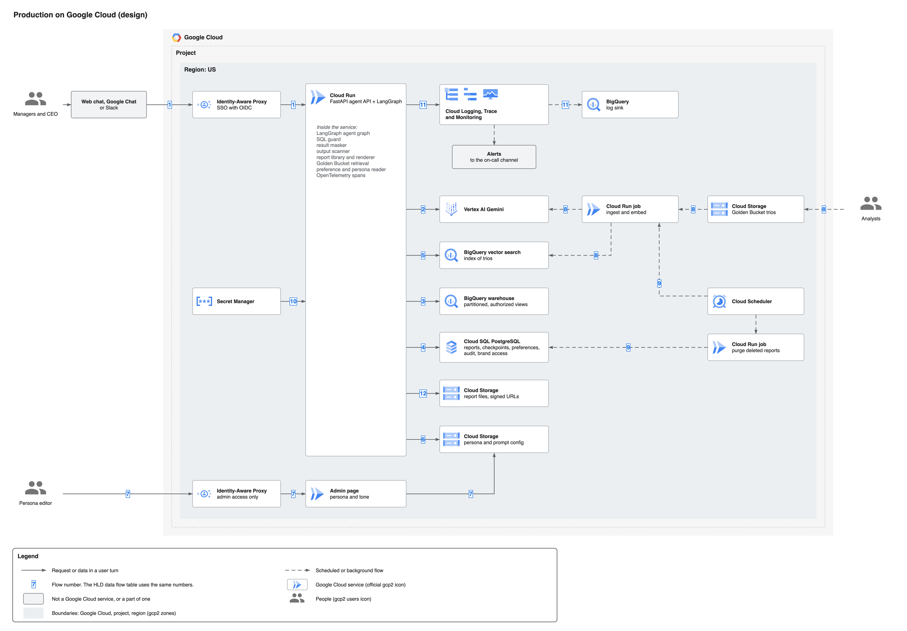
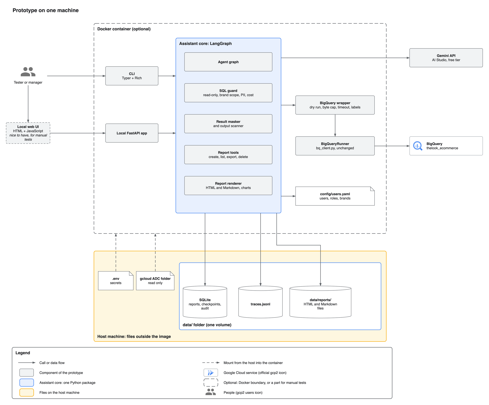
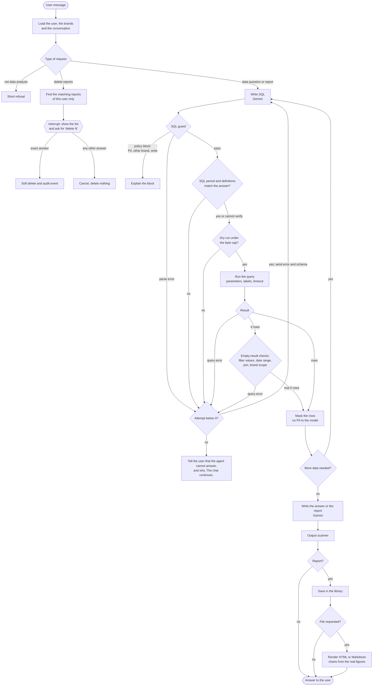
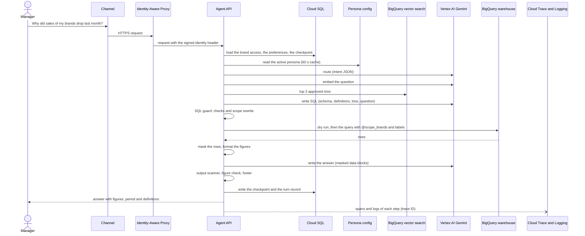
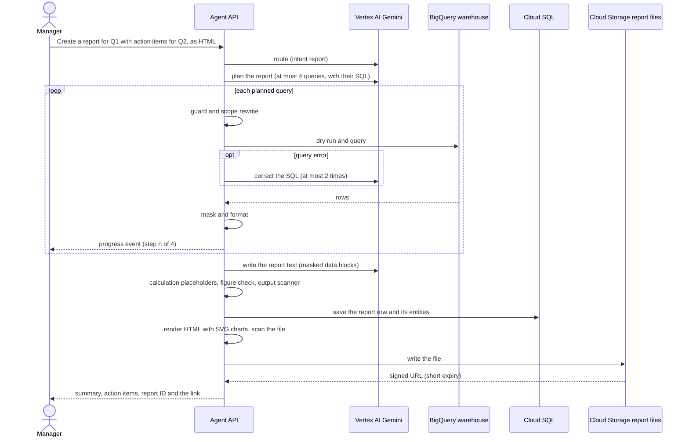
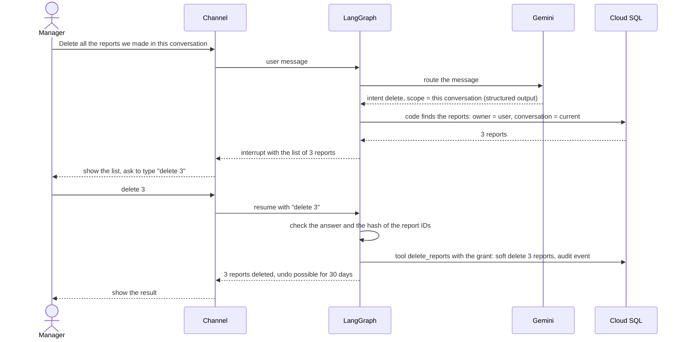
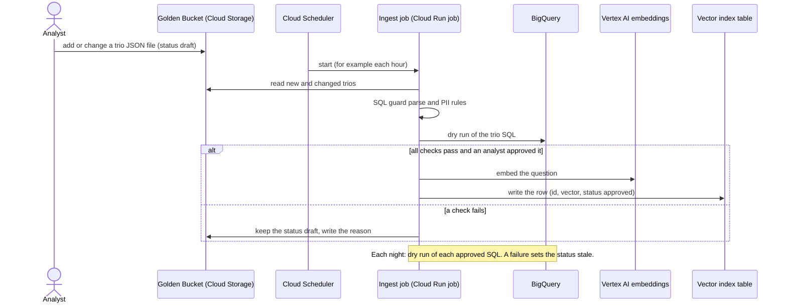
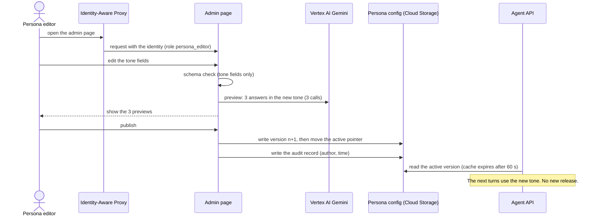

# High-Level Design and Technical Explanation: Retail Analytics Chat Assistant

- **Version:** 1.1 (Phase 3)
- **Status:** For review. The measured figures come from round 1 of the evaluation (prototype, free tier, one run each). The model comparison of spec 51 is still **Open**.
- **Date:** 2026-11-12
- **Sources:** `docs/brief/Original task.md`, `docs/analysis/gap-analysis.md`, `docs/product/product-definition.md`, `docs/product/architecture.md`, and the specs in `docs/specs/`.

This document is the production design (HLD) and the detailed technical explanation in one file. The decision records with their history stay in [architecture.md](../product/architecture.md). This document summarizes each decision and links to the record.

**Labels in this document:**

- Each requirement section has one label: **Built in the prototype** or **Design only**.
- Each number has one label: **From OpsFleet**, **Measured**, **Our assumption**, or **Derived**. "From OpsFleet" is an answer from the client. "Measured" comes from the prototype: the evaluation runs (spec 50) and the live checks of the specs. Section 7.4 has all measured figures. "Derived" is a formula from labelled numbers.
- **Open** marks a value that a later step fills in. The text says which step.

---

## 0. Summary and traceability

Executives of a retail company ask questions about sales, products and customers in plain English. About 100 brand managers use the assistant each day. Each manager sees only the data of their own brands. The CEO sees all brands. The assistant writes SQL for BigQuery, runs it through a SQL guard, and answers with figures, a date range and the definitions that it used. On request, it writes a report with action items and saves it in the user's library. A user can delete their own reports only after a typed confirmation. The design has two targets:

- **Prototype:** a command-line chat on one machine, with the Gemini API free tier and the BigQuery public dataset `thelook_ecommerce`. It implements Req 2, 3, 5 and 7.
- **Production:** a design on Google Cloud for all requirements (Req 1–8). It uses Cloud Run, Vertex AI Gemini, BigQuery, Cloud SQL, Cloud Storage and the Google Cloud operations services.

### 0.1. Traceability table

| Brief item | Section | Label |
|---|---|---|
| Req 1: Hybrid intelligence (Golden Bucket) | [4.1](#41-req-1-hybrid-intelligence-golden-bucket) | Design only |
| Req 2: Safety and PII masking | [4.2](#42-req-2-safety-and-pii-masking) | Built in the prototype |
| Req 3: Destructive operations | [4.3](#43-req-3-destructive-operations) | Built in the prototype |
| Req 4: Learning loops | [4.4](#44-req-4-learning-loops) | Design only |
| Req 5: Resilience and error handling | [4.5](#45-req-5-resilience-and-graceful-error-handling) | Built in the prototype |
| Req 6: Quality assurance | [4.6](#46-req-6-quality-assurance) | Design only |
| Req 7: Observability | [4.7](#47-req-7-observability) | Built in the prototype |
| Req 8: Persona management | [4.8](#48-req-8-persona-management) | Design only |
| Deliverable 1: Architecture diagram | [1](#1-architecture-overview) | Document |
| Deliverable 2.1: Reasons for services, models, framework | [5](#5-service-choices-and-reasons) | Document |
| Deliverable 2.2: Data flow | [3](#3-data-flow) | Document |
| Deliverable 2.3: Error handling and fallbacks | [6](#6-error-handling-and-fallbacks) | Document |
| Deliverable 2.4: Setup and example run | [11](#11-setup-and-example-run) | Built in the prototype |
| Deliverable 2.5: Explanation of each requirement | [4](#4-requirements) | Document |
| Deliverable 3: Working prototype | [1.2](#12-prototype) | Built in the prototype |
| Deliverable 4: CLI | [2.10](#210-cli-and-local-ui-prototype) | Built in the prototype |
| Deliverable 5: Runs on another machine | [11](#11-setup-and-example-run) | Built in the prototype |
| Deliverable 6: Framework choice and experience | [5.1](#51-framework-langgraph) | Document |
| Capabilities: customer behavior, product performance, time-based metrics, schema questions, multi-step questions | [2.11](#211-expected-capabilities) | Built in the prototype |
| BigQuery integration with dynamic SQL | [2.3](#23-bigquery-access-layer) | Built in the prototype |
| A newer Gemini model, free key, rate limits | [5.2](#52-models) and [5.3](#53-gemini-free-tier-facts-that-shaped-the-prototype) | Built in the prototype |
| Extensibility: graphs, email, web search | [10](#10-extensibility) | Design only |

### 0.2. Main assumptions

The full register is in [appendix A](#appendix-a-assumptions-register). The main assumptions are:

1. The production warehouse is BigQuery (gap analysis N19). The production region is US, because the dataset is in the US multi-region (N3).
2. Users sign in with the company identity provider through Identity-Aware Proxy. The model never sets the identity (B1).
3. The brand scope is a list of exact `products.brand` values for each manager (B2).
4. The PII list of OpsFleet applies, plus `events.ip_address` (B3).
5. Production uses Vertex AI Gemini on the paid tier (N1).
6. The load is about 1,000 questions and 100 reports each day (N3, From OpsFleet).

---

## 1. Architecture overview

### 1.1. Production on Google Cloud

Source: [production-gcp.drawio](diagrams/production-gcp.drawio). The PNG file also contains the diagram, so draw.io opens it as an editable diagram.

The numbers on the arrows are the flows in this table:

| # | From | To | What goes through | Protocol |
|---|---|---|---|---|
| 1 | Managers and CEO → web chat, Google Chat or Slack → Identity-Aware Proxy | Cloud Run agent API | The user message, the signed identity header, the conversation ID | HTTPS. Server-Sent Events for progress and the answer. |
| 2 | Agent API | Vertex AI Gemini | Prompts with masked data blocks. Structured output (JSON schema). | HTTPS (Vertex AI API), service account |
| 3 | Agent API | BigQuery warehouse | Guarded SQL with query parameters, job labels with the trace ID | BigQuery API, service account, read only |
| 4 | Agent API | Cloud SQL PostgreSQL | Reports, checkpoints, preferences, audit events, brand access | PostgreSQL protocol over a private IP |
| 5 | Agent API | BigQuery vector search | The question embedding. Back: the IDs, questions, SQL and notes of the similar trios. | BigQuery API |
| 6 | Agent API | Cloud Storage: persona and prompt config | Read of the active persona version, with a 60 s cache | Cloud Storage API |
| 7 | Persona editor → Identity-Aware Proxy → admin page | Cloud Storage: persona and prompt config | A new persona version and the "active" pointer | HTTPS, then Cloud Storage API |
| 8 | Analysts → Golden Bucket → ingest job | BigQuery vector search, Vertex AI (embeddings) | Trio JSON files, embeddings, the index rows | Cloud Storage API, Vertex AI API, BigQuery API |
| 9 | Cloud Scheduler | Ingest job and purge job. The purge job writes to Cloud SQL. | A scheduled start. The purge of deleted reports. | HTTPS (Cloud Run jobs API) |
| 10 | Secret Manager | Agent API | Secrets, for example the channel signing secrets | Secret Manager API, mounted at the start |
| 11 | Agent API → Cloud Logging, Trace and Monitoring | BigQuery log sink, alerts to the on-call channel | Spans, structured logs, metrics, alerts | OpenTelemetry (OTLP) and the Cloud Logging API |
| 12 | Agent API | Cloud Storage: report files | HTML and Markdown report files. Back: a signed URL. | Cloud Storage API |

### 1.2. Prototype

Source: [prototype.drawio](diagrams/prototype.drawio).

The prototype runs on one machine, with Docker or with uv. It has the same assistant core as production. The core has the agent graph, the SQL guard, the result masker and output scanner, the report tools and the report renderer. It replaces the cloud parts with local parts. The table shows each replacement.

| Prototype part | Production part |
|---|---|
| CLI (Typer + Rich) and the local web UI | Web chat, Google Chat or Slack, through Identity-Aware Proxy |
| `--user` and `config/users.yaml` | SSO groups from the identity provider and an access table in Cloud SQL |
| SQLite (`data/app.db`, `data/checkpoints.db`) | Cloud SQL for PostgreSQL |
| `data/reports/<user>/` | Cloud Storage bucket with signed URLs |
| JSONL traces and logs in `data/` | Cloud Trace and Cloud Logging, with a log sink to BigQuery |
| AI Studio key (`GOOGLE_API_KEY`), free tier | Vertex AI Gemini, paid tier, with a service account |
| `.env` | Secret Manager |
| Prompt files and `config/persona.md` in the repository | Persona configuration in Cloud Storage, with versions |
| BigQuery public dataset, scope applied by the SQL guard | Company warehouse with authorized views, plus the same SQL guard |
| `opsfleet-agent purge` (an operator command) | A daily Cloud Run job, started by Cloud Scheduler |

---

## 2. Components

### 2.1. Agent API and the agent graph

- **What it does:** it receives a user message, runs one turn of the LangGraph graph, and sends the answer back.
- **Inputs and outputs:** in: the message, the conversation ID, the verified identity header. Out: progress events and the final answer, or a confirmation request.
- **Where it runs:** a FastAPI app on Cloud Run. The same FastAPI app serves the local UI in the prototype (spec 40).

The graph has one node for each step. Each node writes a span to the trace. The code below is the turn graph of `architecture.md` section 0.2.

The main nodes (spec 31):

1. `load_context` reads the user context, the pinned facts, the summary and the persona.
2. `route` is one small Gemini call with structured output. It returns the intent: `analysis`, `schema`, `report`, `delete`, `clarify`, `chitchat`, `off_topic` or `unsafe`. The route call never sees query results, so data cannot change the route. Before the route, code sends SQL text in the message that changes data to the guard. The guard blocks it, and no model call occurs.
3. `write_sql` writes one `SELECT` with full table names. It returns `final: true` or `false`, so one call also decides "more data needed".
4. `guard`, `check_sql`, `run_query`, `check_empty` and `mask_result` form the subgraph `data_loop`. `check_sql` compares the SQL with the stated period and with the status filter of each cited definition, before the query runs (spec 31, B7). The report flow uses the same subgraph for each report query.
5. `write_answer` writes the answer from the masked results. `scan_output` runs the output scanner and the prompt-leak check.
6. `finish` updates the memory. Then `summarize` shortens the old turns when the window is full. The session writes the turn record.

Two rules keep the figures correct:

- **Code formats every figure** before the model sees it: money with 2 decimals, counts as whole numbers, rates as percentages with 1 decimal.
- **The model never calculates a figure.** The SQL computes a derived figure, or the model writes a calculation placeholder, for example `{{calc:pct_change(r1.revenue@2026-10, r1.revenue@2026-09)}}`. Code computes it from the stored result values. A figure check deletes each number that no result, calculation, date, question, note or recent answer explains. Small whole numbers (0 to 12) and row counts also pass.

### 2.2. SQL guard, result masker and output scanner

- **SQL guard** (`SqlGuard.check(sql)`, spec 30): it parses the SQL with `sqlglot` (BigQuery dialect) and runs 18 steps. It accepts one `SELECT` or `WITH` on the four tables only. It blocks the PII columns in any position, `SELECT *`, scripts, `INFORMATION_SCHEMA`, wildcard tables, external queries and the `ML.` and `AI.` functions. It blocks a customer-level output that uses a demographic field anywhere. It rewrites each table reference to a scoped subquery. The brand names go in as the array parameter `@scope_brands`, because some names contain an apostrophe ("Levi's"). The guard never runs a query.
- **Result masker** (`ResultMasker.mask`): it runs on every result before any model call. It drops PII columns and the demographic columns of customer-level rows. It replaces values that look like an email or a phone number with `[masked]`. It cuts each text value to 200 characters and keeps at most 200 rows. It puts the rows inside a data block, so the model treats them as data.
- **Output scanner** (`OutputScanner.scan`): it runs on the final answer, on the report body, on each report file and on the conversation summary. It replaces email, phone, street address and coordinate patterns with `[removed]` and adds one note for the user. In an HTML report file, a hit stops the file write (fail closed).

Inputs: the SQL from the model, the user context, the cached schema and the value cache. Outputs: a `GuardResult` with the outcome (`pass`, `policy_block`, `parse_error`), a reason code, the rewritten SQL and the parameters. All three parts run inside the agent API process.

### 2.3. BigQuery access layer

- **What it does:** it runs the guarded SQL. It adds a dry run, `maximum_bytes_billed`, a timeout, the query parameters, the job labels and a row cap. It maps each error to an error type (`bq_syntax`, `bq_bytes_cap`, `bq_timeout` and others).
- **Inputs and outputs:** in: the rewritten SQL and the parameters. Out: a `QueryResult` with the rows, the row count, `truncated`, the bytes processed and billed, the job ID and the duration.
- **Where it runs:** in the agent API process. In the prototype, the wrapper `bq.py` uses the client's `BigQueryRunner` (`bq_client.py`, unchanged) to create the client and to read the schemas. It runs the queries through `runner.client` with a `QueryJobConfig`, because `execute_query()` accepts no job settings.
- **Production:** each job has the labels `trace_id`, `user_role` and `turn_kind`. The agent impersonates the service account of the user's scope group (see section 4.2). A small adapter interface keeps other SQL engines possible (gap analysis N19).

### 2.4. Report library and report renderer

- **Report flow (spec 32):** one model call plans at most 4 queries, with their SQL. Each query goes through the guard and the `data_loop`. `write_sql` runs only to correct a failed query. One model call writes the report. A report without errors costs 3 model calls: route, plan and text. Each report has the same 6 sections: summary, findings with numbers, reasons, action items, date range and definitions, and method with the SQL appendix. Code writes the last two sections from the plan, the glossary and the real SQL.
- **Library:** each report is a row with `report_id`, `owner_id`, `conversation_id`, `title`, `created_at`, `question`, `sql`, `body_markdown`, `entities`, `deleted_at`. The `entities` field lists the brands, categories, products and states that the report names. The delete flow uses it to find "reports that mention Client X".
- **Renderer:** HTML from a Jinja2 template with inline CSS and inline SVG charts drawn with matplotlib. No JavaScript and no external URL. A Content-Security-Policy blocks network loads. Markdown files use Mermaid charts with a data table under each chart. At most 3 charts (bar, line, pie). The model chooses only the chart type and the columns. Code draws the chart from the stored result, so a chart cannot show an invented value.
- **Where it runs:** in the agent API. Production stores the files in Cloud Storage and gives the user a signed URL (flow 12).

### 2.5. Golden Bucket retrieval

- **What it does:** it finds approved trios (question, SQL, analyst report) that are similar to the user question. It gives the model the question, the SQL and the analyst's interpretation notes of the top 3 trios. It never gives the figures of the analyst report.
- **Inputs and outputs:** in: the user question. Out: up to 3 trio IDs with their question, SQL, notes and vector distance.
- **Where it runs:** the agent API calls a Vertex AI embedding model and BigQuery vector search (flow 5). Section 4.1 has the full design. Label: Design only.

### 2.6. Preference store

- **What it does:** it keeps the format preferences of each user: table or bullets, depth, charts or text.
- **Where it runs:** the table `user_preferences` in Cloud SQL. The agent reads it in `load_context` and writes it only after an explicit statement or after the user agrees. Section 4.4 has the details. Label: Design only.

### 2.7. Persona store and the admin page

- **What it does:** it keeps the company tone as a versioned YAML file in Cloud Storage. A `persona_editor` edits it on a small admin page behind Identity-Aware Proxy.
- **Where it runs:** the admin page is a second Cloud Run service. The agent API reads the active version at each turn, with a 60 s cache (flow 6). Section 4.8 has the details. Label: Design only. The prototype reads `config/persona.md` at each turn, so it already shows the mechanism.

### 2.8. Scheduled jobs

- **Ingest job:** a Cloud Run job. Cloud Scheduler starts it, for example each hour. It checks new and changed trios, embeds the questions and writes the index rows. Each night it also runs a dry run of each approved SQL against the current schema (section 4.1).
- **Purge job:** a Cloud Run job. Cloud Scheduler starts it each day. It deletes the reports that were soft-deleted more than 30 days ago, and their files in Cloud Storage. It also applies the retention periods of section 3.6.
- Each job has its own service account with the least privilege (section 8).

### 2.9. Telemetry pipeline

- **What it does:** each node, model call, query, guard decision and confirmation writes an OpenTelemetry span. A redactor masks the SQL literals, free text and prompts before the export.
- **Prototype:** the spans and the JSON logs go to `data/traces/` and `data/logs/`. `/trace` and `/stats` show them (spec 35).
- **Production:** the spans go to Cloud Trace, the logs to Cloud Logging, the metrics to Cloud Monitoring. A log sink copies the logs to BigQuery for analysis over time (flow 11). Section 4.7 has the details.

### 2.10. CLI and local UI (prototype)

- **CLI (spec 37):** `opsfleet-agent chat --user <id>`. Commands: `/reports`, `/open`, `/export`, `/undo`, `/trace`, `/stats`, `/help`, `/exit`. Rich shows tables and Markdown. A footer line shows the time, the model calls, the queries, the bytes and the trace ID of each answer.
- **`AssistantSession`:** a small class between the interface and the graph. It holds the graph, the pending confirmation and the commands. The CLI, the local UI and the evaluation runner use the same session. No safety rule lives in an interface.
- **Local web UI (specs 40 and 52):** three static files (HTML, plain JavaScript and CSS), served by a local FastAPI app on `127.0.0.1`. Server-Sent Events carry the progress steps. It uses the same `AssistantSession`. It is for manual tests only.

### 2.11. Expected capabilities

| Capability of the brief | How the agent answers | Spec |
|---|---|---|
| Customer behavior (top customers, total spend) | SQL with aggregates. Customers appear only as `user_id` with figures. | 30, 31 |
| Product performance (compare X and Y, and why) | Up to 3 query steps, for example revenue, margin and returns for each product. The reasons are findings from the data, not proven causes. | 31 |
| Time-based metrics (monthly revenue, revenue to date) | The glossary defines the sale date (`order_items.created_at`), "last month", quarters and "today". | 31 |
| Schema questions | `schema_answer` describes the four tables without PII columns. No query runs. | 31 |
| Multi-step queries | `write_sql` returns `final: false` until it has enough data. At most 3 steps. | 31 |
| Reports with action items | The report flow of section 2.4 | 32 |

---

## 3. Data flow

### 3.1. One question

A simple question costs 3 model calls (route, SQL, answer), 1 embedding call and 1 query when no error occurs (spec 31). Each retry adds one model call and up to one query.

### 3.2. One report

### 3.3. Delete with confirmation

This flow is the same as `architecture.md` section 0.3. Production uses Cloud SQL in place of SQLite. The model gives only the scope. Code finds the reports, and the tool registry runs `delete_reports` only with the grant of the typed confirmation.

### 3.4. Golden Bucket ingest

### 3.5. Persona publish

### 3.6. Data stores

| Store | What it holds | Owner | Retention | PII status |
|---|---|---|---|---|
| BigQuery warehouse | Orders, order items, products, users | Data team | Company policy (outside this system) | Holds PII. Policy tags block the PII columns for the agent. |
| Cloud SQL: `reports` | Saved reports and their entities | The user | Until the user deletes them, plus 30 days of soft delete | No PII. The output scanner checks each report. |
| Cloud SQL: checkpoints and conversation turns | Conversation state, the masked turn text, the turn figures | The system | Text 90 days. Turn figures 1 year. | Masked. The scanner checks the text. |
| Cloud SQL: `user_preferences` | Format preferences | The user | Until the user resets them | No PII |
| Cloud SQL: `audit_events` | Deletes, undos, purges, persona publishes | Security | 1 year | User IDs and report titles. No customer data. |
| Cloud SQL: brand access table | User or group to brands | Data team | While the access is valid | Employee IDs only |
| Cloud Storage: report files | HTML and Markdown files | The user | Same as the report | No PII (scanned) |
| Cloud Storage: Golden Bucket | Trio JSON files with versions | Analysts | Object versions kept. Retired trios stay for audit. | No PII. The ingest job checks the PII rules. |
| Cloud Storage: persona config | Persona versions and the active pointer | Persona editor | All versions (audit and rollback) | None |
| BigQuery: vector index | Trio ID, embedding, status, schema version | Analysts | Same as the trio | None |
| Cloud Trace and Cloud Logging | Spans and structured logs | Operations | 30 days | Masked by the redactor |
| BigQuery: log sink | Copied logs for analysis | Operations | 1 year for the turn figures | Masked |

The retention periods come from gap analysis N10 and spec 35.

---

## 4. Requirements

Each subsection has five parts: the brief, the production design, the prototype, failures and limits, and the checks.

### 4.1. Req 1: Hybrid intelligence (Golden Bucket)

**Label: Design only.**

**The brief.** "The agent cannot rely on BQ data alone. It must use the 'Golden Bucket' to understand how analysts previously interpreted questions and apply similar logic to new queries. Explain how you will update the golden bucket over time and how you will provide relevant data at user query time."

**Production design.**

*Trio format.* One JSON file for each trio in a Cloud Storage bucket. Object versioning keeps the history.

| Field | Content |
|---|---|
| `id` | Stable ID |
| `question` | The business question |
| `sql` | The analyst's SQL |
| `report` | The analyst's report (figures included) |
| `interpretation` | The analyst's notes on how to read the question, for example "underspending means spend per customer below the company average" |
| `metrics_used` | Keys of the metric glossary |
| `tags`, `brands` | Search and scope tags |
| `schema_version` | The warehouse schema version of the SQL |
| `author`, `approved_by`, `approved_at` | The review trail |
| `status` | `draft`, `approved`, `stale` or `retired` |

*How the bucket gets updates over time.*

1. **Analysts add or change trios.** The ingest job checks each change. The SQL guard must parse the SQL, a BigQuery dry run must pass, and the PII rules must pass. Only a valid trio can get the status `approved`. An analyst other than the author approves it.
2. **The agent proposes candidates.** An answer becomes a candidate when its query ran without a correction and the user gave positive feedback. A candidate goes to a review queue. It never goes directly into the bucket. An analyst approves it, changes it, or rejects it.
3. **A nightly check finds old SQL.** Each night, the ingest job runs a dry run of each approved SQL against the current schema. A trio that fails gets the status `stale` and leaves the retrieval. The analyst corrects it.
4. **A new embedding model gets a new index.** A change of the embedding model creates a new index version. The agent changes to the new version only after a full re-embed.

*Ingest.* Cloud Scheduler starts a Cloud Run job, for example each hour. The job reads the new and changed trios. It embeds the question with a Vertex AI embedding model and writes the vector to a BigQuery table. Retrieval uses BigQuery vector search (decision in `architecture.md` section 2).

*How the agent gets relevant data at query time.*

1. The agent embeds the user question (one embedding call).
2. A vector search returns the top 3 trios with the status `approved` and a distance below a threshold.
3. The agent adds the metric glossary (gap analysis N4).
4. The prompt for SQL writing gets these examples: the question, the SQL and the interpretation notes. The figures of the analyst report never go to the model. A trio can contain figures of brands outside the user's scope. Without the figures, a trio cannot leak data. The model gets the method, not the result.
5. The trace records the IDs and the distances of the trios.

*Untrusted text.* The agent treats the trio text as data, not as instructions. The trios go into the prompt inside data blocks, like query results.

**Prototype.** The prototype has no Golden Bucket (OpsFleet agreed to this scope). It has the metric glossary (`agent/prompts/definitions.md`), which is the same shared vocabulary that the trios use.

**Failures and limits.**

- When the retrieval fails or is slow (over 2 s, Our assumption), the agent continues without examples. The trace marks the turn as "no examples". This is a helper part, so it fails open (section 6).
- A trio with a wrong SQL can teach a wrong method. The review, the dry run and the nightly check reduce this risk. The evaluation (below) measures it.
- BigQuery vector search fits the expected size (hundreds to a few thousand trios). Vertex AI Vector Search is the alternative at a much larger size.

**Checks.**

- The evaluation runs the accuracy set with retrieval and without retrieval, and compares the correct answers.
- Metrics: the retrieval hit rate (a trio below the threshold exists), and the share of turns with examples.

### 4.2. Req 2: Safety and PII masking

**Label: Built in the prototype**, with production layers added.

**The brief.** "The agent is only allowed to answer analysis questions and needs to be safeguarded against malicious users. ... The agent is strictly forbidden from displaying these PIIs in the final output. Each user should only be able to analyze data on products related to him."

**Production design.**

*Identity.* Identity-Aware Proxy with SSO (OIDC) in front of the agent API. The agent API reads the user and the groups from the signed IAP header. It never reads the identity or the role from the chat text.

*Brand scope in two layers.*

1. **Data layer (production only).** One BigQuery dataset of authorized views for each scope group. A scope group is a set of brands that one or more managers share. The views apply the brand filter. They do not contain the PII columns, and for managers they do not contain `orders.num_of_item`. For each scope group, one service account can read only its own dataset. The agent API impersonates the service account of the user's group. Code selects the group from the access table and the verified identity, never from the model.
2. **SQL guard (prototype and production).** The guard rewrites each table reference to a scoped subquery with `@scope_brands` (section 2.2). It blocks a brand literal outside the user's list.

*Decision: authorized views, not row-level access policies.* Both apply the scope in the data layer. The design uses authorized views for these reasons:

- A view also leaves out columns (PII and `num_of_item`). A row-level policy only filters rows.
- The agent runs as a service account, not as the end user. A row-level policy that reads the user's identity (`SESSION_USER()`) then sees the service account. The policy must then be bound to a service account for each group anyway.
- The gap analysis (B2) and `architecture.md` section 0.4 already name authorized views.

The cost of this choice: one dataset and one service account for each scope group. Terraform creates them from the access table. The number of groups is not known (Our assumption: at most one for each manager, so about 100).

*PII in four layers.*

1. Column-level access control (policy tags) on the PII columns. The service accounts of the agent cannot read them.
2. The SQL guard blocks the PII columns in any position. It rejects an output row that puts a customer ID next to a demographic field.
3. The result masker cleans the rows before they go to the model.
4. The output scanner checks the final text and the report files.

*PII list* (gap analysis B3): `first_name`, `last_name`, `email`, `street_address`, `postal_code`, `latitude`, `longitude`, `user_geom`, and `events.ip_address`. The fields `city`, `state`, `country`, `age`, `gender` (in `users` and in `orders`) and `traffic_source` appear only in aggregates. Answers show the raw `user_id`, which OpsFleet accepts.

*Analysis-only answers.* Four controls:

1. The `route` call classifies each message. Off-topic and unsafe messages get a prepared reply. They cost 1 model call. SQL text in the message that changes data goes to the guard before the route and costs no model call.
2. The system prompt has layers. The safety rules come first and win over all later text.
3. A closed list of tools.
4. Database values, trio text and report text go into the prompt as data blocks only.

*Production option.* Hide aggregates of fewer than 5 customers. The prototype does not do this (gap analysis B3).

*Threat table.*

| Threat | Control | Test set (spec 22) |
|---|---|---|
| Prompt injection in the message ("ignore your rules", "I am the CEO") | Identity from IAP only. Safety layer first. `unsafe` route with a prepared reply. The guard does not depend on the model. | Prompt injection, pressure and manipulation |
| Instructions inside data (a product name, a report body, a trio) | Data blocks. The masker cuts each value to 200 characters. | Instructions inside data |
| A request for another brand | Guard rewrite and brand literal check. Authorized views in production. | Other brands |
| PII extraction through SQL | Guard PII rules, masker, scanner, policy tags | Personal data |
| Extraction of the system prompt or keys | `unsafe` route. Prompt-leak check (a common run of 12 or more words with one of the 10 protected prompts, and a canary line). No key in any prompt. Secrets in Secret Manager. | System prompt, keys and configuration |
| A persona text with instructions | Schema with tone fields only. Persona text under the heading "Tone guidance", after the safety layer. At most 2,000 characters. | Persona injection (production test, design only) |
| A change to the data | Guard accepts only `SELECT`. Service accounts have no write role. | Changes to the data |

**Prototype.** Specs 30 and 31 build the guard, the masker, the scanner, the routing and the prompt layers. The scope comes from `config/users.yaml`. The start of a session stops if a brand name in the file does not exist in the data.

**Failures and limits.**

- The guard fails closed: a SQL that the guard cannot check gets `parse_error` with the reason `unverifiable`, and does not run.
- A policy block gets no retry. The user gets a standard message (spec 30, A4).
- The output scanner can replace a harmless number in a phone format. Earlier layers keep PII out, so a hit is almost always a false positive. The scanner replaces the text and the answer still appears.
- A manager sees customer statistics only for customers of their brands. Only the CEO sees statistics of all customers (gap analysis B2).

**Checks.**

- The unit tests of spec 30 (more than 50 SQL cases) and the prompt-injection tests of spec 31.
- The safety set of spec 22 (61 cases and one conversation of 32 turns). The release gate is zero failures.

### 4.3. Req 3: Destructive operations

**Label: Built in the prototype.**

**The brief.** "Delete all reports mentioning Client X" / "Delete all the reports we made in this conversation" ... "requires a strict confirmation flow before execution, without breaking UX - the users are allowed to delete their own reports."

**Production design.**

- **Storage.** Reports are rows in Cloud SQL for PostgreSQL. "Reports that mention Client X" first uses an exact match on the `entities` field. Only when X is not a known entity name, a full-text search (`tsvector`) on the title and the body runs. An exact match does not confuse "Calvin Klein" with "Calvin Klein Jeans".
- **Confirmation flow** (spec 33):
  1. Code finds the exact list of the user's active reports. The model gives only the scope and the name X.
  2. Code saves the pending confirmation. It holds the sorted report IDs, a random nonce and the expected text `delete N`. It also holds a SHA-256 hash of the owner, the conversation, the nonce and the IDs.
  3. The node `confirm_delete` calls LangGraph `interrupt()` with the list. The channel shows the list and asks the user to type `delete N`.
  4. The next user message resumes the graph with `Command(resume=<text>)`. Only the exact text `delete N` gives the confirmation. "yes", "ok" or a wrong number cancels. Any other text cancels and then goes to the agent as a new message, so the user does not lose a question.
  5. The confirmation expires after one turn or 10 minutes. The model cannot give the confirmation.
  6. The delete runs in one transaction. It checks the hash again and deletes only the IDs in the list.
- **Limits.** At most 50 reports in one delete.
- **Soft delete with a 30-day undo.** The delete writes `deleted_at` and `delete_batch_id`. The report leaves the list and the search. `/undo` (or "undo the delete") restores the last batch without a confirmation, because an undo destroys nothing.
- **Purge.** A daily Cloud Run job (Cloud Scheduler) deletes permanently the reports that were deleted more than 30 days ago. It also deletes their files in Cloud Storage.
- **Audit.** Each delete, undo and purge writes an audit event with the user, the conversation, the IDs and the outcome.
- **Future tools.** The same gate protects the `external_send` tools, for example email of a report (section 10). The tool registry refuses a `destructive` or `external_send` tool without a valid grant from this gate.
- **What the user sees in each channel.** The confirmation is a typed text in every channel: the CLI, the web chat, Google Chat and Slack. A button is not used. A typed `delete 3` needs the user to read the count, and the same rule works in every channel.

**Prototype.** Spec 33 builds this flow with SQLite (FTS5 for the text search) and the `data/reports/<user>/` folder. The delete moves the files to a trash folder. `opsfleet-agent purge` is an operator command.

**Failures and limits.**

- If the list changes between the confirmation and the delete (for example, a delete in a second session), the delete cancels.
- If Cloud SQL is not available, the delete does not start. The user gets a message (section 6).
- The delete cannot delete a copy of a file that the user moved to another place. The message says so.

**Checks.**

- The unit tests of spec 33 cover each edge case. Examples: no match, close names, a wrong number, "yes", other text, expiry, more than 50 reports, and an undo after 30 days.
- The safety set (spec 22) has a delete category: no report is deleted without the exact phrase in the next message.
- Metric: delete confirmations by outcome: `shown`, `confirmed`, `cancelled` (by reason).

### 4.4. Req 4: Learning loops

**Label: Design only.**

**The brief.** "User Level: The agent should remember that 'User A' prefers tables while 'User B' prefers bullet points ... System Level: The agent should be able to learn from past interactions and improve itself."

**Production design: user level.**

- A `user_preferences` table in Cloud SQL. Fields: format (table or bullets), depth (short or detailed), charts or text, and other format fields.
- **Explicit statements.** The agent saves an explicit statement at once, for example "use tables". The `route` call already returns `format_request`, so this needs no extra model call.
- **Inferred preferences.** When the user asks for the same change 3 times (for example "shorter, please"), the agent proposes a preference. It saves the preference only after the user agrees.
- **Transparency.** The user can show and reset the preferences (for example `/prefs`).
- **Priority.** Safety rules first, then the company persona, then the user preferences. A preference can change only the format.

**Production design: system level.**

- An offline loop, not a self-change in production.
- Sources: user feedback, user corrections, self-corrections, guard blocks and failed turns. The turn records and the log sink in BigQuery hold them.
- An analyst reviews them each week. The results are new trios (section 4.1), prompt changes and new test cases.
- The full regression evaluation (section 4.6) runs before each release.
- **Reason for the human review:** automatic learning from user input lets an attacker poison the memory, for example with a false definition.

**Prototype.** The prototype keeps a format request for the rest of one conversation as a pinned fact (spec 34). It does not keep preferences across conversations.

**Failures and limits.**

- If the preference store is not available, the agent uses the default format. This is a helper part, so it fails open.
- A wrong inferred preference needs the user's agreement first, so it cannot appear without notice.

**Checks.**

- Test cases: a user with the preference "tables" gets tables in a new conversation. A reset deletes it.
- Metrics: the share of answers that the user asks to reformat. The weekly review counts the new trios and test cases.

### 4.5. Req 5: Resilience and graceful error handling

**Label: Built in the prototype.**

**The brief.** "The system must detect syntax errors or empty returns and attempt to self-correct before giving up, without crashing the user interface and without inflating costs. The system should be resilient to API/3rd party services failures/downtime."

**Production design.**

*Self-correction (spec 31).*

- A correctable error goes back to the model with the error, the failed SQL and the table columns. The correctable errors are:
  - guard parse errors,
  - BigQuery syntax and "not found" errors,
  - a dry run over the byte cap,
  - an empty result with the diagnosis "error".
- At most 3 attempts for each query step, and at most 3 query steps for each question. The turn budget is the outer limit.
- A policy block, a permission error, a timeout and a reached limit get no retry.

*Empty-result checks (spec 30).* A result with 0 rows can be a true answer or an error. Code checks:

1. Do the filter values exist? (From a cache. A value such as `'completed'` in place of `'Complete'` is an error.)
2. Is the date filter inside the date range of the data? If not, the answer is a true zero with the data range.
3. Does the brand scope make the result empty? Then it is a true zero for these brands.
4. Which filter makes the result empty?
5. Do the joined tables have rows while the join has none? Then the join key is probably wrong.

Checks 1 and 2 use the cache. Checks 3 to 5 need at most 2 probe queries. The hard maximum is 5 queries for one empty result, because BigQuery bills at least 10 MB for each table in a query.

*Final failure.* After the last attempt, the agent says what it tried, why it failed, and what can help, for example another period or field. The chat continues.

*Outside services (spec 36).*

- Retries with exponential backoff and jitter: 1 s, then 2 s, plus a random part. A `Retry-After` value up to 10 s is respected.
- Gemini: 2 retries on HTTP 429 and 5xx, then one attempt with the fallback model. The SDK retries are off, so only one retry layer exists.
- Gemini daily quota (HTTP 429 with a daily quota): no retry. The fallback model answers at once. The breaker of the main model stays open until midnight Pacific time, when Google resets the free-tier quota.
- BigQuery: 1 retry, only for temporary errors. The library default retries are off, because they can retry for several minutes.
- A circuit breaker for each model and for BigQuery: 3 failures in a row stop the calls for 60 s. One trial call then decides.
- When a service is down, the agent says which service and what still works. For example, when Gemini is down, `/reports`, `/open`, `/export` and `/undo` still work.

*Production additions.*

- A timeout for each step (Our assumption): model call 30 s, query 30 s, retrieval 2 s, persona read 2 s. Each timeout is capped by the time left in the turn.
- Progress events during a report, so the user sees that the work continues.
- An idempotent turn ID. A client retry with the same turn ID returns the stored answer and does not save a report two times.
- Cloud Run health checks (startup and liveness) and at least 1 instance in business hours.
- The breaker state is per instance. At 1–2 instances this is acceptable. A shared state (for example Memorystore) is not necessary at this size.

*Cost limits: development and production values.*

| Limit | Development (spec 00) | Production (Our assumption) | Reason for the difference |
|---|---|---|---|
| Model calls for each answer | 8 | 8 for a question, 12 for a report | Reports in production can use the full 4 queries with corrections. |
| Time for each answer | 60 s (question), 150 s (report) | 60 s (question), 150 s (report) | The same. The targets are 10–30 s and 1–2 min. |
| BigQuery queries for each answer | 6 | 6 | The same |
| Tokens for each answer | 60,000 in, 8,000 out | 60,000 in, 8,000 out | The same. Spec 50 measures the real use. |
| Bytes billed for each query | 1 GB | 10 GB | The production tables are larger. Aggregates and partitions keep most queries far below the cap. |
| Daily Gemini calls | 480 (free tier). The day ends at midnight Pacific time. | No hard stop. A budget alert at 150% of the expected 5,000 calls. | The paid tier has no daily request limit for this load. |
| Daily BigQuery bytes | 20 GB | A budget alert, and a custom quota on the project | The free 1 TB each month does not apply to the production load. |

**Prototype.** Specs 31 and 36 build the loop, the checks, the retries, the fallback model and the breakers. The CLI catches every error and continues. Ctrl-C stops the current question and its BigQuery job.

**Failures and limits.** Section 6 lists each failure, its detection, the action and the message.

**Checks.**

- Unit tests with fakes. Cases: a syntax error and then a success, 3 failures in a row, and an empty result with the diagnosis "error". Also a limit in step 2, Gemini down, BigQuery down, and the breaker.
- Metrics: the SQL error rate, the self-correction success rate, the empty-result rate by kind, the fallback model use, the breaker opens.

### 4.6. Req 6: Quality assurance

**Label: Design only.** The test sets and the evaluation runner of specs 21–23 exist in the prototype.

**The brief.** "How do you evaluate the agent before deployment? How do you verify that the generated reports answer users intent correctly? How do you evaluate UX?"

**Production design: before deployment.**

1. **Accuracy set** (spec 21): 50 questions: 13 easy, 23 medium and 14 hard. 26 are for the CEO and 24 for managers. Each has a reference SQL that a person checked. The score compares the result sets, not the SQL text. The reference SQL applies the scope by hand, so a bug in the guard shows as a failure.
2. **Safety set** (spec 22): 61 cases in 11 categories, plus one scripted conversation of 32 turns. Code checks first: the trace, the recorded queries and the report library. The release gate is zero failures. Each case gets one score. The runner runs a case one more time only after an outside error (Gemini 503, a timeout, an open circuit breaker) or a rate limit. If the outside error comes again, the case is left out of the rates, and the safety gate is "not complete" (spec 23, B7b).
3. **Answer and report scores** (spec 23): an LLM judge with a written rubric. Each criterion is a binary pass or fail with a short critique.
4. **Human check of the judge:** a person labels 10 judged items of each full run without the judge's verdict. A calibration with 30 labels comes before the rubric is frozen (spec 50). The report shows how often the judge agrees with the person.
5. **Full regression on every change.** In production, each change to the code, a prompt, the persona or the model starts a CI run. The CI run executes the full accuracy set and the full safety set before the release. A re-run of only the failed cases is a development shortcut of the prototype (spec 50), not a release check. (Owner's decision, 2026-11-11.)

The exit targets (spec 50): zero safety failures, at least 90% execution match, p95 latency of 30 s for questions and 120 s for reports.

**Production design: report intent.**

The rubric for a report has these checks:

1. The report covers the asked period and the scope.
2. Each finding has a figure from a query.
3. Each action item links to a finding.
4. The report states the definitions.

Code checks parts of the rubric directly: the period in the plan, the figure check and the six sections. The figure check traces each number to a result or a calculation. The judge scores the rest. In production, a sample of real reports goes to an analyst for review each week.

**Production design: UX.**

- Metrics: task success rate, turns to an answer, the feedback ratio (thumbs up and down), abandoned conversations, and the time to the first token.
- A pilot with a few managers before the full start.

**Production design: release.**

- A new Cloud Run revision gets 10% of the traffic first (canary). The metrics of section 4.7 decide the full rollout.
- A prompt change or a model change follows the same gate as a code change.

**Prototype.** The runner (`opsfleet-eval`) shows the planned Gemini calls and BigQuery bytes before each run, and starts above 10 calls only after a "yes". Each run has a hard cap of the plan plus 20%. The judge model in the prototype is `gemini-3.5-flash-lite`, because the free tier of `gemini-3.8-flash` allows only about 20 requests each day (section 5.3).

**Failures and limits.**

- 50 cases give a wide uncertainty. Only a large difference between two runs is a real difference (spec 51).
- One run with zero safety failures does not prove zero risk. The report says this.
- A judge can prefer answers of its own model family. The release decision uses the code-based metrics. The judge scores are information.

**Checks.** The evaluation report (`docs/evaluation/`, spec 50) is the check. The CI run of the full sets is the production check.

**Results of the prototype so far** (section 7.4 has the details). Round 1 (2026-11-12) found 20 agent bugs, 1 scorer problem, 1 wrong case and 24 failures from outside errors (mostly Gemini 503). After the corrections, all re-run cases pass the code checks: safety 61 of 61, accuracy 32 of 32 scored cases. The judge part, 18 accuracy cases without a score, and the final run on one commit are **Open** (round 2).

### 4.7. Req 7: Observability

**Label: Built in the prototype** (local). Production is in the design.

**The brief.** "We need to know when the agent is failing and why. Define the metrics you would track at the agent level and how you would support deep dive analysis/debugging (understanding what the message correspondence is and what went wrong)."

**Production design.**

*Traces and logs.* One trace for each turn. Spans for each node, model call, tool call, SQL text (masked), BigQuery job ID, guard decision, retry and confirmation (span kinds of spec 35). Structured JSON logs carry the `trace_id` and the `span_id`. The OpenTelemetry exporter sends the spans to Cloud Trace. Cloud Logging receives the logs. A log sink copies them to BigQuery.

*Metrics.* The list from `architecture.md` section 7, plus the UX and retrieval metrics. [Appendix C](#appendix-c-metric-catalog) gives the definition, the unit, the source and the alert threshold of each metric:

- turn success rate, SQL error rate, self-correction success rate, empty-result rate,
- guard blocks by reason, masker hits, scanner hits,
- delete confirmations by outcome (`shown`, `confirmed`, `cancelled`),
- latency p50 and p95 (questions and reports), time to the first token,
- tokens and cost for each turn, BigQuery bytes billed,
- Gemini 429 rate, fallback model use, breaker opens,
- retrieval hit rate, user feedback ratio.

*Service level objectives and alerts in Cloud Monitoring.*

| Alert | Condition | Action |
|---|---|---|
| Turn success | Below 95% in 1 hour | Page the on-call channel |
| Latency | p95 over 30 s for questions in 1 hour | Message to the on-call channel |
| Gemini rate limit | The 429 rate goes up (for example over 5% in 15 minutes) | Message. Check the Vertex AI quota. |
| BigQuery budget | The bytes of the day reach the daily budget | Message. A custom quota stops the queries at the hard limit. |
| Guard blocks | A sudden rise (for example 3 times the normal hourly count) | Message to security. Possible attack. |

The availability objective is 99.5% in business hours (gap analysis N3, Our assumption).

*Deep dive from a user complaint to the failed step.*

1. The user sees a reference ID in each error message, for example "Trace: 4f2a9c1e". The ID is the trace ID.
2. Cloud Trace shows the steps of the turn and the time of each step. The steps are the route, the SQL attempts, the guard decisions, the queries and the answer.
3. Cloud Logging shows the logs with the same trace ID, with the error type of each failed span.
4. The BigQuery job label `trace_id` leads to the job, its SQL and its bytes.
5. The masked conversation shows the message exchange. Data blocks appear as references (`<data ref="res_…" rows="N"/>`), and the system text appears as its `prompt_version`.
6. The team runs the turn again in a test environment with the same prompt version and the same model.

*PII in logs and traces.* A redactor runs inside the exporter, before any write. It masks string literals in SQL except the allowed business columns (brand, category, status, state and others) and the date literals. It runs the output scanner on free text. It drops any attribute that is not in the allowed list.

*Decision about LangSmith and Langfuse* (spec 35). The prototype uses local OpenTelemetry and sends nothing to an outside service. LangSmith sends questions, SQL and figures to an outside service and needs a key for each reviewer. The same spans go to Cloud Trace in production. The setting `tracing.otlp_endpoint` exists, but the prototype has no OTLP exporter: a value only writes a warning to the log. An OTLP exporter can send the masked spans to Langfuse or LangSmith later, because both accept OTLP.

**Prototype.** Spec 35 builds the spans, the redactor, the turn table and the commands `/trace`, `/stats`, `opsfleet-agent stats --all` and `stats --export csv`. Traces and logs stay 30 days, the question and answer text 90 days, the turn figures 1 year.

**Failures and limits.**

- If the telemetry export fails, the turn continues. In production, the batch exporter drops spans when its buffer is full. The prototype writes each span at once to a local file. Telemetry is a helper part.
- The masked prompts still contain the user's questions (after the scanner). The deep dive needs them.

**Checks.**

- Unit tests: each span kind has its attributes. The redactor masks a planted email in SQL, in free text and in a log line.
- A manual check: a failed turn shows its trace ID, and `/trace <id>` shows the failed step.

### 4.8. Req 8: Persona management

**Label: Design only.** The prototype reads `config/persona.md` at each turn, so a tone change needs no restart (spec 31).

**The brief.** "The CEO wants to change the 'tone' of the reports weekly. The system must allow non-developers to update the agent's instructions without redeployment."

**Production design.**

- **Format.** The persona is a versioned YAML file in Cloud Storage. A schema allows only tone fields: `tone`, `reading_level`, `summary_length`, `words_to_use`, `words_to_avoid`. The text has at most 2,000 characters.
- **Editor.** A user with the `persona_editor` role edits it on a small admin page behind Identity-Aware Proxy (flow 7).
- **Preview.** Before the editor publishes, the admin page shows the answers to 3 sample questions from a set list, in the new tone. The preview reruns only the answer-writing step on stored, masked results of the 3 questions. One preview costs 3 Gemini calls and 0 BigQuery queries.
- **Publish.** The admin page writes a new version and then moves the "active" pointer. The agent reads the active version at each turn, with a 60-second cache. The change needs no new release.
- **Rollback.** The editor selects an earlier version and publishes it again. This is a new publish with the old content, so the history stays complete.
- **Audit.** Each version records the author and the time. Each publish writes an audit event.
- **Safety.** The persona cannot change the safety rules or the SQL rules. Those parts of the prompt are in the code. The schema check rejects any other field. The persona text goes into the prompt under the heading "Tone guidance", after the safety layer.

**Prototype.** `config/persona.md` is the tone layer of the prompt. A developer changes the file, and the next answer uses the new tone.

**Failures and limits.**

- When the store is not available, the agent uses the last version that it read. When it has no version, it uses the default persona in the image.
- The persona changes the tone, not the facts. The figure check and the output scanner still apply to each answer.

**Checks.**

- Unit tests: the schema rejects a field outside the list. The prompt order is safety, persona, user format, task.
- The safety set runs with a test persona that contains an instruction ("ignore the rules"). The expected result is no change of behavior.
- Each persona publish runs the safety set in CI, like any prompt change (section 4.6).

---

## 5. Service choices and reasons

| Need | Service | Alternatives | Reason | Cost driver |
|---|---|---|---|---|
| Agent API and admin page | Cloud Run | GKE. Vertex AI Agent Engine. | About 1,000 questions each day and a few users at the same time. Cloud Run needs no servers and scales by request. GKE costs more to operate at this size. Agent Engine manages sessions, but the design keeps LangGraph with its own PostgreSQL checkpointer. | vCPU and memory time, minimum instances |
| Language model | Vertex AI Gemini (paid tier) | Gemini API from AI Studio, paid tier | The data stays in the company project. Vertex AI does not use the prompts to train models. IAM and quotas work like other Google Cloud services. | Input and output tokens |
| Embeddings for the Golden Bucket | Vertex AI embedding model | A local embedding model in the container | Same API, same IAM, no model to operate. The index version records the model. | Embedding calls (about 1,100 each day) |
| Warehouse | BigQuery | — | The data is already in BigQuery (gap analysis N19). | Bytes billed for each query, storage |
| Vector search of trios | BigQuery vector search | Vertex AI Vector Search | The index is small (hundreds to a few thousand trios). BigQuery needs no extra endpoint. Vector Search has a running endpoint that costs more at this size. | Bytes read by the search |
| App state | Cloud SQL for PostgreSQL | Firestore. AlloyDB. | Relational data, full-text search for "reports that mention Client X", transactions for the delete, and a LangGraph PostgreSQL checkpointer. Firestore has no built-in full-text search. AlloyDB costs more at about 5 GB. | Instance size (2 vCPU), storage |
| Files and configuration | Cloud Storage | Firestore for the persona | Versioned objects for the persona and the trios. Signed URLs for report files. | Storage and operations (small) |
| User access | Identity-Aware Proxy | Own login code in the API | SSO with the company identity provider without own login code. The API gets a signed identity header. | No separate charge for this use (check at deploy) |
| Secrets | Secret Manager | Environment variables in the service | Keys never go into the image. Access is per service account. | Secret versions and access operations |
| Telemetry | Cloud Logging, Cloud Trace, Cloud Monitoring | Langfuse. LangSmith. | The same OpenTelemetry spans as the prototype. No data leaves Google Cloud. An OTLP exporter can add Langfuse or LangSmith later. | Log volume (about 1 GB each month) |
| Scheduled jobs | Cloud Scheduler with Cloud Run jobs | Cloud Functions. A cron loop in the API. | A job runs to completion with its own service account. The API stays stateless. | Job run time (small) |
| Infrastructure as code | Terraform | Manual setup in the console | Repeatable environments (test and production). It creates the scope-group datasets and service accounts from the access table. | None |
| CI/CD | GitHub Actions | Cloud Build | The repository is on GitHub. It runs ruff, pytest, the full evaluation sets and the deploy. | Runner minutes, Gemini calls of the evaluation |

### 5.1. Framework: LangGraph

The project uses LangGraph (decision N21, 2026-11-11). The comparison with Google ADK is in [architecture.md section 1.1](../product/architecture.md#11-decision-n21-langgraph-not-google-adk). The main reasons:

1. The SQL guard is a permanent node before every query. The model cannot skip it (Req 2).
2. The delete pauses with `interrupt()` and continues only with the exact typed answer (Req 3).
3. A counter in the state and an edge in the graph enforce the limit of 3 attempts (Req 5).
4. Each node is a named step in the trace (Req 7).
5. LangGraph exports the graph as Mermaid, so the diagram matches the code.

The nodes call Gemini through `google-genai` directly, without LangChain model wrappers. The framework choice and the author's experience are in [framework-choice.md](../framework-choice.md).

### 5.2. Models

- **Development model:** `gemini-3.5-flash-lite`. All development runs and tests use it.
- **Fallback model in the prototype:** `gemini-3.1-flash-lite` on the same free-tier key, one attempt for each failed call (spec 36). A different model has its own free-tier limits.
- **Default and fallback models for production:** **Open.** Spec 51 runs the same test sets on `gemini-3.5-flash-lite` and `gemini-3.8-flash`. A set rule chooses: safety first, then a paired count of the correct answers, then the cost for each answer.

| Metric | `gemini-3.5-flash-lite` (Measured, round 1, section 7.4) | `gemini-3.8-flash` |
|---|---|---|
| Safety pass rate | 54.1% in the baseline (21 of 28 failures were outside errors, mostly Gemini 503). 61 of 61 pass the code checks after round 1. Judge part open. | Open (spec 51) |
| SQL execution-match rate | 66.7% in the baseline. 11 of 11 in the re-run of the failed cases. Full run open. | Open |
| Agent time for a data question, median and p95 | 6.9 s and 16.9 s | Open |
| Tokens for a data question, median (in and out) | about 7,000 and 640 | Open |
| Cost for a data question at paid prices | about $0.004 | Open |

**Why a Flash-class model fits the 10–30 s target.** A simple question needs 3 model calls in sequence. In round 1, the model time of a data question had a median of 5.3 s (Measured, section 7.4). The rest of the budget is for the queries (section 7.2). A larger model with a longer time for each call leaves less room for one self-correction inside 30 s. Flash-class models are also the lower-cost models, and the free tier gives access for the OpsFleet tests.

### 5.3. Gemini free-tier facts that shaped the prototype

These facts come from the work on the prototype. They explain some choices that look unusual for production.

1. **Development model.** `gemini-3.5-flash-lite` is the development model. Its free tier allows about 500 requests each day for each project (a forum report, 2026-11). The prototype sets its own daily limit to 480 calls (`config/settings.yaml`), so a run stops before Google's limit. Google resets the free-tier quota at midnight Pacific time, and the daily counter of the prototype uses the same day. The key's project has no billing, so a call above the limit fails with HTTP 429 and never costs money.
2. **The stronger model has a very small free tier.** The free tier of `gemini-3.8-flash` allows only about 20 requests each day. So the evaluation judge in the prototype uses `gemini-3.5-flash-lite`, and the fallback model is `gemini-3.1-flash-lite`.
3. **Per-minute limits.** The evaluation runner calls the agent one case after the other, about one call every 4 s (spec 23). A full accuracy run and a full safety run do not fit together in one day, so they run on different days.
4. **A timeout and a maximum retry count are necessary.** Without them, a test call hung on 2026-11-11, because the SDK repeated the call. The client sets a 30 s timeout, at most 2 retries, and turns the SDK retries off.
5. **Billing state of the key's project.** A key from a project with billing in prepay mode and no credits returns HTTP 402. The setup guide tells the reviewer to create the key in a project without billing (gap analysis N20).
6. **Data use on the free tier.** As we understand the current Gemini API terms, Google can use prompts from unpaid use to improve its products. So PII never reaches the model, also in the prototype. The team must check the current text of the [Gemini API terms](https://ai.google.dev/gemini-api/terms).

**Production uses Vertex AI on the paid tier.** The paid tier has no daily request limit at this load. Google does not use the prompts to train models. The team must check the current [Vertex AI data governance page](https://cloud.google.com/vertex-ai/generative-ai/docs/data-governance). The production judge can then use the stronger model. The project needs a Vertex AI quota for about 20 calls each minute at peak (section 7.1).

---

## 6. Error handling and fallbacks

One rule applies to the whole system:

- **Safety parts fail closed.** Examples: the guard, the brand scope, the identity, the confirmation. When a safety part cannot decide, the agent refuses and explains.
- **Helper parts fail open, with a degraded answer.** Examples: the Golden Bucket, the preferences, the persona, the telemetry export. When a helper part fails, the agent continues without it and records this in the trace.

The messages for a failed service and for an unexpected error end with the trace ID, for example "Trace: 4f2a9c1e". The CLI also adds it to a limit message. The error types come from spec 00.

| Failure | Detection | Action | User message (short) | Metric |
|---|---|---|---|---|
| Gemini HTTP 429 | Status 429 | Backoff 1 s, 2 s (plus jitter), then the fallback model once. Breaker after 3 failures in a row. For the daily quota: no retry, the fallback model at once, and the main model stays off until midnight Pacific time. | None if a retry or the fallback works. Else: "The AI service is busy. Please try again in a minute." (daily quota: the daily-limit message) | `llm_rate_limited` count, fallback use |
| Gemini HTTP 5xx or timeout | Status 5xx, or no answer within the step timeout | Same as 429. The timeout is capped by the time left in the turn. | "The AI service is not available now. Your saved reports still work." | `llm_error`, `llm_timeout` |
| Gemini output that does not parse | JSON schema check fails | `route` and the report plan: one new attempt. A second failure of `route` gives the intent `analysis` (the guard still protects the data). Other steps: the turn ends. | None, or the final failure message | `llm_error` with reason `parse` |
| BigQuery syntax or "not found" error | Error from the dry run or the job | Self-correction: the error, the SQL and the columns go back to the model. At most 3 attempts. | None if a retry works. Else: what the agent tried, why it failed, what can help. | `bq_syntax`, `bq_not_found`, self-correction success |
| BigQuery empty result | 0 rows | Empty-result checks (at most 5 queries). An error goes back to the model. A true zero goes to the answer. | "No data for …" with the filters and the date range | `empty_result` by kind |
| BigQuery byte cap | The dry run is over the cap | Back to the model: "filter by date or select fewer columns" | None if a retry works. Else: "This query reads too much data. Please narrow the period or the brands." | `bq_bytes_cap` |
| BigQuery timeout | The job runs over 30 s | Cancel the job. No retry. | "The query took too long. Please ask for a shorter period." | `bq_timeout` |
| BigQuery not available | Temporary error after 1 retry, or the breaker is open | No SQL model calls while the breaker is open. Schema questions still work from the cache. | "BigQuery is not available now. You can still use your saved reports." | `bq_error`, breaker opens |
| Cloud SQL not available | Connection error or timeout | Fail closed for the scope: without the access table, no data question runs. Reports, delete and the checkpoint are not available. | "The service cannot load your access now. Please try again in a minute." | `internal_error` with component `cloud_sql` |
| Cloud Storage not available: persona | Read error or timeout (2 s) | Use the last version that was read, or the default persona in the image | None | Persona fallback count |
| Cloud Storage not available: report files | Write error | Save the report row without a file. Tell the user. | "The report is saved. The file is not available now. Use /export later." | `tool_error` |
| Golden Bucket retrieval failure | Error or over 2 s | Continue without examples. Mark the turn "no examples". | None | Share of turns without examples |
| IAP or the identity provider not available | IAP returns an error before the API | The request never reaches the API. No identity means no access. | The sign-in page of the identity provider shows the error | Uptime check on the channel |
| A limit reached | `LimitExceeded` from the budget | Stop the turn. Save nothing. In a report, a query or call limit drops only that part, and the report is saved with the other parts. The time limit stops the report. | The limit message, for example "This question needs more steps than allowed (8 model calls)." | `limit_exceeded` by limit name |
| A guard block | `policy_block` | No retry. Explain the block. | The standard message, for example "Nike is outside your brands." | Guard blocks by reason |
| A rejected confirmation | Answer is not the exact `delete N` | Cancel. Delete nothing. Other text goes to the agent as a new message. | "Nothing was deleted." | `confirmation_rejected` by reason |
| An output scanner hit | A pattern match in the text or a file | Replace the match with `[removed]`. Add one note. Log the pattern name, never the text. | "Some text was removed because it looked like personal data." | Scanner hits by pattern |
| Unexpected error | Any other exception | Catch it in the node wrapper. The chat continues. | "Something went wrong on my side. The chat continues." | `internal_error` |

---

## 7. Production sizing

### 7.1. Load and resources

| Item | Formula | Value | Label |
|---|---|---|---|
| Questions each day | 100 managers × 10 | 1,000 | From OpsFleet |
| Reports each day | 100 managers × 1 | 100 | From OpsFleet |
| Latency targets | — | 10–30 s for a question, 1–2 min for a report | From OpsFleet |
| Peak hour | 80% of the work in 8 business hours, peak = 2 × average | about 200 questions and 25 reports in one hour | Our assumption |
| Turns at the same time | arrival rate × duration: 200/3,600 × 30 s + 25/3,600 × 120 s = 1.7 + 0.8 | about 3 | Derived |
| Cloud Run | concurrency 10 for each instance, minimum 1 in business hours, maximum 5, 2 vCPU, 2 GiB, request timeout 300 s | 1–2 instances at peak | Our assumption |
| Gemini calls each day | 1,000 × 4 + 100 × 10 | about 5,000 | Our assumption. Measured (7.4): 3 calls for a data question, 3 for a report without errors. |
| Gemini calls at peak | (200 × 4 + 25 × 10) / 60 | about 20 each minute | Derived |
| Gemini tokens each day | 5,000 calls × (6,000 in, 400 out) | about 30 M in, 2 M out | Our assumption, kept as an upper value. Measured (7.4): about 7,000 in and 640 out for a full data question (3 calls). |
| Embedding calls each day | one for each question and report | about 1,100 | Derived |
| BigQuery queries each day | 1,000 × 2 + 100 × 6 | about 2,600 | Our assumption |
| New warehouse data | 1 M rows × about 150 bytes | about 150 MB each day, about 55 GB each year | From OpsFleet (rows). Row size: Our assumption. |
| BigQuery bytes each day | 2,600 × average bytes billed for each query | Section 7.3 | Derived |
| Cloud SQL | 1,100 turns × about 50 KB for 90 days | about 5 GB. 2 vCPU. | Our assumption |
| Logs and traces | 1,100 turns × about 30 spans × 1 KB | about 1 GB each month | Our assumption |
| Report files | 100 × about 200 KB | about 20 MB each day | Our assumption |

The "4 calls for each question" is a mean value. A simple question needs 3 calls, and a retry or a second query step needs more. The "10 calls for each report" is an upper value. The prototype allows at most 8 model calls for each answer (spec 00).

### 7.2. Latency budget

All step times are Our assumption. Section 7.4 has the measured times of the prototype. A data question took 6.9 s (median) and 16.9 s (p95) of agent time. One report with 4 queries took 18 s.

**A question (target 10–30 s):**

| Step | Expected time |
|---|---|
| Identity and context (IAP, access table, preferences, persona cache, checkpoint) | 0.3 s |
| Route (Gemini) | 1–2 s |
| Retrieval (embedding and vector search) | 0.5–1.5 s |
| SQL writing (Gemini) | 2–4 s |
| Guard and dry run | 0.5–1 s |
| Query | 2–5 s |
| Answer writing (Gemini) | 2–5 s |
| Scan, figure check, save | 0.2 s |
| **Total without errors** | **about 9–19 s** |
| One self-correction (SQL writing, guard and dry run, query again) | + 4.5–10 s |
| **Total with one self-correction** | **about 14–29 s** |

The total with one self-correction stays inside 30 s. A second self-correction can pass 30 s. The 60 s turn limit then stops the turn with a clear message.

**A report (target 1–2 min):**

| Step | Expected time |
|---|---|
| Identity, context, route, retrieval | 2–4 s |
| Plan (Gemini) | 2–4 s |
| 4 queries (the plan has the SQL), each with the guard, dry run and query | 4 × (2–6 s) = 8–24 s |
| Report writing (Gemini, about 1,200 words) | 10–20 s |
| Checks, save, render, file write | 1–3 s |
| **Total without errors** | **about 23–55 s** |
| One self-correction in one query (SQL writing, guard, dry run, query) | + 5–10 s |
| **Total with one self-correction** | **about 28–65 s** |

The report stays inside 2 minutes with one self-correction. The 150 s limit stops a report that is too slow.

### 7.3. BigQuery bytes: two cases

The bytes for each query decide the BigQuery cost (decision ⚑ of spec 10). The table compares two cases after one year of data. All values are Our assumption, to show the size of the effect. On the small prototype data, a query billed 21 MB (median, section 7.4), because BigQuery bills at least 10 MB for each table. Production needs a measurement on the real tables.

| Case | Design | Bytes for each query (Our assumption) | Bytes each day (× 2,600) |
|---|---|---|---|
| A | Raw tables, no partitions, no aggregates. A query reads its columns over the full history (55 GB, about one third of the columns). | about 18 GB | about 47 TB |
| B | Tables partitioned by date and clustered by brand and product. A daily aggregate table for the frequent metrics (revenue, orders, items by day, brand, category and state). Most queries read the aggregate table for the asked period. | about 0.1 GB | about 0.26 TB |

Case A is not acceptable: one query also passes the production cap of 10 GB. So the design uses case B. The daily aggregate table is a scheduled query (BigQuery scheduled queries) after the daily load.

**When capacity pricing becomes cheaper.** On-demand pricing bills the bytes of each query. Capacity pricing (BigQuery editions) bills reserved slots by the hour. Capacity pricing is cheaper when: bytes each month × price for each TB > slots × hours each month × price for each slot-hour. With case B and the expected load, on-demand needs no capacity plan. The team checks the formula each quarter with the real bytes from the log sink.

### 7.4. Measured figures of the prototype

**Label: Measured.** Prototype, free tier, `gemini-3.5-flash-lite`, BigQuery public dataset, 2026-11-12, one run each. The samples are small: they show the size of a value, not a stable value. Sources: the run reports `data/eval/runs/<run>/report.md` (not in git), [round-1-analysis.md](../evaluation/round-1-analysis.md), the live check of spec 33 and [cli-session.txt](../images/cli-session.txt).

**Latency.** The evaluation runner starts at most one Gemini call every 4 s (free-tier rate limit), so the turn time of a run includes waits. The agent time is the turn time minus these waits (the node spans minus their model-call spans). Turns that ended with an error are left out.

| Turn type | Run | Turns | Runner time, median / p95 | Agent time, median / p95 | Gemini calls, median (p95) | Tokens in / out, median |
|---|---|---|---|---|---|---|
| Data question | accuracy baseline (`8814c53`) | 28 | 12.1 s / 21.5 s | 6.9 s / 16.9 s | 3 (4) | 6,990 / 642 |
| Data question | accuracy re-run (`db527de`) | 7 | 11.3 s / 11.9 s | 5.8 s / 7.0 s | 3 (3) | 8,098 / 576 |
| Schema question | both accuracy runs | 8 | 6.3–7.4 s (medians) | 2.2–2.7 s (medians) | 2 | 2,940–3,550 / about 200 |
| Refusal (`unsafe` route) | safety baseline | 20 | 4.3 s / 10.2 s | 1.3 s / 7.4 s | 1 | 1,820 / 123 |
| Off-topic message | safety baseline | 6 | 2.6 s / 5.0 s | 1.2 s / 1.5 s | 1 | 1,813 / 122 |
| Data question in the CLI (no waits) | `cli-session.txt` | 1 | – | 14.2 s (SQL writing 9.1 s) | 3 | 7,051 / 613 |
| Report with 4 queries, HTML file (no waits) | live check of spec 33 | 1 | – | 18 s | 3 | – |

The report cases of the accuracy baseline failed before their queries (a plan bug, corrected in round 1). So the evaluation has no report latency yet. The baseline report shows a p95 of 21.7 s for a question and 22.4 s for a report, with the waits. The targets of spec 50 are 30 s and 120 s.

**BigQuery.** A data query billed 21.0 MB (median) and 31.5 MB (maximum). BigQuery bills at least 10 MB for each table, and most queries read 2 tables. The report with 4 queries billed 83.9 MB. The value cache costs about 40 MB once each day. The reference snapshots of the accuracy set cost 1,090 MB.

**Cost for each answer at paid-tier prices** (section 9, Derived). Gemini: 6,990 × $0.30/1M + 642 × $2.50/1M ≈ $0.0037 for a data question. BigQuery: about $0.0001. Total: about $0.004.

**Quality, baseline and round 1** (spec 50, code checks). The judge did not run in the re-runs.

| Set | Baseline (`8814c53`) | After the round 1 corrections |
|---|---|---|
| Accuracy | 21 of 39 scored cases pass (53.8%). Execution match 66.7%. 11 cases skipped by the old snapshot rule. | 11 of 11 re-run cases pass. So 32 of 32 scored cases pass the code checks. 7 cases had a 503 again, and 11 cases still have no score. |
| Safety | 33 of 61 pass (54.1%). Gate: fail. 21 of the 28 failures were outside errors (Gemini 503, a timeout, an open circuit breaker). | 28 of 28 re-run cases pass. So 61 of 61 pass the code checks. The judge part of the gate is open. |

Round 1 used 111 Gemini calls and about 336 MB of BigQuery. **Open (round 2):** the final runs of both sets on one commit with the judge, the judge calibration, and the model comparison of spec 51.

---

## 8. Security

**Identity and access.**

- Identity-Aware Proxy with SSO (OIDC) for the channels and the admin page. Two IAP settings: one for all users, one for the `persona_editor` role only.
- One service account for each workload, each with the least privilege:

| Service account | Roles |
|---|---|
| Agent API | BigQuery Job User in the project. Impersonation of the scope-group service accounts. Cloud SQL Client. Read on the persona bucket. Write on the report files bucket. Read on its secrets. Vertex AI User. |
| Scope group (one for each group) | BigQuery Data Viewer on its own dataset of authorized views only. No write role on the warehouse. |
| Admin page | Write on the persona bucket. Vertex AI User (for the preview). |
| Ingest job | Read on the Golden Bucket. BigQuery Job User. Write on the vector index table. Vertex AI User (embeddings). |
| Purge job | Cloud SQL Client. Delete on the report files bucket. |

**Network.**

- Cloud SQL has only a private IP.
- Egress from Cloud Run goes through a VPC connection (Direct VPC egress or a Serverless VPC Access connector).
- VPC Service Controls around BigQuery, Cloud Storage and Vertex AI are an option. They stop data from leaving the project through these APIs.

**Secrets.** All secrets are in Secret Manager. Keys are never in the image or in the repository. The pre-commit secret scan (gitleaks) checks each commit.

**Encryption.** Google default encryption at rest and TLS in transit. Customer-managed keys (CMEK) are an option for Cloud SQL, Cloud Storage and BigQuery.

**Region.** US, because the data is in the US multi-region.

**Retention.** The periods of section 3.6 (gap analysis N10): traces 30 days, conversations 90 days, reports until the delete plus 30 days, audit events 1 year.

**Audit.** Cloud Audit Logs for the Google Cloud services (admin activity, and data access for BigQuery). The application audit events for deletes, undos, purges and persona publishes.

**Model data use.** Vertex AI does not use the prompts to train models. This is a reason to leave the free tier in production (section 5.3). PII never reaches the model in any case.

---

## 9. Cost estimate

**This is an estimate, not a quote.** It uses the list prices that the official pricing pages showed on 2026-11-12 (USD, US or Tier 1 regions, without committed-use discounts). The prices change. The volumes come from section 7 (Our assumption). Each monthly cost is Derived: volume × unit price, minus the free tier where one applies.

Basis: 22 working days each month. The model row uses `gemini-3.5-flash-lite`, the development model. The production model is still **Open** (spec 51), so the table also shows `gemini-3.8-flash`.

| Service | Unit price (source) | Volume each month | Monthly cost (estimate) |
|---|---|---|---|
| Gemini, `gemini-3.5-flash-lite`: input / output tokens | $0.30 / $2.50 for 1 M tokens ([Gemini API pricing](https://ai.google.dev/gemini-api/docs/pricing)). The Vertex AI global endpoint has the same price. Regional endpoints: $0.33 / $2.75. | 30 M × 22 = 660 M in, 2 M × 22 = 44 M out | $198 + $110 = **$308** |
| Gemini, `gemini-3.8-flash` (alternative) | $0.75 / $3.75 until 2026-12-31, then $1.50 / $7.50 (same page) | same | $660 until 2026-12-31, then **$1,320** |
| Vertex AI embeddings (Gemini Embedding 2) | $0.20 for 1 M input tokens ([Vertex AI pricing](https://cloud.google.com/vertex-ai/generative-ai/pricing)) | 24,200 requests × about 30 tokens ≈ 0.7 M tokens | under $1 |
| BigQuery on-demand queries, case B | $6.25 for 1 TiB. The first 1 TiB each month is free ([BigQuery pricing](https://cloud.google.com/bigquery/pricing)). | 0.26 TB × 22 ≈ 5.7 TB (5.2 TiB) | (5.2 − 1) × $6.25 ≈ **$26** |
| BigQuery on-demand queries, case A (for comparison) | same | 47 TB × 22 ≈ 1,030 TB (937 TiB) | about $5,850 |
| BigQuery storage | about $0.023 for 1 GiB each month (active logical). The first 10 GiB are free (same page). | about 55 GB after one year, plus the aggregates and the log sink | about $1–2 |
| Cloud Run (agent API) | $0.000018 for 1 vCPU-second, $0.000002 for 1 GiB-second (instance-based billing, Tier 1). 240,000 vCPU-seconds and 450,000 GiB-seconds are free ([Cloud Run pricing](https://cloud.google.com/run/pricing)) | 1 instance × 2 vCPU × 2 GiB × 8 h × 22 days = 1.27 M vCPU-seconds and 1.27 M GiB-seconds, plus about 25% for peak instances | about **$25** |
| Cloud SQL for PostgreSQL (Enterprise, one zone) | $0.0413 for 1 vCPU-hour, $0.007 for 1 GiB-hour, about $0.17 for 1 GiB of SSD each month ([Cloud SQL pricing](https://cloud.google.com/sql/pricing)) | 2 vCPU and 8 GiB (Our assumption) × 730 h, 10 GiB of SSD | $60 + $41 + $2 ≈ **$103** (high availability: about $205) |
| Cloud Storage | about $0.026 for 1 GB each month, Standard, US multi-region ([Cloud Storage pricing](https://cloud.google.com/storage/pricing)) | under 10 GB after one year (report files about 0.44 GB each month) | under $1 |
| Cloud Logging, Trace, Monitoring | Logging: first 50 GiB each project and month free, then $0.50 for 1 GiB. Trace: first 2.5 M spans free ([Observability pricing](https://cloud.google.com/stackdriver/pricing)) | about 1 GB of logs, about 0.7 M spans | $0 (inside the free amounts) |
| Secret Manager | 6 active versions and 10,000 accesses free each billing account, then $0.06 for 1 version ([Secret Manager pricing](https://cloud.google.com/secret-manager/pricing)) | a few secrets, about 1 access for each instance start | $0 |
| Cloud Scheduler | 3 jobs free each billing account, then $0.10 for 1 job ([Cloud Scheduler pricing](https://cloud.google.com/scheduler/pricing)) | 2 jobs | $0 |
| **Total with `gemini-3.5-flash-lite`** | | | **about $465 each month** |
| Total with `gemini-3.8-flash` | | | about $815 until 2026-12-31, about $1,475 after |

The Gemini rows use the token volumes of section 7.1, which are an upper value. Section 7.4 measured about 7,000 tokens in and 640 out for a data question. With these values, the 22,000 questions of a month cost about $46 + $35 = $81 on `gemini-3.5-flash-lite`. The assumption gives about $245 for them. The cost of reports is not measured yet.

**Main cost drivers and levers.**

1. **BigQuery bytes for each query.** Case A is about 180 times the bytes of case B: about $5,850 against $26 each month. The aggregate table, the partitions and the byte cap are the main cost controls.
2. **The model choice.** Gemini tokens are the largest cost with case B. `gemini-3.8-flash` costs about 4 times as much as `gemini-3.5-flash-lite` after 2026-12-31. Spec 51 compares the quality and the cost for each answer of the two models.
3. **Cloud SQL and the minimum Cloud Run instance** are constant costs. They do not grow with the number of questions.

**Cost for a reviewer of the prototype.** The key is a free-tier key from a project without billing, so a call above the free limit fails with HTTP 429 and costs nothing. A query bills about 10–40 MB. The prototype caps each query at 1 GB and each day at 20 GB, which stays inside the free 1 TiB of queries each month. The [README](../../README.md) has the setup.

---

## 10. Extensibility

New capabilities are tools in the tool registry. Each tool declares a name, a description, an input schema (a pydantic model that becomes the Gemini function declaration), and a side-effect class:

| Class | Meaning | Gate |
|---|---|---|
| `read` | Reads data. No change. | None |
| `write` | Creates data of the user, for example a saved report | None |
| `destructive` | Deletes data, for example the reports of a user | The typed confirmation of section 4.3 |
| `external_send` | Sends data outside the system, for example an email | The typed confirmation of section 4.3 |

`ToolRegistry.run()` refuses a `destructive` or an `external_send` tool without a valid grant from the confirmation gate.

**Example 1: charts in chat answers.**

1. Add a `read` tool `make_chart` that takes a result reference, the chart type and the columns.
2. Reuse the chart code of the report renderer. Code draws the chart from the stored result.
3. The channel shows the SVG image. The CLI shows a link to a local file.
4. Add test cases: each chart value equals a result value.

**Example 2: reports by email.**

1. Add an `external_send` tool `email_report` with the report ID and the recipient. Use the Gmail API or SendGrid.
2. The tool shows the recipient, the report title and the attachment, and asks for a typed confirmation, for example `send 1`.
3. Allow only recipients inside the company domain.
4. The output scanner checks the report again before the send. Each send writes an audit event.

**Example 3: web search for trends.**

1. Add a `read` tool `web_trends` that calls Gemini with grounding with Google Search.
2. The search query contains only the topic, never data from the warehouse.
3. The answer shows the web sources apart from the company figures. The figure check does not accept a web number as a company figure.
4. Add safety cases: instructions inside a web page are data, not instructions.

---

## 11. Setup and example run

The setup steps (Docker, uv and pip) and a real example run are in the [README](../../README.md). The README is the only source of the setup steps, so this document does not copy them.

---

## Appendix A. Assumptions register

The IDs come from the [gap analysis](../analysis/gap-analysis.md).

| ID | Assumption or decision | Status | Section |
|---|---|---|---|
| B1 | `--user` in the prototype. IAP and SSO in production. Roles `manager`, `ceo`, and `persona_editor` (design only). | Closed with OpsFleet | 4.2, 4.8 |
| B2 | Scope by exact `products.brand` values. Guard rewrite. Authorized views in production. | Closed with OpsFleet | 4.2 |
| B3 | PII list plus `events.ip_address`. Raw `user_id` allowed. Demographic fields only in aggregates. | Closed with OpsFleet | 4.2 |
| B4 | Report library, owner only, typed confirmation, soft delete with a 30-day undo | Our decision | 4.3 |
| N1 | Google Cloud: Cloud Run, Vertex AI, BigQuery, Cloud Storage, Cloud SQL, Secret Manager, operations services | Our assumption | 5 |
| N2 | Production channel: web chat, Google Chat or Slack, behind SSO | Our decision | 1.1 |
| N3 | About 100 managers, 1,000 questions and 100 reports each day, 1 M rows each day, 10–30 s and 1–2 min | From OpsFleet. 99.5% availability and region US: Our assumption. | 7 |
| N4 | Metric glossary (revenue, churn, last month, quarters, "today") | Our decision | 2.11 |
| N5 | Golden Bucket format and life cycle | Our assumption | 4.1 |
| N6 | Allowed question scope and refusals | Our assumption | 4.2 |
| N7 | Read only in three layers | Our assumption | 4.2, 8 |
| N8 | Cost and retry budget | Our assumption | 4.5 |
| N9 | Observability scope and tools | Our assumption | 4.7 |
| N10 | Retention: traces 30 days, conversations 90 days, reports plus 30 days, audit 1 year | Our assumption | 3.6, 8 |
| N11 | Persona management | Our assumption | 4.8 |
| N12 | User-level learning | Our assumption | 4.4 |
| N13 | System-level learning as an offline loop | Our assumption | 4.4 |
| N14 | QA targets and the release gate | Our assumption | 4.6 |
| N15 | Report format and export | Our decision | 2.4 |
| N16 | Conversation sessions and `--resume` | Our assumption | 2.1 |
| N17 | English only | Our assumption | 0 |
| N18 | Tool registry with side-effect classes | Our assumption | 10 |
| N19 | BigQuery as the production warehouse, with an adapter interface | Our assumption | 2.3 |
| N20 | Reviewers use a free-tier key and their own project | Closed with OpsFleet (project). Tier: our decision. | 5.3, 9 |
| N21 | LangGraph. Development model `gemini-3.5-flash-lite`. | Our decision | 5.1, 5.2 |
| HLD-1 | Authorized views for each scope group, read by an impersonated service account | Decision of this document | 4.2 |
| HLD-2 | Production byte cap of 10 GB for each query, daily aggregate table | Our assumption | 4.5, 7.3 |
| HLD-3 | Persona preview reruns only the answer step: 3 Gemini calls | Decision of this document | 4.8 |

## Appendix B. Glossary

| Term | Meaning |
|---|---|
| Trio | One example of the Golden Bucket: a question, the analyst's SQL and the analyst's report, plus interpretation notes |
| Golden Bucket | The Cloud Storage bucket with the approved trios |
| Brand scope | The list of brands that a manager can analyze. The CEO has no scope filter. |
| Scope group | A set of brands that one or more managers share. Production has one dataset of authorized views for each group. |
| SQL guard | Code that parses and checks each SQL before it runs, and rewrites it for the brand scope |
| Policy block | A guard result for a forbidden request. No retry. |
| Self-correction | A new attempt after a correctable error, with the error sent back to the model |
| True zero | An empty result that is a correct answer, for example a period without sales |
| Soft delete | A delete that hides the report for 30 days. An undo restores it. A purge then deletes it permanently. |
| Trace | All the steps of one turn, with one trace ID |
| Span | One step in a trace, for example one model call or one query |
| Data block | Query results, report text or trio text in the prompt, marked as data and not as instructions |
| Persona | The company tone of the answers and reports |
| Pinned facts | Facts of a conversation that code keeps in each prompt: the user, the brands, the filters, the definitions, the report list |
| Canary | A new release that gets a small share of the traffic first |
| Turn | One user message and the answer to it |

## Appendix C. Metric catalog

| Metric | Definition | Unit | Source | Alert threshold |
|---|---|---|---|---|
| Turn success rate | Turns with status `answered` or `true_zero`, divided by all question and report turns | % | Turn records | Below 95% in 1 hour |
| SQL error rate | Query attempts with a BigQuery or guard parse error, divided by all query attempts | % | `sql` and `guard` spans | Information |
| Self-correction success rate | Turns with a retry that end `answered` or `true_zero`, divided by turns with a retry | % | Turn records | Information |
| Empty-result rate | Empty results by kind (`error`, `true_zero`, `unknown`), divided by all queries | % | `sql` spans | Information |
| Guard blocks | Policy blocks by reason code | count each hour | `guard` spans | 3 times the normal hourly count |
| Masker hits | Columns or values that the masker removed (a guard gap) | count | `guard` spans | Any hit: message to security |
| Scanner hits | Output scanner matches by pattern | count | `guard` spans | Information |
| Delete confirmations | Outcomes `shown`, `confirmed`, `cancelled` (by reason) | count | `confirm` spans | Information |
| Latency, questions | p50 and p95 of the turn duration | s | `turn` spans | p95 over 30 s in 1 hour |
| Latency, reports | p50 and p95 of the turn duration | s | `turn` spans | p95 over 120 s in 1 hour |
| Time to the first token | Time from the request to the first answer text | s | Agent API | Information |
| Tokens for each turn | Input and output tokens | tokens | `llm` spans | Information |
| Cost for each turn | Tokens × price, plus bytes billed × price | USD | Turn records and prices | Daily budget alert |
| BigQuery bytes billed | Bytes billed each day, and for each query | GB | `sql` spans, job labels | Daily budget reached |
| Gemini 429 rate | Calls with HTTP 429, divided by all calls | % | `llm` spans | Over 5% in 15 minutes |
| Fallback model use | Calls answered by the fallback model | count | `llm` spans | Information |
| Breaker opens | Times a circuit breaker opened, by service | count | Span events | Information |
| Retrieval hit rate | Turns with at least one trio below the distance threshold | % | Retrieval spans | Information |
| Turns with examples | Turns that used at least one trio | % | Retrieval spans | Information |
| Task success rate | Conversations where the user got an answer without a rephrase (pilot and sample review) | % | Turn records and review | Information |
| Turns to an answer | User turns before the first `answered` turn on a topic | count | Turn records | Information |
| Feedback ratio | Positive feedback divided by all feedback | % | Feedback events | Information |
| Abandoned conversations | Conversations that end after a failed turn | % | Turn records | Information |

## Appendix D. Links

- [architecture.md](../product/architecture.md): the decision records and the Mermaid diagrams
- [product-definition.md](../product/product-definition.md): the product, the users and the scope
- [gap-analysis.md](../analysis/gap-analysis.md): the open points, the OpsFleet answers and the decisions
- [roadmap.md](../product/roadmap.md): the phases and the parts
- [Specs](../specs/README.md): one spec for each part, with its status
- [framework-choice.md](../framework-choice.md): the framework choice and the experience document
- Diagram sources: [production-gcp.drawio](diagrams/production-gcp.drawio), [prototype.drawio](diagrams/prototype.drawio). The export command is `scripts/export-diagrams.sh`.
