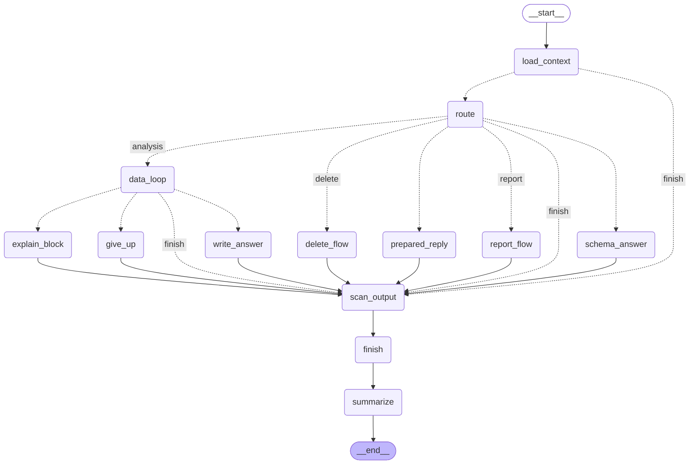
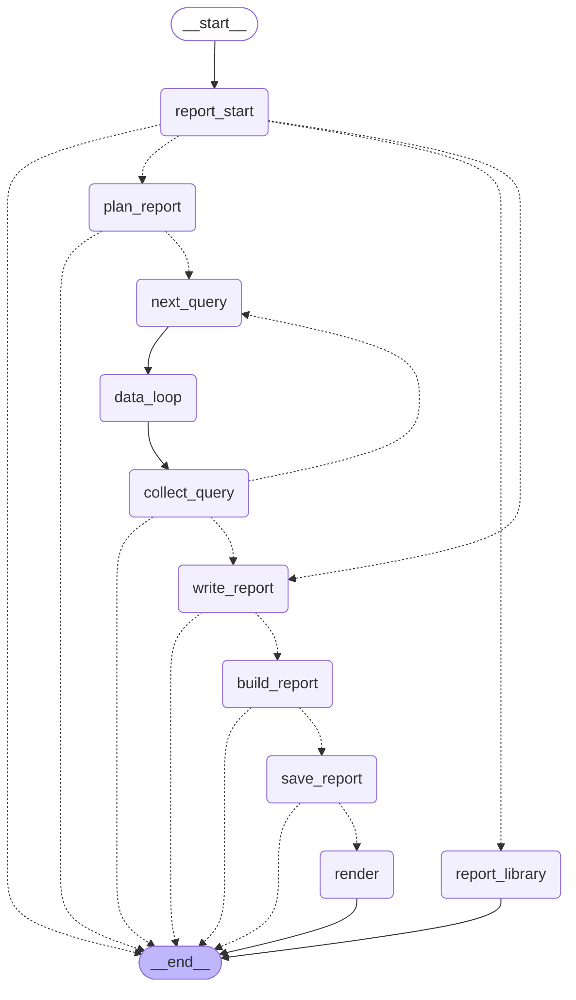
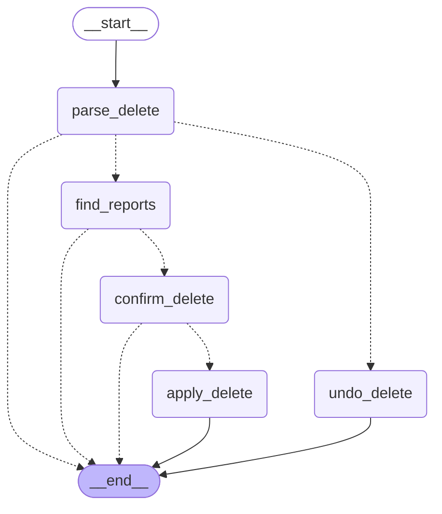

# Framework Choice: LangGraph

This document answers deliverable 6 of the brief: "Use a framework of your choice, explain why you choose it and your level of experience with it."

- Part 1 gives the reasons for LangGraph.
- Part 2 shows how the project uses it.
- Part 3 states the author's experience with it.

## 1. Why LangGraph

The project compared two frameworks on the needs of this assistant: LangGraph and Google ADK (decision N21, 2026-11-11). Both support Gemini with an AI Studio key. The full comparison is in [architecture.md, section 1.1](product/architecture.md#11-decision-n21-langgraph-not-google-adk).

| Need | LangGraph | Google ADK |
|---|---|---|
| Delete confirmation (Req 3) | `interrupt()` pauses the graph at any point with any data. `Command(resume=...)` continues it with the typed `delete 3`. | `require_confirmation` or `request_confirmation()` pauses before a tool. The typed `delete 3` needs a custom path. |
| Self-correction loop (Req 5) | A visible cycle in the graph. Each step is a node. | The model decides inside one agent when to call the tool again. A fixed loop needs a loop agent or code in the tool. |
| State between turns | Checkpointers: SQLite in the prototype, PostgreSQL in production | Session services, or Vertex AI Agent Engine sessions |
| Evaluation (Req 6) | Nothing built in. The project uses pytest and its own test sets. | Built-in `adk eval` |
| Lock-in | Independent of the model provider | Optimized for Gemini and Google Cloud |

ADK gives more built-in parts: evaluation, a Dev UI and managed sessions. LangGraph gives more explicit control. The prototype requirements need behavior that does not depend on the model. So the project uses LangGraph, for five reasons:

1. **The SQL guard is a fixed node before every query.** The model cannot skip it (Req 2).
2. **The delete confirmation is code, not a model decision.** The graph pauses with `interrupt()` and continues only with the exact typed answer (Req 3).
3. **The retry limit is in the graph.** A counter in the state and an edge in the graph stop the self-correction after 3 attempts (Req 5).
4. **Each node is a named step in the trace** (Req 7).
5. **The diagram comes from the code.** LangGraph exports the graph as Mermaid, so the design diagram matches the code.

What the project accepts: more own code. The evaluation harness is plain pytest with own scorers (spec 20). Managed sessions are in the design only.

## 2. How the project uses LangGraph

**The graph.** One turn of the chat is one run of a compiled `StateGraph` (`agent/graph.py`). Each node is a plain Python function. The nodes call Gemini through `google-genai` directly. The project uses no LangChain model wrappers.

**State and runtime context.** The state (`AgentState`) holds the recent messages, the pinned facts of the conversation, the summary, the conversation ID and the data of the current turn. The user, the brands, the services and the turn budget come in the runtime context (`context_schema=TurnContext`). So the identity of the user is never a part of the state that a model output can change.

**The graph from the code.** The diagrams below are the output of `draw_mermaid()` on the final code (2026-11-12). Dotted lines are conditional edges. This command prints the main graph:

```bash
uv run python -c "from opsfleet_agent.agent.graph import build_graph; from opsfleet_agent.reports.flow import build_report_flow; from opsfleet_agent.reports.delete_flow import build_delete_flow; print(build_graph(flows={'report': build_report_flow(), 'delete': build_delete_flow()}).get_graph().draw_mermaid())"
```



- `route` is one model call with structured output. It selects the path: a data question, a schema question, a prepared reply (greeting, off-topic, unsafe), a report or a delete.
- Every path ends in `scan_output` (the output scanner and the prompt-leak check), then `finish`. So no text reaches the user without the scanner.
- `summarize` runs after `finish`. It shortens the old turns when the window is full.

**The self-correction cycle.** `data_loop` is a subgraph with the nodes `write_sql`, `guard`, `check_sql`, `run_query`, `check_empty` and `mask_result`. Each node writes the next step into the turn, and one routing function reads it. A correctable error goes back to `write_sql` with the error. The correctable errors are a guard parse error, a SQL that does not match the stated period or definitions, a BigQuery error, a dry run over the byte cap and an empty result with an error. A counter in the state stops the cycle after 3 attempts for each query step. A policy block of the guard ends the loop at once, with no retry (spec 31). `draw_mermaid(xray=1)` shows the subgraph with an edge between each pair of nodes, because one routing function selects the next node. So this document does not show it.

**Reports.** The report flow is a subgraph too. It uses the same `data_loop` for each planned query, so each report query goes through the same guard. The plan already has the SQL, so the loop starts at `guard`. `write_sql` runs only after a failed query (spec 32).



**The confirmation with `interrupt()`.** The delete flow is the third subgraph:



- The model gives only the scope of the delete ("this conversation", "reports that mention Levi's"). `find_reports` finds the exact list in code and saves it, with a hash of the IDs and the expected text `delete N`, in the state.
- `confirm_delete` calls `interrupt()` with the list. The CLI or the UI shows the list, and the session sends the next user input back with `Command(resume=text)`.
- Only the exact text `delete N` continues to `apply_delete`. Any other text cancels, and then goes to the agent as a new message. The model never gives the confirmation (spec 33).
- `apply_delete` runs the tool `delete_reports` through the tool registry. The registry refuses a destructive tool without the grant of this confirmation.

**The checkpointer.** The prototype uses `SqliteSaver` with `data/checkpoints.db`, inside a small wrapper: a failed checkpoint write does not stop the turn (spec 36). The checkpointer keeps the state between turns, so the pause of `interrupt()` can continue in the next turn. `--resume` continues a saved conversation, but it cancels a delete that waits for a confirmation. Production uses the PostgreSQL checkpointer with Cloud SQL.

**Traces.** Each node runs inside a wrapper that writes one OpenTelemetry span with the node name. So the trace of a turn (`/trace`) shows the same names as the graph (spec 35).

## 3. My experience with LangGraph

> **Placeholder for the author.** Claude does not write this part. The author answers these questions in their own words:
>
> 1. Which projects used LangGraph?
> 2. For how long?
> 3. Which features were used before this project?
> 4. What was new in this project?
