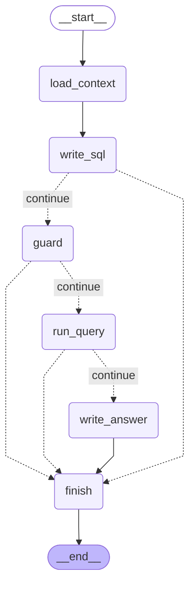

# Framework Choice: LangGraph

This document answers deliverable 6 of the brief: "Use a framework of your choice, explain why you choose it and your level of experience with it."

- Part 1 gives the reasons for LangGraph.
- Part 2 shows how the project uses it.
- Part 3 states the author's experience with it.

## 1. Why LangGraph

The project compared two frameworks on the needs of this assistant: LangGraph and Google ADK (decision N21, 2026-11-11). Both support Gemini with an AI Studio key. The full comparison is in [architecture.md, section 1.1](product/architecture.md#11-decision-n21-langgraph-not-google-adk).

| Need | LangGraph | Google ADK |
|---|---|---|
| Delete confirmation (Req 3) | `interrupt()` pauses the graph at any point with any data. `Command(resume=...)` continues it with the typed `delete 3`. | `require_confirmation` or `request_confirmation()` pauses before a tool. The typed `delete 3` needs a custom path. |
| Self-correction loop (Req 5) | A visible cycle in the graph. Each step is a node. | The model decides inside one agent when to call the tool again. A fixed loop needs a loop agent or code in the tool. |
| State between turns | Checkpointers: SQLite in the prototype, PostgreSQL in production | Session services, or Vertex AI Agent Engine sessions |
| Evaluation (Req 6) | Nothing built in. The project uses pytest and its own test sets. | Built-in `adk eval` |
| Lock-in | Independent of the model provider | Optimized for Gemini and Google Cloud |

ADK gives more built-in parts: evaluation, a Dev UI and managed sessions. LangGraph gives more explicit control. The prototype requirements need behavior that does not depend on the model. So the project uses LangGraph, for five reasons:

1. **The SQL guard is a fixed node before every query.** The model cannot skip it (Req 2).
2. **The delete confirmation is code, not a model decision.** The graph pauses with `interrupt()` and continues only with the exact typed answer (Req 3).
3. **The retry limit is in the graph.** A counter in the state and an edge in the graph stop the self-correction after 3 attempts (Req 5).
4. **Each node is a named step in the trace** (Req 7).
5. **The diagram comes from the code.** LangGraph exports the graph as Mermaid, so the design diagram matches the code.

What the project accepts: more own code. The evaluation harness is plain pytest with own scorers (spec 20). Managed sessions are in the design only.

## 2. How the project uses LangGraph

**The graph.** One turn of the chat is one run of a `StateGraph`. The state (`AgentState`) holds the messages, the user context, the conversation ID, the turn details, the pending confirmation and the summary. Each node is a plain Python function. The nodes call Gemini through `google-genai` directly. The project uses no LangChain model wrappers.

**The confirmation with `interrupt()`.** The node `confirm_delete` saves the exact list of reports and a hash of their IDs in the state. Then it calls `interrupt()` with the list. The CLI shows the list and sends the next user input back with `Command(resume=text)`. Only the exact text `delete N` deletes. The model never gives the confirmation (spec 33).

**The checkpointer.** The prototype uses `SqliteSaver` with `data/checkpoints.db`. The checkpointer keeps the state between turns and makes the pause of `interrupt()` possible. Production uses the PostgreSQL checkpointer with Cloud SQL.

**The self-correction cycle.** The nodes `write_sql`, `guard`, `run_query`, `check_empty` and `mask_result` form a subgraph. On a correctable error, an edge goes back to `write_sql` with the error. The attempt counter in the state stops the cycle after 3 attempts (spec 31).

**The graph from the code.** This diagram is the output of this command on 2026-11-11:

```bash
uv run python -c "from opsfleet_agent.agent.graph import build_graph; print(build_graph().get_graph().draw_mermaid())"
```



This is the graph of the walking skeleton (spec 01). The graph grows in the later specs: routing, the self-correction cycle, the empty-result checks, reports and the delete flow (specs 30–37). The team must export the diagram again with the same command at the end of the project. The planned full graph is in [spec 31, section B2.1](specs/31-agent-core/spec.md).

## 3. My experience with LangGraph

> **Placeholder for the author.** Claude does not write this part. The author answers these questions in their own words:
>
> 1. Which projects used LangGraph?
> 2. For how long?
> 3. Which features were used before this project?
> 4. What was new in this project?
