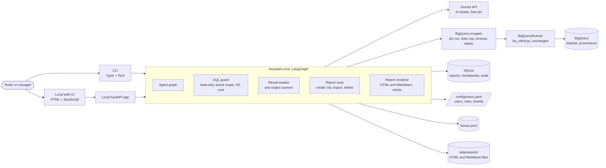
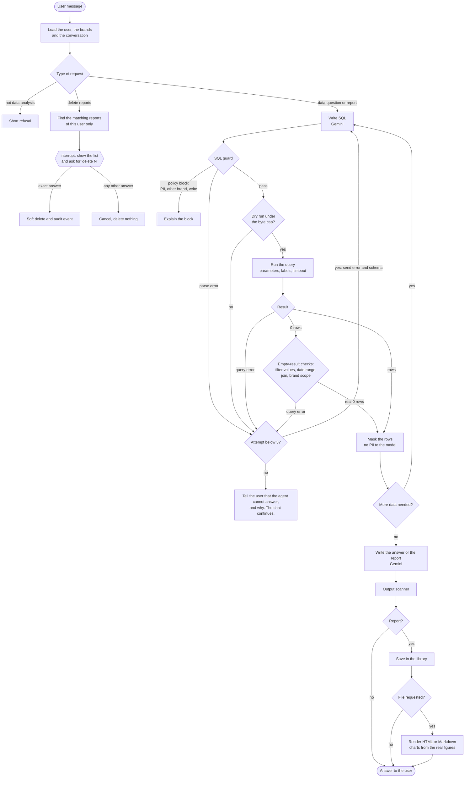
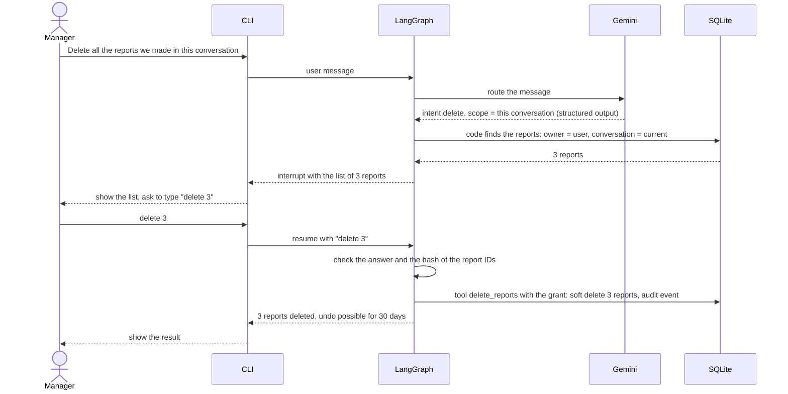
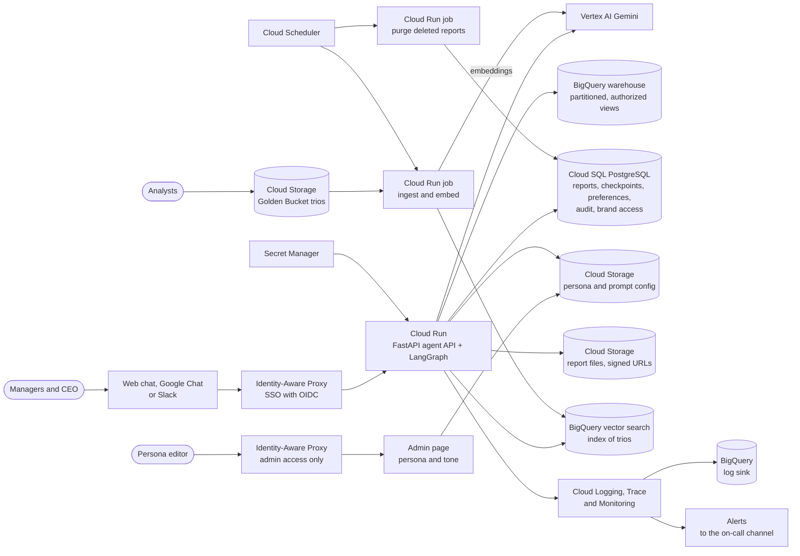

# System Architecture Overview: Retail Analytics Chat Assistant

- **Version:** 1.0
- **Status:** Proposed
- **Inputs:** `docs/product/product-definition.md`, `docs/brief/Original task.md`, `docs/analysis/gap-analysis.md`, and a scan of the repository on 2026-11-11.

The architecture has two targets:

- **Prototype:** a local CLI on one machine. It implements Requirements 2, 3, 5 and 7.
- **Production:** a design on Google Cloud. It covers all requirements. The HLD (`docs/design/hld.md`, spec 10) describes it in detail.

Labels:

- **[repo: `<file>`]** — the repository already uses this technology. The file is the evidence.
- **_(assumption)_** — our proposal. Nothing in the repository uses it yet.

One rule applies to all areas: the CLI and the local UI call one **assistant core**. The core holds every safety rule: brand scope, PII protection, read-only access and the delete confirmation. No interface can bypass these rules.

---

## 0. Diagrams

### 0.1. Prototype: components

### 0.2. Prototype: one turn in the agent graph

Each step writes a span to the trace (Req 7).

### 0.3. Prototype: delete with confirmation (Req 3)

The model asks for the delete. Only the code and the user's typed answer allow it.

### 0.4. Production on Google Cloud (design)

---

## 1. Application & Technology Stack

- **Language:** Python 3.12. [repo: `.python-version`, `pyproject.toml`]
- **Packaging and build:** uv with the `uv_build` backend. A `uv export` generates `requirements.txt`, so `pip install -r requirements.txt` also works. [repo: `pyproject.toml`, `uv.lock`, `requirements.txt`]
- **Agent framework:** LangGraph. Decided on 2026-11-11 (N21). Section 1.1 gives the comparison and the reasons.
  - The nodes call Gemini through `google-genai` directly. We do not add LangChain model wrappers.
- **LLM SDK:** `google-genai` 3.0.0. [repo: `pyproject.toml`]
- **LLM model:** a Gemini Flash model. The model name is a configuration value.
  - **During development:** `gemini-3.5-flash-lite`, the cheaper model. All development runs and tests use it. _(decision 2026-11-11)_
  - **Final choice:** after the implementation and the test set are ready, we run the test set on `gemini-3.5-flash-lite` and on `gemini-3.8-flash`. We compare the correct answers, the latency and the token use. Then we choose the default model and the fallback model.
  - Both names are in the model list of our free-tier key on 2026-11-11. A test call to `gemini-3.5-flash-lite` on 2026-11-11 succeeded in 1.0 s on the free tier.
  - The client sets a timeout and a fixed retry count. Without them, an earlier test call hung, because the SDK repeated the call.
  - Reasons for Flash models: low cost, low latency for the 10–30 s target, and free-tier access for OpsFleet tests.
- **BigQuery access:** a wrapper module around the client's `BigQueryRunner`. We do not change `bq_client.py`. [repo: `src/opsfleet_agent/bq_client.py`]
  - The wrapper uses `BigQueryRunner` to create the client and to read table schemas.
  - The wrapper runs queries through `runner.client` with a `QueryJobConfig`, because `execute_query()` accepts no job settings. The config adds a dry run, `maximum_bytes_billed`, a timeout, query parameters, job labels and a row cap.
- **SQL guard:** `sqlglot` with the BigQuery dialect. _(assumption)_
  - It parses the SQL, checks the rules in section 5, and rewrites each table to a scoped subquery.
  - Alternative: only a BigQuery dry run. A dry run gives the cost, but it cannot rewrite the SQL for the brand scope.
- **Data frames:** pandas 3.1.1. [repo: `pyproject.toml`, `uv.lock`]
- **Configuration:** `python-dotenv` for secrets in `.env` [repo: `pyproject.toml`, `.env.example`]. YAML files for the users, brands and agent settings, read with PyYAML _(assumption)_.
- **CLI:** Typer for the arguments (`--user`) and Rich for tables and Markdown in the terminal. _(assumption)_ Alternative: `argparse` and plain text.
- **Report files:** _(assumption, scope decided 2026-11-11)_
  - HTML (the main format): one self-contained file from a Jinja2 template. Charts are inline SVG, drawn with matplotlib. The file works offline and needs no JavaScript.
  - Markdown (the second format): the same content, with Mermaid charts (bar, line, pie).
  - The model chooses only the chart type and the columns, for example "bar chart: brand by revenue". The code draws the chart from the query result, so the model cannot invent a figure.
  - Alternative: Vega-Lite charts in HTML. They need a JavaScript library from a CDN, so the file does not work offline.
- **Local web UI (nice to have):** one static HTML page with plain JavaScript and CSS. No npm, no build step. A small FastAPI app serves the page and a local JSON API: users, conversations, chat and delete confirmation. _(assumption)_
  - The API calls the same assistant core as the CLI.
  - The same FastAPI app can become the agent API in production (section 3).
  - Alternative: the Python standard library `http.server`. It adds no dependency, but it has no simple support for streamed answers.

### 1.1. Decision N21: LangGraph, not Google ADK

**Decision (2026-11-11):** LangGraph.

Both frameworks support Gemini through the Gemini API key from AI Studio. The table compares them on the needs of this project. Sources: the current LangGraph and ADK documentation, read on 2026-11-11.

| Need | LangGraph | Google ADK |
|---|---|---|
| Delete confirmation (Req 3) | `interrupt()` pauses the graph at any point with any data, for example the list of reports. The code resumes with `Command(resume=...)` and any value, for example the typed `delete 3`. This fits our typed confirmation directly. | `FunctionTool(..., require_confirmation=True)` pauses before a tool runs and asks to approve or reject. A tool can also call `request_confirmation(hint, payload)` for custom data. The confirmation is an extra event that our code answers. The typed `delete 3` needs this custom path. |
| Self-correction loop (Req 5) | A visible cycle in the graph: generate SQL, check, run, and on error go back. Each step is a node, so the trace shows it clearly. | The model decides inside one agent when to call the tool again. A fixed loop needs a workflow agent (for example a loop agent) or code in the tool. |
| State between turns | Checkpointers: SQLite for the prototype, PostgreSQL for production. | Session services: SQLite or a SQL database for the prototype, Vertex AI Agent Engine sessions for production. |
| Gemini | The nodes call `google-genai` directly. LangChain model wrappers are optional. | Native. ADK uses `google-genai`, which the project already has. |
| Testing and evaluation (Req 6) | No built-in evaluation. We use pytest and our own test set. LangSmith is an optional paid service. | Built-in evaluation (`adk eval`), with checks of the tool-call order against expected calls. |
| Developer tools | LangGraph Studio (optional). | `adk web`, a Dev UI that shows the events of each session. This can help manual tests. |
| Production on Google Cloud | Runs in our own FastAPI app on Cloud Run. | Runs on Cloud Run, or on Vertex AI Agent Engine with managed sessions. |
| Lock-in | Independent of the model provider. | Optimized for Gemini and Google Cloud. Other models are possible, but less direct. |
| Familiarity for reviewers | Very widely used. | Newer, but it is Google's own kit, and the brief prefers Gemini. |

Summary:

- **LangGraph** gives more explicit control. The confirmation flow and the self-correction loop are visible in the graph, and that helps the safety and resilience requirements of the prototype.
- **Google ADK** gives more built-in parts: evaluation, a Dev UI and managed sessions on Google Cloud. That helps the design-only requirements (Req 6) and the production story.

Reasons for the decision:

1. The prototype requirements need fixed behavior that does not depend on the model. In the graph, the SQL guard is a fixed node before every query, and the model cannot skip it (Req 2).
2. The delete confirmation pauses with `interrupt()` and continues only with the exact typed answer (Req 3).
3. A counter in the state and an edge in the graph enforce the limit of 3 self-correction attempts (Req 5).
4. Each node is a named step in the trace (Req 7).
5. LangGraph exports the graph as a Mermaid diagram, so the HLD diagram matches the code.

What we accept: we write more code ourselves. We build our own evaluation harness with pytest (spec 20). Managed sessions are in the design only.

---

## 2. Data & Persistence

- **Analytics data (prototype):** the BigQuery public dataset `bigquery-public-data.thelook_ecommerce`, tables `orders`, `order_items`, `products`, `users`. Read only. BigQuery bills the queries to `GOOGLE_CLOUD_PROJECT`. [repo: `src/opsfleet_agent/bq_client.py`, `.env.example`]
- **Analytics data (production):** the company's BigQuery warehouse. About 1 million new rows each day. Tables are partitioned by date and clustered by product, so a query for one brand and one period reads less data. _(assumption)_
- **Brand access mapping:**
  - Prototype: `config/users.yaml` with each user, the role and the list of brands.
  - Production: an access table (user or group to brand), with the groups from the identity provider. _(assumption)_
- **Saved reports, conversations, preferences and audit events:**
  - Prototype: one local SQLite file. Reports use a soft delete with a 30-day undo. _(assumption)_
  - Production: Cloud SQL for PostgreSQL. _(assumption)_ Reasons: relational data, full-text search for "reports that mention Client X", and transactions for the delete. Alternative: Firestore, which has no built-in full-text search.
- **Report files:**
  - Prototype: a local `data/reports/<user>/` folder. Git ignores the whole `data/` folder. The library stores the path of each file. _(assumption)_
  - Production: a Cloud Storage bucket. The user gets a short-lived signed URL. _(assumption)_
- **Conversation state:** a LangGraph checkpointer. SQLite in the prototype, PostgreSQL in production. _(assumption)_
- **Golden Bucket (design only):** a Cloud Storage bucket with one JSON file for each trio (question, SQL, analyst report). An ingest job embeds the questions with a Gemini embedding model into BigQuery vector search. At query time, the agent gets the most similar trios as examples. _(assumption)_ Alternative: Vertex AI Vector Search, which costs more at this small size.
- **Persona and prompt configuration (design only):** versioned YAML files in Cloud Storage. The agent reads them at each turn with a short cache, so a tone change needs no new release. _(assumption)_ Alternative: a Firestore document.
- **Traces:** a local JSONL file in the prototype. Cloud Logging with a sink to BigQuery in production. _(assumption)_

---

## 3. Infrastructure & Deployment

- **Prototype, during development:** runs locally with uv (`uv sync`, `uv run`). [repo: `uv.lock`] _(decision 2026-11-11)_
- **Prototype, for reviewers and final checks:** a Docker image, because we do not know the operating system of the reviewers. _(decision 2026-11-11)_ [repo: `Dockerfile`, `compose.yaml`, `.dockerignore`, `scripts/docker-checks.sh`]
  - Base image `python:3.12-slim`. uv installs the locked dependencies (`uv sync --frozen --no-dev`), so the image uses the same versions as local development.
  - The container runs as a user without root rights.
  - The CLI needs an interactive terminal: `docker run -it`. The local web UI listens on `0.0.0.0` inside the container, and Docker publishes the port only on the host loopback: `-p 127.0.0.1:8000:8000`.
  - Secrets come from `--env-file .env`. The image does not contain them.
  - BigQuery credentials: the container mounts the host's gcloud folder read-only at `/gcloud`, and `CLOUDSDK_CONFIG=/gcloud` points the Google libraries to it. The host folder is `~/.config/gcloud` on macOS and Linux, and `%APPDATA%\gcloud` on Windows. On Linux, the container runs with the host user ID, because the ADC file has mode 600. Spec 53 gives the commands. A service-account key file is the alternative.
  - One volume keeps the `data/` folder between runs: the SQLite files, the traces and the report files.
  - We build and test the image for both `linux/arm64` and `linux/amd64`. Our machine is arm64, and many reviewers use amd64.
  - A `compose.yaml` starts the CLI or the UI with the same mounts in one command. _(decision 2026-11-12)_
- **Fallback without Docker:** uv, or `pip install -r requirements.txt` from `uv export`, as the brief describes. [repo: `requirements.txt`]
- **Cloud provider (production):** Google Cloud, region US, because the dataset is in the US multi-region. _(assumption)_
- **Agent API (production):** a FastAPI app on Cloud Run. _(assumption)_
  - Reasons: about 1,000 questions each day and only a few users at the same time. Cloud Run scales to zero and needs no servers. A minimum of 1 instance during business hours prevents a slow cold start.
  - Alternative: GKE, which costs more to operate at this size.
- **User channels (production):** a web chat or Google Chat / Slack. All channels call the agent API through Identity-Aware Proxy. _(assumption)_
- **Scheduled jobs (production):** Cloud Scheduler with Cloud Run jobs for the purge of deleted reports and the Golden Bucket ingest. _(assumption)_
- **Secrets:** `.env` in the prototype. Secret Manager in production. _(assumption)_
- **Infrastructure as code:** Terraform. _(assumption)_
- **CI/CD:** GitHub Actions for ruff, pytest and the offline test set. A live evaluation run against Gemini has a fixed call limit. _(assumption)_ [repo: no CI configuration yet]

---

## 4. External Services & APIs

- **LLM:**
  - Prototype: the Gemini API through Google AI Studio, free tier, with `GOOGLE_API_KEY`. [repo: `.env.example`]
  - Production: Vertex AI Gemini, paid tier. _(assumption)_ Reasons: the data stays in the company's Google Cloud project and is not used to train models, and the limits are higher.
- **Google Cloud authentication:** Application Default Credentials. An optional service-account key in `GOOGLE_APPLICATION_CREDENTIALS`. [repo: `.env.example`]
- **Service identity (production):** a dedicated service account with BigQuery Data Viewer on the dataset and BigQuery Job User in the billing project. Nothing more. _(assumption)_
- **User authentication:**
  - Prototype: `--user <id>` and `config/users.yaml`. OpsFleet confirmed that the CLI argument is acceptable.
  - Production: single sign-on with the company identity provider (OIDC), for example Google Workspace. _(assumption)_
- **New capabilities (design only):** each one is a tool in the tool registry. _(assumption)_
  - Charts in plain chat answers: the same chart code as the report files. The prototype builds charts only in report files.
  - Reports by email: the Gmail API or SendGrid. This is an `external_send` tool, so it uses the same confirmation gate as delete.
  - Web search for trends: Gemini grounding with Google Search.

---

## 5. Safety & Access Control

- **Read-only access:** the SQL guard accepts one statement, only `SELECT` or `WITH`, and only the four tables. In production, the service account also has no write role. _(assumption)_
- **Brand scope:** the guard rewrites each table reference to a subquery that keeps only the order items of the user's brands. Brand names go in as query parameters, because some names contain an apostrophe. The `ceo` role has no filter. _(assumption)_
- **PII protection:** _(assumption, rules confirmed by OpsFleet)_
  1. The guard blocks the PII columns in the query output: names, email, street address, postal code, latitude, longitude and `user_geom`.
  2. The guard rejects an output row that puts a `user_id` next to city, state, country, age, gender (in `users` and in `orders`) or traffic source. These fields appear only in aggregates.
  3. A result masker checks the rows before they go to the LLM. PII never reaches the model.
  4. An output scanner checks the final text for email, phone and address patterns.
- **Analysis-only answers:** a short input check with the LLM, the system prompt, and a fixed list of tools. The agent treats database values as data, not as instructions. _(assumption)_
- **Destructive operations:** the delete tool uses a LangGraph `interrupt()`. The code shows the exact list of reports. It binds the confirmation to a hash of the report IDs. It accepts only the typed answer, for example `delete 3`. The LLM cannot confirm a delete. Each delete writes an audit event. _(assumption)_
- **Soft delete:** the delete writes a `deleted_at` date. The report disappears from the list and the search. The user can undo the delete for 30 days. Then a purge erases it permanently: a CLI command in the prototype, a scheduled job in production. _(assumption)_
- **Report files:** a user can export only their own reports. Charts use only the masked, aggregated data. The output scanner checks the file before the code saves it. A delete also removes the files in `data/reports/<user>/`. It cannot remove a copy that the user moved to another place. _(assumption)_

---

## 6. Resilience & Cost Control

- **Self-correction:** after a SQL error, the agent sends the error and the schema to the model and tries again. The maximum is 3 attempts for each query step, and 3 query steps for each question. The turn budget of spec 00 is the outer limit. _(decision 2026-11-11, spec 31)_
- **Empty-result checks:** a result with 0 rows can be a true answer or an error. The code runs small checks before it decides: _(assumption)_
  1. Do the filter values exist in the data? The guard already knows the values from the parsed SQL. A value that does not exist, for example `'completed'` in place of `'Complete'`, is an error.
  2. Is the date filter inside the date range of the data? If not, the answer is a true 0, and the agent states the available range.
  3. Which filter makes the result empty? The code counts the rows with each filter removed, one at a time.
  4. Does each joined table return rows, while the join returns none? Then the join key is probably wrong, and it is an error.
  5. Does the brand scope make the result empty? Then the answer is a true 0 for these brands.
  - An error goes back to the self-correction loop and counts as an attempt. A true 0 goes to the answer, with the filters and the date range that the agent used.
  - Each check is a small `COUNT` query. BigQuery bills at least 10 MB for each one, so the code runs at most 5 checks for each empty result.
- **Final failure:** after the last attempt, the agent tells the user that it cannot answer, and why. It also says what can help, for example another field or period. The chat continues, and the program does not stop.
- **Retries for outside services:** exponential backoff with jitter on HTTP 429 and 5xx, with `tenacity`. _(assumption)_
- **Fallbacks:** a fallback Gemini model, and a simple circuit breaker for each outside service. When a service is not available, the agent tells the user, and the chat continues. _(assumption)_
- **BigQuery cost limits:** a dry run before each query, `maximum_bytes_billed` (1 GB in development, a separate production value in the HLD), a timeout, and a maximum of 200 rows to the LLM. The SQL must aggregate the data. _(assumption)_
- **LLM cost limits:** a token budget and a maximum number of model calls for each turn. _(assumption)_

---

## 7. Observability & Monitoring

- **Tracing standard:** OpenTelemetry. `opentelemetry-api` is already in the lock file as a dependency of `google-api-core`, but nothing configures it. [repo: `uv.lock`] We add the SDK. _(assumption)_
- **Prototype:**
  - One trace for each turn, with spans for each model call, tool call, SQL text, BigQuery job ID, guard decision, retry and confirmation.
  - Structured JSON logs.
  - Both go to a local JSONL file. A CLI command (`/trace`) shows the last trace.
  - Each BigQuery job gets the trace ID as a label.
  - Logs and traces mask PII. _(assumption)_
- **Production:** OpenTelemetry to Cloud Trace and Cloud Logging. Dashboards and alerts in Cloud Monitoring. Logs go to BigQuery for analysis. _(assumption)_ Alternative: Langfuse for LLM-specific views.
- **Metrics:** turn success rate, SQL error rate, self-correction success rate, empty-result rate, guard blocks, delete confirmations (asked, confirmed, cancelled), latency p50 and p95, tokens and cost for each turn, and BigQuery bytes billed. _(assumption)_

---

## 8. Quality & Development Tooling

- **Tests:** pytest 9.2.0. There are no test files yet. [repo: `pyproject.toml`]
- **Lint and format:** ruff 0.17.4. `bq_client.py` is excluded. [repo: `pyproject.toml`]
- **Type check:** pyright settings exist, but pyright is not a declared dependency. [repo: `pyproject.toml`]
- **Pre-commit:** pre-commit 4.7.0 is a dependency, but there is no `.pre-commit-config.yaml` yet. [repo: `pyproject.toml`]
- **Final checks:** before the submission, we run the tests and a manual demo inside the Docker image, on `linux/amd64` and `linux/arm64`. Local runs with uv are for development only. _(decision 2026-11-11)_
- **Evaluation harness (built in the prototype, specs 20–23 and 50–51):** test questions with reference SQL and expected figures. A safety set tests PII, cross-brand access, prompt injection and delete without confirmation. A live run makes a known, limited number of Gemini calls. _(assumption)_
