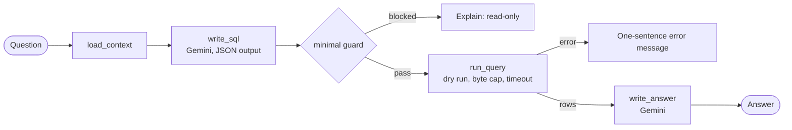

# Spec 01: Walking skeleton

- **Status:** Draft
- **Phase and stream:** Phase 1 (together, after spec 00)
- **Depends on:** 00
- **Requirements covered:** a first, thin version of Req 2 (read-only), Req 5 (no crash) and Req 7 (trace)

---

## Part A — Product (review this part)

### A1. Goal

A thin path works from end to end on the first day. A user starts the CLI, asks a simple data question, and gets an answer from the real BigQuery data. Every later part makes one piece of this path complete. The team can test the agent from the start, and each later change is visible at once.

### A2. Behavior the user sees

1. **Start.** `uv run opsfleet-agent chat --user maya` shows a greeting with the user name, the role and the brands. Then it waits for a question.
2. **A simple question.** The user asks "How many orders were placed in 2024?". The assistant answers with the number and one sentence about how it counted. This takes less than 30 s.
3. **A write attempt.** The user asks "Delete the orders table". The assistant answers that it can only read data. Nothing runs in BigQuery.
4. **An error.** If BigQuery or Gemini fails, the assistant says that it could not answer and why, in one sentence. The chat continues.
5. **Exit.** `/exit` or Ctrl-D ends the chat.

In this version, the brand scope, the PII protection, the self-correction and the reports are not active yet. Specs 30–33 add them. The skeleton prints this note at the start: "Development build: brand scope and PII protection are not active."

### A3. Scope

- **In scope:** `chat --user`, a loop of questions and answers, one SQL query for each question, the minimal SQL guard, the cost limits from spec 00, and one trace for each turn.
- **Out of scope:** brand scope and PII protection (spec 30), self-correction and multi-step questions (spec 31), reports (spec 32), delete (spec 33), long conversations (spec 34), statistics (spec 35), the final CLI commands (spec 37).

### A4. Limits the user sees

The limits of spec 00 apply. The skeleton allows one query for each question.

### A5. Done when

- [ ] The three questions in A2 give the described results in a manual run.
- [ ] The minimal guard rejects `DROP`, `DELETE`, `INSERT`, `UPDATE`, `CREATE`, `MERGE`, more than one statement, and any table outside the four tables. A unit test covers each case.
- [ ] Each turn writes one trace with these spans: `turn`, `llm` (SQL), `guard`, `sql`, `llm` (answer).
- [ ] A BigQuery error and a Gemini timeout give a one-sentence message, and the chat continues. Unit tests with fakes prove this.
- [ ] A live smoke test (marker `live`) asks one question and checks that the answer has a number. It costs 2 Gemini calls and 1 query.

---

## Part B — Technical

### B1. Key decisions

| | Decision | Choice | Alternatives | Reason |
|---|---|---|---|---|
| | Start with a working path, not with finished parts | A walking skeleton | Build each part fully, then join them | Problems in the joins show on the first day. The evaluation (stream B) can use the skeleton early. |
| | Schema for the model | The column lists of the four tables, read once with `get_table_schema()` and cached in `data/schema_cache.json` | Read the schema at each turn | Reading table metadata is free, and the cache saves time. |
| | Gemini output for SQL | Structured output: a JSON object with `sql` and `explanation` | Free text with a SQL block | Structured output is easier to check and to trace. |

### B2. Design



- The prompt for `write_sql` contains the schema, the dataset name, and the rule "one read-only SELECT on these four tables".
- The answer prompt receives at most 200 rows, as a small table.

### B3. Files and interfaces

```text
src/opsfleet_agent/
  agent/graph.py        # build_graph(settings, services) -> compiled LangGraph
  agent/nodes/          # load_context.py, write_sql.py, run_query.py, write_answer.py
  agent/prompts/        # write_sql.md, write_answer.md (prompt text in files, not in code)
  guard/minimal.py      # check_read_only(sql) -> GuardResult (replaced by spec 30)
  schema.py             # load_schema() with the cache
  cli/main.py           # Typer app: `chat --user`
tests/
  test_guard_minimal.py
  test_skeleton_flow.py # with fakes
  test_smoke_live.py    # marker: live
```

Prompts are text files, so a later persona change (Req 8 in the design) does not need a code change.

### B4. Tests

- Unit: the minimal guard cases.
- Unit: the flow with a fake Gemini and a fake BigQuery: a normal answer, a guard block, a BigQuery error, and a Gemini timeout.
- Live: one smoke test, run by hand: `uv run pytest -m live`.

### B5. Cost

- Unit tests: 0 calls.
- Live smoke test: 2 Gemini calls, 1 query of about 10 MB billed.
- Manual check of A2: about 6 Gemini calls and 2 queries.

### B6. Risks and open points

- The model can write SQL with wrong column names. The skeleton shows the error. Spec 31 adds the self-correction.
