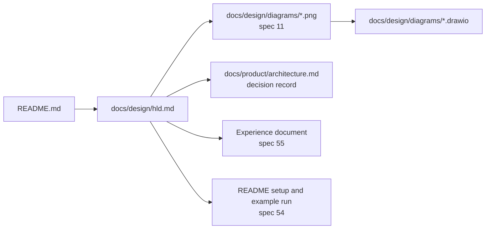

# Spec 10: Design document (HLD) and technical explanation

- **Status:** Draft
- **Phase and stream:** Phase 2, stream A. A final update in Phase 3, after specs 50 and 51.
- **Depends on:** 00, 01. It uses the results of 11 (diagrams), 51 (model choice), 54 (setup guide) and 55 (experience document).
- **Requirements covered:** Req 1–8 in the design. Deliverable 1 (architecture diagram with explanations) and deliverable 2 (detailed technical explanation).

---

## Part A — Product (review this part)

### A1. Goal

An OpsFleet reviewer reads one document and understands how the system works in production on Google Cloud. The document explains each requirement (Req 1–8), the services and the reasons for them, the data flow, the error handling, the size and the cost. The reviewer can find the answer to each item of the brief in less than one minute.

### A2. Behavior the user sees

The "user" of this spec is the OpsFleet reviewer.

1. **Start from the README.** The reviewer opens the repository. The README has a link "Design document (HLD)". The link opens `docs/design/hld.md`.
2. **Find an item of the brief.** The first section of the HLD is a table. Each row is one item of the brief (Req 1–8, deliverables 1–6, the expected capabilities). Each row links to the section that answers it.
3. **See the system.** Near the start, the reviewer sees the production diagram on Google Cloud (spec 11) as an image. The text under the image names each numbered flow in the diagram.
4. **Read one requirement.** Each requirement section has the same five parts. The parts are: the brief, the production design, the prototype, failures and limits, and the checks. The reviewer can compare requirements quickly.
5. **Know what we built.** Each requirement section starts with a label: "Built in the prototype" or "Design only". The reviewer does not need to guess.
6. **Check the numbers.** The sizing section starts from the OpsFleet load figures. Each derived number shows its formula. The cost section shows the unit prices, the source page and the date.
7. **Ask "why this service?".** A table lists each service, the choice, the alternatives, and the reason. The reviewer gets the reason without a search in other files.
8. **Go deeper.** The HLD links to `docs/product/architecture.md` for the full decision records, for example the LangGraph and ADK comparison. The HLD does not need these links to be complete.

### A3. Scope

- **In scope:**
  - The full text of `docs/design/hld.md`.
  - The Mermaid diagrams in it.
  - The links to the draw.io images (spec 11), the README (spec 54) and the experience document (spec 55).
  - A traceability table from the brief to the sections.
  - The production sizing and the monthly cost estimate.
- **Out of scope:**
  - The draw.io files and images (spec 11).
  - The setup steps and the example run (spec 54). The HLD links to them and does not copy them.
  - The framework experience text (spec 55).
  - Infrastructure code, for example Terraform files. The HLD describes the infrastructure. It does not contain code for it.
  - Any change to the prototype code.

### A4. Limits the user sees

- **Length.** The main part is readable in about 45 minutes. Long tables go to appendices: the assumptions register, the metric list, the error catalog.
- **Honest labels.** Each feature has one label: "Built in the prototype" or "Design only". Each number has one label: "From OpsFleet", "Measured" (from specs 50 and 51), or "Our assumption".
- **Prices.** The cost estimate uses list prices on the date of writing. It is an estimate, not a quote. The document says so in one sentence.
- **One source for each fact.** The setup steps are only in the README. The HLD links to them.

### A5. Done when

- [ ] `docs/design/hld.md` exists. The README links to it.
- [ ] The traceability table has one row for each of Req 1–8, deliverables 1–6 and the expected capabilities of the brief. Each row links to a section that exists.
- [ ] The Req 1 section answers both questions of the brief:
  - How does the Golden Bucket get updates over time?
  - How does the agent get relevant data at query time?
- [ ] The Req 4 section describes both loops: user level and system level.
- [ ] The Req 6 section answers the three questions of the brief: evaluation before deployment, the check of report intent, and the UX evaluation.
- [ ] The Req 7 section lists the metrics and describes a deep dive from a user complaint to the failed step.
- [ ] The Req 8 section shows how a non-developer changes the tone without a new release, and how the editor reverses a change.
- [ ] Each service in the production diagram has a row in the service table, with the reason and at least one alternative.
- [ ] The sizing section uses all the OpsFleet figures:
  - about 100 managers each day, with 10 questions and 1 report each,
  - about 1 million new rows each day,
  - 10–30 s for a question and 1–2 min for a report.
- [ ] The cost section gives a monthly total, a table for each service, the price source and the date.
- [ ] The error handling section has one row for each failure in B2, section 9.
- [ ] Each requirement section has the label "Built in the prototype" or "Design only".
- [ ] The production draw.io image (spec 11) shows in the HLD on GitHub. The numbered flows in the image match the data flow table.
- [ ] The HLD does not contradict `docs/product/architecture.md`. The check in B4 passes.
- [ ] The model section names the default and fallback models from spec 51, with the measured figures.
- [ ] The STE lint (`ste-lint.py`) gives no hard violations, except quotes from the brief.
- [ ] All Mermaid diagrams render on GitHub. All relative links work.

---

## Part B — Technical

### B1. Key decisions

| | Decision | Choice | Alternatives | Reason |
|---|---|---|---|---|
| ⚑ | Location and relation to the architecture document | One reviewer-facing file, `docs/design/hld.md`, with the HLD and the technical explanation together. `architecture.md` stays as the decision record. The HLD summarizes each decision and links to the record. | Two files (HLD and explanation). Or extend `architecture.md`. | The brief asks for an HLD "accompanied by" an explanation. One file with a traceability table is easier to review. `architecture.md` is an internal record with history and evidence labels. |
| ⚑ | Golden Bucket data at query time | The agent gives the model only the question, the SQL and the analyst's interpretation notes of the similar trios. It never gives the figures from the analyst report. | Give the full trio, filtered by brand | A trio can contain figures of brands outside the user's scope. Without figures, the trio cannot leak data. The model gets the method, not the result. |
| ⚑ | Production BigQuery cost model | On-demand pricing, a daily aggregate table for the frequent metrics, partitions by date, clusters by brand and product, and a per-query byte cap. The HLD shows when capacity pricing (BigQuery editions) becomes cheaper. | Capacity pricing from the first day. No aggregate tables. | At about 2,600 queries each day, the bytes for each query decide the cost. Aggregates and partitions reduce the bytes. On-demand needs no capacity plan. |
| | Diagram sources | The draw.io images from spec 11 for the overview. The Mermaid diagrams from `architecture.md` section 0, plus new production sequence diagrams. | Mermaid only | The brief accepts Mermaid. The draw.io image with Google Cloud icons is easier to read for the overview. |
| | Setup and example run (deliverable 2.4) | A short section with a link to the README (spec 54) | Copy the steps into the HLD | One source prevents two different versions. |
| | Framework experience (deliverable 6) | A link to the document of spec 55 | A section in the HLD | The roadmap gives it a separate document. |

### B2. Design: the outline of `docs/design/hld.md`

Each numbered item is one section of the HLD. The list under each item is the content that the section must have.

**0. Summary and traceability**

- Five to eight sentences: the problem, the users, the system, the two targets (prototype and production).
- The traceability table: brief item, section link, label ("Built in the prototype" or "Design only").
- A list of the main assumptions, with a link to appendix A.

**1. Architecture overview**

- The production image from spec 11, with numbered flows.
- A table under the image: flow number, from, to, what goes through, protocol.
- The prototype image from spec 11, and one paragraph: what the prototype has, and what it replaces with a local part.
- A table "Prototype to production": each local part and its production part. Rows: CLI and local UI → web chat, Google Chat or Slack. `config/users.yaml` → SSO groups and an access table. SQLite → Cloud SQL for PostgreSQL. `data/reports/` → Cloud Storage with signed URLs. JSONL traces → Cloud Trace and Cloud Logging. AI Studio key → Vertex AI. `.env` → Secret Manager. Prompt files in the repository → persona configuration in Cloud Storage.

**2. Components**

One paragraph for each component: what it does, its inputs and outputs, where it runs. The components are:

- The agent API (FastAPI on Cloud Run) and the LangGraph graph with its nodes.
- The SQL guard, the result masker and the output scanner.
- The BigQuery access layer.
- The report library and the report renderer.
- The Golden Bucket retrieval.
- The preference store.
- The persona store and the admin page.
- The scheduled jobs: ingest (with the nightly check of the trios) and purge.
- The telemetry pipeline.

Include the agent graph diagram from `architecture.md` section 0.2.

**3. Data flow**

Mermaid sequence diagrams for these flows:

1. One question: channel → IAP → agent API → user context → persona and preferences → Golden Bucket retrieval → Gemini (SQL) → guard → BigQuery → masker → Gemini (answer) → scanner → answer. Show the checkpoint write and the spans.
2. One report: the same flow with several queries, the report save, the file render to Cloud Storage, and the signed URL.
3. A delete with confirmation. Reuse `architecture.md` section 0.3, with Cloud SQL in place of SQLite.
4. The Golden Bucket ingest (section 4.1 below).
5. A persona publish (section 4.8 below).

Add a table of the data stores: what each store holds, the owner, the retention period (gap analysis N10), and the PII status.

**4. Requirements.** One subsection for each requirement. Each subsection has five parts:

1. What the brief asks, as a short quote.
2. The production design.
3. What the prototype does.
4. Failures and limits.
5. How we check it.

The content below is mandatory.

**4.1 Req 1 — Hybrid intelligence (Golden Bucket).** Label: Design only.

- **Trio format.** One JSON file for each trio in a Cloud Storage bucket. Fields: `id`, `question`, `sql`, `report`, `interpretation` (the analyst's notes on how to read the question), `metrics_used`, `tags`, `brands`, `schema_version`, `author`, `approved_by`, `approved_at`, `status` (`draft`, `approved`, `stale`, `retired`). Object versioning keeps the history.
- **How the bucket gets updates over time.**
  1. Analysts add or change trios. Each change goes through a validation job: the SQL guard parses the SQL, a BigQuery dry run passes, and the PII rules pass. Only a valid trio can get the status `approved`.
  2. The agent proposes candidates. An answer becomes a candidate when the query ran without a correction and the user gave positive feedback. A candidate goes to a review queue. It never goes directly into the bucket. An analyst approves it, changes it, or rejects it.
  3. Each night, the ingest job also runs a dry run of each approved SQL against the current schema. A trio that fails gets the status `stale` and leaves the retrieval.
  4. A change of the embedding model creates a new index version. The agent changes to the new version only after a full re-embed.
- **Ingest.** Cloud Scheduler starts a Cloud Run job, for example each hour. The job reads new and changed trios, embeds the question with a Vertex AI embedding model, and writes the vector to a BigQuery table. Retrieval uses BigQuery vector search.
- **How the agent gets relevant data at query time.**
  1. The agent embeds the user question.
  2. A vector search returns the top 3 trios with the status `approved` and a distance below a threshold.
  3. The agent adds the metric glossary (gap analysis N4).
  4. The prompt for SQL writing gets these examples: the question, the SQL and the interpretation notes. The analyst report figures never go to the model (decision ⚑ in B1).
  5. The trace records the IDs and distances of the trios.
- **Untrusted text.** The agent treats the trio text as data, not as instructions.
- **Failure.** When retrieval fails or is slow (for example over 2 s), the agent continues without examples. The trace marks the turn as "no examples".
- **Check.** The evaluation runs the test set with and without retrieval and compares the correct answers. Metrics: the retrieval hit rate, and the share of turns with examples.

**4.2 Req 2 — Safety and PII masking.** Label: Built in the prototype, with production layers added.

- Identity: IAP with SSO (OIDC). The agent API reads the user and the groups from the signed IAP header. It never reads identity from the chat text.
- Brand scope: an access table maps a user or a group to brands. BigQuery authorized views or row-level access policies apply the scope in the data layer. The SQL guard applies the same scope as a second layer.
- PII:
  1. Column-level access control (policy tags) on the PII columns. The agent service account cannot read them.
  2. The SQL guard blocks the PII columns in the output. It rejects a row that puts a `user_id` next to a demographic field.
  3. The result masker cleans the rows before they go to the model.
  4. The output scanner checks the final text and the report files.
- The PII list from gap analysis B3, plus `events.ip_address`.
- Analysis-only answers: an input check, the system prompt, a closed list of tools, and database values as data only.
- A production option: hide aggregates of fewer than 5 customers.
- A threat table. For each threat: the control and the test set that covers it (spec 22). The threats are:
  - prompt injection,
  - a request for another brand,
  - PII extraction through SQL,
  - extraction of the system prompt or keys,
  - a persona text with instructions.

**4.3 Req 3 — Destructive operations.** Label: Built in the prototype.

- Reports in Cloud SQL for PostgreSQL. Full-text search (`tsvector`) for "reports that mention Client X", with the `entities` field first.
- The confirmation flow: `interrupt()`, the exact list, the hash of the report IDs, the typed `delete N`, and the expiry after one turn. The model cannot give the confirmation.
- Soft delete with a 30-day undo. A daily purge job (Cloud Scheduler and Cloud Run job). The purge also deletes the report files in Cloud Storage.
- Each delete writes an audit event.
- The same gate protects the future `external_send` tools, for example email.
- What the user sees in each channel. The confirmation is a typed text in every channel.

**4.4 Req 4 — Learning loops.** Label: Design only.

- **User level.**
  - A `user_preferences` table in Cloud SQL. Fields: format (table or bullets), depth, charts or text, and other fields.
  - The agent saves an explicit statement at once, for example "use tables".
  - The agent proposes an inferred preference after it repeats 3 times. It saves the preference only after the user agrees.
  - The user can show and reset the preferences.
  - Priority: safety rules, then the company persona, then the user preferences.
- **System level.**
  - An offline loop, not a self-change in production.
  - Sources: feedback, user corrections, self-corrections, guard blocks, and failed turns.
  - An analyst reviews them each week. The results are new trios, prompt changes and new test cases.
  - The regression evaluation (4.6) runs before each release.
  - The reason for human review: automatic learning from user input lets an attacker poison the memory.

**4.5 Req 5 — Resilience.** Label: Built in the prototype.

- The self-correction loop with a maximum of 3 attempts.
- The empty-result checks, at most 5 `COUNT` queries.
- The final failure message.
- Backoff with jitter, the fallback model, and a circuit breaker for each outside service.
- The production additions:
  - Timeouts for each step.
  - Progress messages during a report, so the user sees that the work continues.
  - An idempotent turn ID, so a client retry does not save a report two times.
  - Cloud Run health checks.
- The cost limits: show the production values next to the development values. The production byte cap is larger than the 1 GB development cap, because the production tables are larger.

**4.6 Req 6 — Quality assurance.** Label: Design only. The test sets of specs 21–23 exist in the prototype.

- **Before deployment:**
  - The offline test set: questions with reference SQL, with result comparison (spec 21).
  - The safety set (spec 22). The release gate for the safety set is zero failures.
  - The answer and report scores with an LLM judge and a written rubric (spec 23).
  - A person checks a sample of the judge scores.
- **Report intent:**
  - A rubric with these checks:
    1. The report covers the asked period and the scope.
    2. Each finding has a figure from a query.
    3. Each action item links to a finding.
    4. The report states the definitions.
  - A judge scores the rubric.
  - In production, a sample of reports goes to an analyst for review.
- **UX:**
  - Metrics: task success rate, turns to an answer, the feedback ratio, abandoned conversations, and the time to the first token.
  - A pilot with a few managers before the full start.
- **Release:**
  - A Cloud Run revision with a traffic split. A canary gets 10% of the traffic first.
  - A prompt or model change follows the same gate.

**4.7 Req 7 — Observability.** Label: Built in the prototype (local), production in the design.

- The metric list from `architecture.md` section 7. Appendix C gives a definition and a unit for each metric.
- Service level objectives and alerts in Cloud Monitoring, for example:
  - The turn success rate is below 95% in 1 hour.
  - The p95 latency is over 30 s for questions.
  - The Gemini 429 rate goes up.
  - The BigQuery bytes of the day reach the daily budget.
  - The guard blocks go up suddenly.
- The deep dive, step by step:
  1. The user sees a reference ID in each error message. The ID is the trace ID.
  2. Cloud Trace shows the steps of the turn.
  3. Cloud Logging shows the logs with the same trace ID.
  4. The BigQuery job label leads to the job.
  5. The masked conversation shows the message exchange.
  6. The team runs the turn again in a test environment with the same prompt version and model.
- The log sink to BigQuery for analysis over time.
- PII masking in logs and traces.
- The decision about LangSmith or Langfuse from spec 35.

**4.8 Req 8 — Persona management.** Label: Design only.

- The persona is a versioned YAML file in Cloud Storage. A schema allows only tone fields. Examples: tone, reading level, length of the summary, words to use or to avoid.
- A `persona_editor` edits it on a small admin page behind IAP.
- **Preview.** Before the editor publishes, the admin page shows the answers to 3 sample questions from a set list in the new tone. The HLD states the number of Gemini calls for each preview.
- **Publish.** The admin page writes a new version and moves the "active" pointer. The agent reads the active version at each turn, with a 60-second cache. The change needs no new release.
- **Rollback.** The editor selects an earlier version and publishes it again.
- **Audit.** Each version records the author and the time.
- **Safety.** The persona cannot change the safety rules or the SQL rules. Those parts of the prompt are in the code. The schema check rejects any other field.
- **Failure.** When the store is not available, the agent uses the last version that it read. When it has no version, it uses the default persona in the image.

**5. Service choices and reasons**

- A table with these columns: need, service, alternatives, reason, cost driver.
- Rows:
  - Cloud Run (alternatives: GKE, Vertex AI Agent Engine).
  - Vertex AI Gemini (alternative: the AI Studio paid tier).
  - The embedding model.
  - BigQuery (the warehouse and the vector search, with the alternative Vertex AI Vector Search).
  - Cloud SQL for PostgreSQL (alternatives: Firestore, AlloyDB).
  - Cloud Storage.
  - IAP.
  - Secret Manager.
  - Cloud Logging, Cloud Trace and Cloud Monitoring (alternatives: Langfuse, LangSmith).
  - Cloud Scheduler with Cloud Run jobs.
  - Terraform.
  - GitHub Actions.
- The framework: LangGraph. One paragraph and a link to `architecture.md` section 1.1. The experience: a link to the document of spec 55.
- The models: the default and the fallback model from spec 51. Show the measured correct-answer rate, the latency and the tokens. Explain why a Flash-class model fits the 10–30 s target.

**6. Error handling and fallbacks**

A table with these columns: failure, detection, action, user message, metric. The table has one row for each failure in section 9 below.

One rule for the whole system:

- Safety parts fail closed. Examples: the guard, the scope, the identity, the confirmation.
- Helper parts fail open, with a degraded answer. Examples: the Golden Bucket, the preferences, the persona.

**7. Production sizing**

Start from the OpsFleet figures. Show each formula. Use these starting values. The HLD can change them with a reason.

| Item | Formula | Starting value | Label |
|---|---|---|---|
| Questions each day | 100 managers × 10 | 1,000 | From OpsFleet |
| Reports each day | 100 managers × 1 | 100 | From OpsFleet |
| Peak hour | 80% of the work in 8 business hours, peak = 2 × average | about 200 questions and 25 reports in one hour | Our assumption |
| Turns at the same time | arrival rate × duration: 200/3,600 × 30 s + 25/3,600 × 120 s | about 3 | Derived |
| Cloud Run | concurrency 10 for each instance, minimum 1 in business hours, maximum 5 instances, 2 vCPU, 2 GiB, request timeout 300 s | 1–2 instances at peak | Our assumption |
| Gemini calls each day | 1,000 × 4 + 100 × 10 | about 5,000 | Our assumption, check with spec 50 |
| Gemini calls at peak | (200 × 4 + 25 × 10) / 60 | about 20 each minute | Derived |
| Gemini tokens each day | 5,000 calls × (6,000 in, 400 out) | about 30 M in, 2 M out | Our assumption, check with spec 50 |
| Embedding calls each day | one for each question and report | about 1,100 | Derived |
| BigQuery queries each day | 1,000 × 2 + 100 × 6 | about 2,600 | Our assumption |
| New warehouse data | 1 M rows × about 150 bytes | about 150 MB each day, about 55 GB each year | From OpsFleet, row size assumed |
| BigQuery bytes each day | 2,600 × average bytes billed for each query | Two cases: with aggregates and partitions, and without them | Derived |
| Cloud SQL | 1,100 turns × about 50 KB for 90 days | about 5 GB. 2 vCPU. | Our assumption |
| Logs and traces | 1,100 turns × about 30 spans × 1 KB | about 1 GB each month | Our assumption |
| Report files | 100 × about 200 KB | about 20 MB each day | Our assumption |

Also give a latency budget table for a question (target 10–30 s) and for a report (target 1–2 min). List each step with its expected time: identity and context, retrieval, SQL writing, guard and dry run, query, answer writing, scan. Then add one self-correction attempt and show that the total stays inside the target.

**8. Security**

- Identity and access:
  - IAP and SSO.
  - One service account for each workload: the agent API, the ingest job and the purge job. Each has the least privilege.
  - The agent service account has BigQuery Data Viewer on the views and BigQuery Job User. It has no write role on the warehouse.
- Network:
  - Cloud SQL with a private IP.
  - Egress from Cloud Run through a VPC connection.
  - VPC Service Controls as an option.
- Secrets in Secret Manager. Keys are never in the image.
- Encryption: Google default encryption. Customer-managed keys (CMEK) as an option.
- Region US, because the data is in the US multi-region.
- Retention: the periods from gap analysis N10.
- Audit: Cloud Audit Logs and the application audit events.
- Vertex AI does not use the prompts to train models. This is a reason to leave the free tier in production. Check the current terms and link them.

**9. Failures that sections 6 and 4.5 cover**

- Gemini: HTTP 429, HTTP 5xx or timeout, output that does not parse.
- BigQuery: syntax error, empty result, byte cap, timeout, service not available.
- Cloud SQL not available.
- Cloud Storage not available (persona, files).
- Golden Bucket retrieval failure.
- IAP or the identity provider not available.
- A limit reached, a guard block, a rejected confirmation, an output scanner hit.

**10. Cost estimate**

- A monthly table for production with 22 working days. Columns: service, unit, volume, unit price, monthly cost.
- Rows:
  - Vertex AI Gemini (tokens in and out) and the embeddings.
  - BigQuery: the two cases of section 7, and the storage.
  - Cloud Run, Cloud SQL and Cloud Storage.
  - Cloud Logging, Cloud Trace and Cloud Monitoring.
  - Secret Manager and Cloud Scheduler.
- Unit prices come from the official Google Cloud pricing pages. Write the date and the link for each price.
- Show the main cost drivers. Show the effect of two levers: the model choice (spec 51) and the bytes for each query.
- A short part "Cost for a reviewer of the prototype". Content: the free-tier Gemini key and about 10 MB billed for each small query. Also the 1 GB cap for each query and the 20 GB daily cap. Link to the README.

**11. Extensibility**

- The tool registry and the side-effect classes (`read`, `write`, `destructive`, `external_send`).
- Three examples, with the steps to add each one:
  - charts in chat answers,
  - reports by email, through the confirmation gate,
  - web search with Gemini grounding.

**12. Setup and example run**

Two sentences and a link to the README (spec 54).

**Appendices**

- A. Assumptions register. One row for each assumption, with the ID from the gap analysis (B1–B4, N1–N21) and a link.
- B. Glossary: trio, brand scope, soft delete, trace, span, and other terms.
- C. Metric catalog: name, definition, unit, source, alert threshold.
- D. Links: `architecture.md`, `product-definition.md`, `gap-analysis.md`, the specs, the diagram sources.

**Diagrams in the HLD**



### B3. Files and interfaces

```text
docs/design/
  hld.md                     # the HLD and the technical explanation (this spec)
  diagrams/                  # spec 11
    production-gcp.drawio
    production-gcp.png
    prototype.drawio
    prototype.png
README.md                    # link to hld.md (spec 54)
```

- The HLD embeds the images with relative paths, for example ``.
- Under each image, a link to the `.drawio` source.
- The flow numbers in `production-gcp.drawio` and the data flow table in the HLD use the same numbers.

### B4. Tests

These checks run by hand or with a small script before the review. They make no calls to Gemini or BigQuery.

1. **Traceability.** Each row of the traceability table links to a heading that exists. A Markdown link checker (for example `lychee --offline`) checks all relative links.
2. **Consistency with `architecture.md`.** Compare these values in both files. They must be equal:
   - The model names.
   - The limits: 3 attempts, 5 empty-result checks, 200 rows, 1 GB cap in development.
   - The retention periods.
   - The 30-day undo.
   - The roles.
   - The service names.

   A difference is a defect in one of the two files.
3. **Diagram consistency.** Each service in the draw.io production image has a row in the service table and a node in the Mermaid diagram of `architecture.md` section 0.4.
4. **Mermaid.** Each Mermaid block renders on GitHub, or with the Mermaid CLI (`mmdc`) locally.
5. **Style.** `python3 -I ~/.claude/skills/asd-ste100/scripts/ste-lint.py docs/design/hld.md` gives no hard violations, except quotes from the brief.
6. **Reviewer walk-through.** A person who did not write the HLD finds the answer to 5 random brief items in less than one minute each.

### B5. Cost

- Writing and checks: 0 Gemini calls, 0 BigQuery queries.
- The price research reads public pricing pages. It costs nothing.
- The measured figures come from specs 50 and 51. This spec makes no new calls for them.

### B6. Risks and open points

- **Order of work.** The model choice (spec 51) and the measured figures (spec 50) come in Phase 3. In Phase 2, the HLD keeps marked places for them. A final pass fills them in Phase 3.
- **Drift.** `architecture.md` and the HLD can drift apart. The consistency check in B4 runs before each commit that changes one of the two files.
- **Prices change.** The cost section states the date. The total is an estimate only.
- **Sizing assumptions.** The calls for each question, the tokens for each call and the bytes for each query are our assumptions. Spec 50 measures them on the prototype. The HLD uses the measured values when they exist.
- **The `persona_editor` role** is only in the design (gap analysis B1). The prototype does not have it.
- **Row-level access policies or authorized views.** The HLD must choose one for production and give the reason. Both apply the scope in the data layer.
