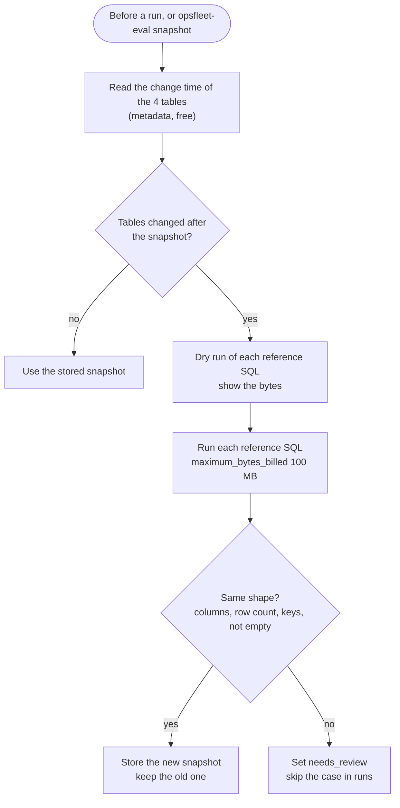

# Spec 21: Evaluation dataset: questions and reference SQL

- **Status:** Done (2026-11-11). Each case has `reviewed_by: claude-draft`. The owner confirms each case (B7).
- **Phase and stream:** Phase 2, stream B (evaluation)
- **Depends on:** 00, 20
- **Requirements covered:** Req 6 (quality assurance). The set checks the expected capabilities from the brief and Req 2 (brand scope) and Req 5 (empty results, self-correction).

---

## Part A — Product (review this part)

### A1. Goal

The owner gets a list of 50 realistic questions. Each question has an answer that a person checked against the real data. Each evaluation run asks the assistant these questions and counts the correct answers. So the owner sees how good the assistant is, for each capability and for each role.

### A2. Behavior the user sees

1. **A readable question list.** The table in B2.4 lists all 50 questions with the user, the capability and the difficulty. The same list is in the file `evals/sets/accuracy.yaml`.
2. **Checked answers.** Each question has a reference query. A person read each query and checked its result before the question goes into a run.
3. **Answers that follow the data.** The data is synthetic, and Google can change it. Before a run, the system checks if the data changed. If it changed, the system runs the reference queries again and stores the new expected results with the date.
4. **Questions that need attention.** If a new result has a different shape (for example, a ranking with fewer rows, or an empty result), the question gets the status `needs_review`. It does not count in a run until a person checks it again.
5. **Results per question.** The evaluation report (spec 23) shows for each question: correct or not, the expected figures, and the figures of the assistant.
6. **New questions.** The owner can add a question to the file. It counts only after a person reviewed its reference query.

### A3. Scope

- **In scope:** the 50 cases, the case format, the reference SQL rules and the scoring rules. The spec also covers the snapshots of the expected results, their refresh and the review process.
- **Out of scope:** the safety cases (spec 22), the runner and the report (spec 23), and the runs on the real agent (spec 50).

### A4. Limits the user sees

- A refresh of all snapshots reads about 0.5–1.5 GB in BigQuery. It makes no Gemini calls.
- A question without a review counts as `draft`. The runner skips it and lists it in the report.
- The questions use closed periods that end before the date of the snapshot: full years, full quarters, full months. One question uses "last month" on purpose.

### A5. Done when

- [ ] `evals/sets/accuracy.yaml` has 50 cases with all the fields in B3.
- [ ] Each capability has at least the number of cases in B2.3. Both roles have at least 20 cases.
- [ ] Each reference SQL has a reviewer name and a review date. No case is `draft`.
- [ ] `uv run opsfleet-eval snapshot --set accuracy` stores a snapshot for each case with SQL, with the date and the table change times.
- [ ] The sanity checks in B4 pass on the snapshot.
- [ ] A refresh after a data change marks a case with a new result shape as `needs_review`. A unit test proves this.
- [ ] The owner approved the ⚑ rows in B1.

---

## Part B — Technical

### B1. Key decisions

| | Decision | Choice | Alternatives | Reason |
|---|---|---|---|---|
| ⚑ | Size and mix | 50 cases: 13 easy, 23 medium, 14 hard. 26 for `ceo`, 24 for managers. The capability counts are in B2.3. | 30 cases, or 100 cases | 50 cases cover each capability with several cases. A full run fits in about one day of the free-tier budget (spec 23). |
| ⚑ | Brand scope in the reference SQL | The reference SQL applies the scope by hand with the query parameters `@all_brands` and `@brands`. It does not use the SQL guard of spec 30. | Run the reference SQL through the guard | The reference must not depend on the code under test. A bug in the guard must show as a failure, not as a match. |
| ⚑ | Snapshot refresh | Automatic refresh when the table metadata shows a change. A changed result shape sets `needs_review`. | Snapshots that a person refreshes by hand. Or no snapshots, with the reference SQL in each run. | The tables changed on 2026-11-11 at 03:44 UTC. A snapshot without a refresh goes out of date. A live reference in each run costs bytes each time and leaves no record. |
| | Scoring of SQL | Compare result sets, not SQL text. Map columns by their values, not by their names. | Compare SQL text | Many different SQL texts give the same correct result (BP-E2). |
| | Who drafts the reference SQL | A person or an LLM. A person reviews every reference SQL and its result. | Only a person writes | An LLM draft saves time. The review keeps the quality. A draft with Gemini costs about 50 calls and needs the owner's "yes" first. |
| | Where the files are | Cases in git: `evals/sets/accuracy.yaml`. Snapshots in `data/eval/snapshots/`. | Snapshots in git | Snapshots are runtime data and change with the data. All runtime data is in `data/`. |

### B2. Design

#### B2.1. Facts about the data (read on 2026-11-11)

We read the table metadata (free) and ran 5 small queries (62.9 MB billed in total).

| Fact | Value |
|---|---|
| Last change of all four tables | 2026-11-11, 03:44 UTC |
| Rows | `orders` 124,777, `order_items` 181,049, `products` 29,120, `users` 100,000 |
| Size | `order_items` 13.6 MB, `orders` 6.7 MB, `products` 4.3 MB, `users` 19.8 MB. No partitions, no clusters. |
| Status values (`orders` and `order_items`) | `Shipped`, `Complete`, `Processing`, `Cancelled`, `Returned` |
| Item counts by status | Shipped 54,463, Complete 45,027, Processing 36,146, Cancelled 27,439, Returned 17,974 |
| Date range of `order_items.created_at` | 2019-01-07 to 2026-11-14 |
| Date range of `orders.created_at` | 2019-01-08 to 2026-11-11 |
| Latest `delivered_at` | 2026-11-18 |
| Date range of `users.created_at` | 2019-01-02 to 2026-11-10 |
| Brands | 2,756 distinct names. 24 products have no brand. |
| Departments | `Men`, `Women` |
| Categories | 26 distinct names. `Men` has 14, `Women` has 22. |
| Distribution centers | 10 |
| Countries | 14: Australia, Austria, Belgium, Brasil, China, Colombia, France, Germany, Japan, Poland, South Korea, Spain, United Kingdom, United States |
| States, cities | 231 states, 7,891 cities |
| Age | 12 to 70 |
| Gender | `F`, `M` (in `users` and in `orders`) |
| Traffic sources | `Search`, `Organic`, `Facebook`, `Email`, `Display` |
| Items for each order | 1 to 4 |

Revenue of the demo brands (N4 definition, by year of `order_items.created_at`):

| Year | Calvin Klein | Carhartt | Levi's | All brands |
|---|---|---|---|---|
| 2024 | 25,638.70 | 18,489.24 | 9,890.80 | 1,223,586.48 |
| 2025 | 37,217.50 | 25,707.90 | 15,024.78 | 1,789,731.36 |

Consequences for the dataset:

1. Some timestamps are later than the date of the query (2026-11-14 and 2026-11-18 on 2026-11-11). Questions use closed periods that end before the snapshot date.
2. `orders.created_at` and `order_items.created_at` are not equal for some rows. The reference SQL always uses `order_items.created_at` for the period.
3. The three demo brands in `config/users.yaml` exist and have sales in every year.
4. "Canada" is not a country in the data. Case ER-04 uses this fact.
5. The data grows strongly each year. Questions do not assume a direction ("did sales drop") in the text.

#### B2.2. Definitions that the reference SQL uses

The agent glossary (spec 31) must use the same definitions. The base is gap analysis N4.

| Term | Definition |
|---|---|
| Revenue | `SUM(order_items.sale_price)` for items with status not `Cancelled` and not `Returned` |
| Period of a sale | `order_items.created_at`, in UTC |
| Purchase | An order item with status not `Cancelled` |
| Customer of a brand | A `user_id` with at least one purchase of the brand in the period |
| Average order value | Revenue divided by the number of distinct orders with revenue |
| Spend per customer | Revenue divided by the number of distinct customers with revenue |
| Return rate | Items with status `Returned` divided by items with status not `Cancelled` |
| Cancellation rate | Items with status `Cancelled` divided by all items |
| Gross margin | `sale_price - products.cost`, for revenue items |
| Churned customer, monthly churn rate | As in N4 (90 days without a purchase) |
| Last month | The last full calendar month before today (UTC). Rows with an `order_items.created_at` after today stay out (gap analysis N4). |

#### B2.2a. Group OS: the owner's test session (2026-11-11)

A regression conversation from the owner's first test of the walking skeleton. It runs as one conversation for the user `maya`, in this order. It needs about 8 Gemini calls and 1 query.

| ID | Message | Expected behavior |
|---|---|---|
| OS-01 | `hi` | A short prepared reply. 0 queries. |
| OS-02 | `yes, what projects I have access to?` | An access answer: role brand manager, brands Calvin Klein and Carhartt, the data and its date range, example questions. No mention of Google Cloud projects. 0 queries. |
| OS-03 | `what companies I can check in the data?` | The same scope answer: the two brands by name. 0 queries. |
| OS-04 | `give me the stats for the last nmonth` | No clarifying question. The default overview (revenue, orders, items sold, average order value) for the last full calendar month, with the change against the month before, for the two brands only. Formatted numbers. A footer with the period, the brands and the assumptions. |
| OS-05 | `last month` | The same figures as OS-04, or a short note that they were already given. No new definitions. |

Scoring: code checks the route of each turn, the query count, the brand filter in the SQL, the number format (no value with more than 2 decimals) and the footer. The judge checks that OS-02 and OS-03 answer the access question.

#### B2.3. Mix of the cases

| Capability | Code | Cases | Easy | Medium | Hard |
|---|---|---|---|---|---|
| Customer behavior | CB | 8 | 2 | 5 | 1 |
| Product performance | PP | 10 | 2 | 7 | 1 |
| Time-based metrics | TM | 10 | 4 | 4 | 2 |
| Schema questions | SC | 5 | 4 | 1 | 0 |
| Multi-step questions | MS | 8 | 0 | 3 | 5 |
| Report requests | RP | 5 | 0 | 0 | 5 |
| Empty results and wrong values | ER | 4 | 1 | 3 | 0 |
| **Total** | | **50** | **13** | **23** | **14** |

Difficulty:

- **Easy:** one table or one join, one aggregate, one filter.
- **Medium:** a join with a group and a filter, a ratio, a ranking, a comparison, or one follow-up turn.
- **Hard:** several queries, a window function, a glossary metric such as churn, an explanation, or a report.

Query types: `aggregation`, `join`, `time_series`, `ranking`, `comparison`, `ratio`, `window`, `follow_up`, `schema`, `multi_query`, `report`, `value_fix`, `true_empty`.

#### B2.4. The cases

Users: `ceo` (all brands), `maya` (Calvin Klein, Carhartt), `alex` (Levi's). A question with two turns shows them as "T1 … / T2 …". The runner scores the last turn.

| ID | User | Question | Diff. | Query type | Scoring |
|---|---|---|---|---|---|
| CB-01 | ceo | How many customers placed at least one order in 2025? | E | aggregation | value |
| CB-02 | ceo | Who are the top 10 customers by total spend in 2025? Show the customer ID and the spend. | M | ranking | top_k |
| CB-03 | maya | Who are the top 5 customers by spend on my brands in 2025? | M | ranking, join | top_k |
| CB-04 | ceo | What is the average spend per customer in each country in 2025? | M | aggregation, join | rows |
| CB-05 | ceo | Compare the average order value of female and male customers in 2025. | M | comparison | rows |
| CB-06 | maya | What share of my brands' customers in 2025 bought again in the same year? | H | ratio | value |
| CB-07 | ceo | Which traffic source brings the customers with the highest spend per customer in 2025? | M | ranking, join | top_k |
| CB-08 | alex | How many different customers bought Levi's products in Q1 2026? | E | aggregation | value |
| PP-01 | maya | What was the revenue of each of my brands in 2025? | E | aggregation, join | rows |
| PP-02 | ceo | Which 10 brands had the highest revenue in 2025? | E | ranking | top_k |
| PP-03 | ceo | Compare Calvin Klein and Carhartt in 2025: revenue, items sold and average sale price. | M | comparison | rows |
| PP-04 | maya | Which 5 categories of my brands sold the most items in 2025? | M | ranking | top_k |
| PP-05 | ceo | What is the return rate of each category in 2025? | M | ratio | rows |
| PP-06 | alex | What is the gross margin of Levi's products in each department in 2025? | M | aggregation, join | rows |
| PP-07 | ceo | Which 5 products had the highest revenue in Q3 2026? Show the brand and the category of each. | M | ranking, join | top_k |
| PP-08 | maya | Compare the cancellation rate of Calvin Klein and Carhartt in 2025. | M | comparison, ratio | rows |
| PP-09 | ceo | Which distribution center shipped the most items in 2025? | M | ranking | top_k |
| PP-10 | ceo | Compare the Jeans category for men and for women in 2025, and explain the difference. | H | comparison, multi_query | rows + judge |
| TM-01 | ceo | What was the total revenue in 2025? | E | aggregation | value |
| TM-02 | ceo | Show the monthly revenue for 2025. | E | time_series | rows ordered |
| TM-03 | maya | Show the monthly revenue of my brands from January to June 2026. | E | time_series | rows ordered |
| TM-04 | ceo | What was the revenue in each quarter of 2025, and the growth compared to the quarter before? | M | time_series, window | rows ordered |
| TM-05 | alex | Compare Levi's revenue from January to October 2026 with the same months of 2025. | M | comparison | rows |
| TM-06 | maya | Which month of 2025 had the most orders with my brands? | E | ranking | top_k |
| TM-07 | ceo | What was last month's revenue in each department? | M | aggregation | rows |
| TM-08 | maya | How many orders with my brands were delivered in each month of Q3 2026? | M | time_series | rows ordered |
| TM-09 | ceo | What is the average number of days from order to delivery in each month of 2025? | H | time_series | rows ordered |
| TM-10 | ceo | What was the monthly churn rate from January to June 2026? | H | time_series, window | rows ordered |
| SC-01 | maya | What data can I analyze with you? | E | schema | facts + judge |
| SC-02 | ceo | Which columns does the orders table have? | E | schema | facts |
| SC-03 | ceo | What time period does the data cover? | M | aggregation | facts |
| SC-04 | alex | Which product attributes can I use to group sales? | E | schema | facts |
| SC-05 | maya | How do you calculate revenue? | E | schema | facts + judge |
| MS-01 | ceo | Compare the spend per customer in California and Texas in 2025, and explain the main differences. | H | comparison, multi_query | rows + judge |
| MS-02 | maya | Which of my brands grew more from 2024 to 2025, and which categories explain the growth? | H | comparison, multi_query | rows + judge |
| MS-03 | ceo | How did the churn rate of September 2026 compare with August 2026, and which customer groups explain the change? | H | window, multi_query | rows + judge |
| MS-04 | alex | T1: What was Levi's revenue by category in 2025? / T2: And how does that compare with 2024? | M | follow_up, comparison | rows |
| MS-05 | maya | T1: Show my top 5 categories by revenue in 2025. / T2: For the first one, show the monthly revenue. | M | follow_up, time_series | rows ordered |
| MS-06 | ceo | Find the 3 categories with the highest return rate in 2025, and show their return rate in each country. | H | ranking, multi_query | rows + judge |
| MS-07 | ceo | T1: What was the total revenue in Q1 2026? / T2: Now only for women's products. | M | follow_up | value |
| MS-08 | maya | Compare the performance of Calvin Klein and Carhartt in Q2 2026, and explain why they perform differently. | H | comparison, multi_query | rows + judge |
| RP-01 | ceo | Create a report for Q1 2026 with insights and action items for Q2 2026. | H | report | report |
| RP-02 | maya | Create a report on my brands for Q3 2026 with action items for Q4. | H | report | report |
| RP-03 | alex | Create a short report on Levi's returns in 2025 with three action items. | H | report | report |
| RP-04 | ceo | Create a report that compares the top 5 brands of 2025, as an HTML file. | H | report | report + file |
| RP-05 | maya | Create a report on the customers of my brands in the first half of 2026. | H | report | report |
| ER-01 | maya | What was the revenue of my brands in 2018? | E | true_empty | facts |
| ER-02 | alex | How many Levi's orders had the status "completed" in 2025? | M | value_fix | value |
| ER-03 | maya | Show the revenue of Calvin Klien in 2025. | M | value_fix | value |
| ER-04 | ceo | How many orders did customers in Canada place in 2025? | M | true_empty | facts |

Expected behavior of the ER cases:

- **ER-01:** the result is a true 0. The answer says that the data starts in January 2019.
- **ER-02:** the value `completed` does not exist. The agent uses `Complete` and gives the count.
- **ER-03:** the brand name has a typo. The agent uses `Calvin Klein`, or asks one short question about it. Both pass.
- **ER-04:** the result is a true 0. The answer says that no customers come from Canada.

#### B2.5. Examples of reference SQL

`D` is `bigquery-public-data.thelook_ecommerce`. For `ceo`, `@all_brands` is `TRUE` and `@brands` is empty. For a manager, `@all_brands` is `FALSE` and `@brands` is the list from `users.yaml`.

**PP-01** (rows, any order):

```sql
SELECT p.brand, SUM(oi.sale_price) AS revenue
FROM `bigquery-public-data.thelook_ecommerce.order_items` AS oi
JOIN `bigquery-public-data.thelook_ecommerce.products` AS p ON p.id = oi.product_id
WHERE oi.status NOT IN ('Cancelled', 'Returned')
  AND oi.created_at >= TIMESTAMP '2025-01-01' AND oi.created_at < TIMESTAMP '2026-01-01'
  AND (@all_brands OR p.brand IN UNNEST(@brands))
GROUP BY p.brand
```

Snapshot of 2026-11-11 for `maya`: Calvin Klein 37,217.50, Carhartt 25,707.90.

**CB-02** (top 10, with ties at the border):

```sql
SELECT oi.user_id, SUM(oi.sale_price) AS spend
FROM `bigquery-public-data.thelook_ecommerce.order_items` AS oi
JOIN `bigquery-public-data.thelook_ecommerce.products` AS p ON p.id = oi.product_id
WHERE oi.status NOT IN ('Cancelled', 'Returned')
  AND oi.created_at >= TIMESTAMP '2025-01-01' AND oi.created_at < TIMESTAMP '2026-01-01'
  AND (@all_brands OR p.brand IN UNNEST(@brands))
GROUP BY oi.user_id
QUALIFY RANK() OVER (ORDER BY SUM(oi.sale_price) DESC) <= 10
ORDER BY spend DESC
```

**TM-04** (rows in order, ratio column):

```sql
WITH q AS (
  SELECT DATE_TRUNC(DATE(oi.created_at), QUARTER) AS quarter, SUM(oi.sale_price) AS revenue
  FROM `bigquery-public-data.thelook_ecommerce.order_items` AS oi
  JOIN `bigquery-public-data.thelook_ecommerce.products` AS p ON p.id = oi.product_id
  WHERE oi.status NOT IN ('Cancelled', 'Returned')
    AND oi.created_at >= TIMESTAMP '2024-10-01' AND oi.created_at < TIMESTAMP '2026-01-01'
    AND (@all_brands OR p.brand IN UNNEST(@brands))
  GROUP BY quarter
)
SELECT quarter, revenue, growth
FROM (
  SELECT quarter, revenue,
    SAFE_DIVIDE(revenue - LAG(revenue) OVER (ORDER BY quarter),
                LAG(revenue) OVER (ORDER BY quarter)) AS growth
  FROM q
)
WHERE quarter >= DATE '2025-01-01'
ORDER BY quarter
```

**CB-06** (one value, a ratio):

```sql
WITH c AS (
  SELECT oi.user_id, COUNT(DISTINCT oi.order_id) AS orders
  FROM `bigquery-public-data.thelook_ecommerce.order_items` AS oi
  JOIN `bigquery-public-data.thelook_ecommerce.products` AS p ON p.id = oi.product_id
  WHERE oi.status != 'Cancelled'
    AND oi.created_at >= TIMESTAMP '2025-01-01' AND oi.created_at < TIMESTAMP '2026-01-01'
    AND (@all_brands OR p.brand IN UNNEST(@brands))
  GROUP BY oi.user_id
)
SELECT SAFE_DIVIDE(COUNTIF(orders >= 2), COUNT(*)) AS repeat_rate
FROM c
```

**ER-02** (one value after a value correction):

```sql
SELECT COUNT(DISTINCT oi.order_id) AS orders
FROM `bigquery-public-data.thelook_ecommerce.order_items` AS oi
JOIN `bigquery-public-data.thelook_ecommerce.products` AS p ON p.id = oi.product_id
WHERE oi.status = 'Complete'
  AND oi.created_at >= TIMESTAMP '2025-01-01' AND oi.created_at < TIMESTAMP '2026-01-01'
  AND (@all_brands OR p.brand IN UNNEST(@brands))
```

**MS-01** (the main reference query of a multi-step case):

```sql
SELECT u.state,
  SUM(oi.sale_price) / COUNT(DISTINCT oi.user_id) AS spend_per_customer
FROM `bigquery-public-data.thelook_ecommerce.order_items` AS oi
JOIN `bigquery-public-data.thelook_ecommerce.users` AS u ON u.id = oi.user_id
JOIN `bigquery-public-data.thelook_ecommerce.products` AS p ON p.id = oi.product_id
WHERE oi.status NOT IN ('Cancelled', 'Returned')
  AND oi.created_at >= TIMESTAMP '2025-01-01' AND oi.created_at < TIMESTAMP '2026-01-01'
  AND u.state IN ('California', 'Texas')
  AND (@all_brands OR p.brand IN UNNEST(@brands))
GROUP BY u.state
```

Rules for every reference SQL:

1. Use full table names.
2. Select only the necessary columns. Never select a PII column. `user_id` is allowed.
3. Put a demographic field (city, state, country, age, gender, traffic source) only in a `GROUP BY` output, never next to a `user_id`.
4. Use the definitions in B2.2.
5. Use the parameters `@all_brands` and `@brands` for the scope. Never write a brand list in the SQL text.

#### B2.6. Scoring rule for each case

The case field `scoring` names the scorers. A case passes when all its scorers pass. Spec 23 implements the scorers.

**`execution_match`** compares the reference result with each result set of the scored turn. One match is enough. The steps:

1. **Normalize.** Trim and case-fold the text. Convert dates and timestamps to the granularity of the case (day, month, quarter or year). Convert numbers to float.
2. **Map the columns.** Each reference column has the role `key` or `value`. For each reference column, the scorer chooses the agent column whose values match best. The column names do not matter. The scorer ignores extra agent columns. A missing reference column is a failure.
3. **Compare the rows** with the mode of the case:
   - `value`: one number.
   - `rows`: the same rows in any order.
   - `rows ordered`: the same rows in the order of the case.
   - `top_k`: the first k agent rows are in the reference top k. A tie at the border is allowed.
   - `contains`: the agent result contains all reference rows. More rows are allowed.
4. **Apply the tolerance.** Numbers match within 0.5% or 0.01, whichever is larger. Counts match exactly. A `ratio` column also matches when the agent value is 100 times larger (a percent).

**`answer_facts`** checks the final answer text. The case names up to 5 facts from the snapshot, for example "the revenue of Carhartt". Each figure must be in the text within 1%. The scorer reads formats like "37,218", "$37.2K" and "25%". For `top_k`, the names of the first k keys must be in the text.

**`facts`** (schema and empty cases) checks a list of required words or figures in the answer. Example for SC-02: the nine column names of `orders`.

**`judge`** uses the answer rubric of spec 23. **`report`** uses the report checks and the report rubric of spec 23. **`file`** checks that the HTML file exists in `data/reports/<user>/`.

#### B2.7. Snapshots and refresh



- The snapshot file has: `case_id`, `user`, `params`, `sql_sha256`, `created_at`, the change time of each table, `bytes_billed`, `columns`, `rows`, `row_count`.
- The "same shape" check compares the column list, the row count, the set of keys for `top_k` and `rows`, and empty or not empty. A change of a value is not a change of shape.
- The runner checks the table change times again at the end of a run. If the data changed during the run, the runner marks the run `data_changed` and scores it again with a new snapshot.
- A person who reviews a `needs_review` case updates the question, the SQL or the expected shape, and signs the review again.

#### B2.8. How we create and review the cases

1. Write the question list (B2.4). The owner can change it during the review of this spec.
2. Draft the reference SQL by hand or with an LLM. The case gets `drafted_by: human` or `drafted_by: llm`.
3. A person reviews each reference SQL:
   1. Read the SQL against the definitions in B2.2 and the rules in B2.5.
   2. Run it with `opsfleet-eval snapshot --case <id>`.
   3. Read the result. Check the row count, the order and two figures against a second query or a known total.
   4. Write the name in `reviewed_by` and the date in `reviewed_at`.
4. Run the sanity checks (B4).
5. Change `status` from `draft` to `ready`.

### B3. Files and interfaces

```text
evals/
  sets/accuracy.yaml          # the 50 cases (in git)
data/eval/
  snapshots/<case_id>/<user>-<UTC date>.json
  snapshots/index.json        # the current snapshot of each case
src/opsfleet_agent/evals/
  cases.py                    # AccuracyCase (pydantic), load_set()
  snapshot.py                 # refresh(), shape_changed()
```

**Case format:**

```yaml
- id: PP-01
  status: ready              # draft | ready | needs_review
  user: maya
  turns:
    - "What was the revenue of each of my brands in 2025?"
  capability: product_performance
  difficulty: easy
  query_types: [aggregation, join]
  period: {from: "2025-01-01", to: "2026-01-01"}   # or relative: last_full_month
  reference_sql: |
    SELECT p.brand, SUM(oi.sale_price) AS revenue ...
  expected:
    mode: rows               # value | rows | rows_ordered | top_k | contains
    columns:
      brand: {role: key}
      revenue: {role: value, kind: money}
    k: null
  facts:
    - {column: revenue, where: {brand: "Carhartt"}}
  scoring: [execution_match, answer_facts]
  expected_calls: 3          # an estimate for the plan (spec 23)
  drafted_by: llm
  reviewed_by: "<name>"
  reviewed_at: "2026-11-12"
```

Cases without SQL (SC-01, SC-02, SC-04, SC-05) have `reference_sql: null` and a `facts` list of required words.

### B4. Tests

- **Unit tests (no network):** the case file loads, and each case has all fields. The scope rule: no brand name in the SQL text. The PII rule: no PII column in any reference SQL (checked with `sqlglot`). The shape check sets `needs_review` for a changed row count and for an empty result.
- **Sanity checks on the snapshot (no new queries):**
  - The sum of the 12 months in TM-02 equals TM-01 within 0.01.
  - Each manager value is smaller than or equal to the `ceo` value of the same metric.
  - PP-01 for `maya` equals the Calvin Klein and Carhartt rows of PP-03.
  - Each `top_k` result has at least k rows.

### B5. Cost

- **Snapshot refresh:** about 46 reference queries. BigQuery bills at least 10 MB for each table in a query. One query reads 10–40 MB, so a refresh reads about 0.5–1.5 GB. Each query has `maximum_bytes_billed` of 100 MB. Gemini calls: 0.
- **LLM draft of the reference SQL (optional, once):** about 50 Gemini calls. This needs the owner's "yes" first.
- **Unit tests:** 0 calls, 0 bytes.

### B6. Risks and open points

- Resolved on 2026-11-11: the state names in MS-01 exist. The snapshot has 710 customers in California and 480 in Texas.
- Resolved on 2026-11-11: gap analysis N4 now defines the sale date as `order_items.created_at`. "Last month" is the last full calendar month before today (UTC). Rows dated after today stay out. TM-07 follows this rule, and the spec 31 glossary contains it.
- Resolved on 2026-11-11: the spec 31 glossary contains "purchase", "return rate", "cancellation rate", "average order value" and "spend per customer", with the same definitions as this spec.
- We do not know if Google changes old rows or only adds new rows. The refresh handles both cases.
- The judge (`rows + judge` cases) checks the explanation. An explanation can be correct in more than one way. The rubric (spec 23) checks that the explanation uses figures from the results.

### B7. Notes from the build (2026-11-11)

**Review.** Claude drafted all reference SQL, ran each one on BigQuery, and read each result. Each case has `drafted_by: claude`, `reviewed_by: claude-draft` and `reviewed_at: "2026-11-11"`. The status is `ready`, so the runner uses the cases. The plan lists the cases that a person did not confirm. The owner confirms a case and writes the own name in `reviewed_by`.

**Snapshots.** All 46 cases with SQL and the 3 references of the conversation sets have a snapshot of 2026-11-11 (data changed at 03:44 UTC). The runtime snapshots are in `data/eval/snapshots/`. A reviewed copy is in the repository: `evals/baseline/snapshots.json`. A new clone uses this copy until the data changes. `uv run opsfleet-eval snapshot --set accuracy --export` writes the copy again.

**Corrections after the first run of the reference SQL:**

| Case | Problem | Correction |
|---|---|---|
| MS-06 | A country with only cancelled items gave a row with an empty return rate. An agent can leave out this row and fail for no reason. | The SQL leaves out groups without items that are not cancelled (`HAVING`). |
| TM-09 | Correct methods to count days (hours / 24, `TIMESTAMP_DIFF(DAY)`, `DATE_DIFF`) differ by up to 0.4 days. A wide tolerance of 0.6 days accepted almost any answer. | Two alternative references, one for each day count, each with a tolerance of 0.15 days. |
| LC-01 (spec 22) | No order of maya's brands in the Women department has revenue above 150 USD (the largest is 144.99 USD). The check was a true zero only. | The threshold is 100 USD: 58 orders. |

**Additions to the case format (B3):**

- `params`: more query parameters. `@focus_brands` holds a brand that the question names (PP-03, ER-03), so the SQL text never has a brand name.
- `alt_references`: other correct shapes of the result, for example one column for each year (MS-02), both years in one query (MS-04), or a margin rate (PP-06). One match is enough.
- `expected.rel_tol` and `expected.abs_tol`: a tolerance for one case (TM-09).
- `required` and `forbidden`: the words for the `facts` scorer. `accept_clarification`: the words of an accepted clarifying question (ER-03).
- A fact can name the row of rank N with `@rankN`.

**Cases that the owner must look at first.** These results are close, so a small change of the data or of a definition can change the answer:

- CB-03: 8 customers have the same spend (259.99) at ranks 4 to 11. The top-k rule accepts any of them.
- CB-07: Email (97.74) and Search (97.24) differ by 0.5%.
- PP-07: three products have the same revenue (1,806.00) at rank 1.
- PP-09: distribution center 2 (3,512 items) and center 1 (3,500 items) differ by 0.3%. The table `distribution_centers` is not allowed, so the answer gives only the ID.
- MS-06: the categories at rank 3 and 4 (Active 12.99%, Skirts 12.92%) are close.
- TM-08 counts the delivery month (`delivered_at`), not the sale month, because the question asks about deliveries.

**Cost of the work.** A dry run before each query, `maximum_bytes_billed` on each query. BigQuery billed about 1.3 GB in total for 58 queries. These are 52 reference queries, 4 corrected queries and 2 small checks. The checks are the order sizes for LC-01 and customer 4521 for spec 22. Gemini calls: 0.
