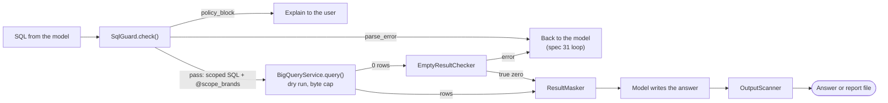

# Spec 30: Query safety

- **Status:** Done (2026-11-11). Implementation notes and deviations are in B7.
- **Phase and stream:** Phase 2, stream C (first part of the stream)
- **Depends on:** 00, 01
- **Requirements covered:** Req 2 (safety, PII masking, brand scope). Part of Req 5 (empty-result checks).

---

## Part A — Product (review this part)

### A1. Goal

Each user sees only the data of their own brands, and no person ever sees personal customer data. Code enforces these rules before and after each query, so a wrong model answer or a malicious message cannot break them. When a query returns no rows, the assistant finds out if the data is really empty or if the query has an error.

### A2. Behavior the user sees

1. **Brand scope.** Maya manages "Calvin Klein" and "Carhartt". She asks "What was our revenue last quarter?". The figures include only these two brands. The answer names the brands.
2. **Another brand.** Maya asks "How did Nike sell last month?". The assistant answers: "Nike is outside your brands. Your brands are Calvin Klein and Carhartt." No query runs for Nike.
3. **Close brand names.** "Calvin Klein" and "Calvin Klein Jeans" are different brands. Maya sees only "Calvin Klein", because only this exact name is in her list.
4. **Personal data.** Maya asks for the email addresses of the top 10 customers. The assistant refuses and offers the customer IDs with their total spend.
5. **One customer with a location or age.** Maya asks "List the top customers in California". The assistant refuses to list single customers together with a state, city, country, age, gender or traffic source. It offers totals by state, or the top customers without the state.
6. **Totals by group are allowed.** "Average spend per customer by state" works. The answer shows one row for each state, not one row for each customer.
7. **Write attempts.** "Drop the users table" or "update the prices" gets the answer "I can only read data." Nothing runs in BigQuery.
8. **Customers of a manager.** Maya asks "How many new customers signed up in March?". The answer counts only customers who bought one of her brands, and the answer says so. Only the CEO sees statistics of all customers.
9. **Wrong filter value.** The model writes `status = 'completed'`, but the data uses `'Complete'`. The assistant finds this, corrects the query and answers. The user sees only the correct answer.
10. **A true zero.** Maya asks about sales in 2015. The assistant answers that the data starts on a later date, and gives the date range of the data.
11. **Brands in the user file.** A developer writes "Levis" in `config/users.yaml`. The start stops with: "Brand 'Levis' for user 'alex' does not exist in the data. Close names: Levi's."
12. **Last safety net.** Sometimes an answer or a report file contains text that looks like an email address, a phone number or a street address. The assistant removes this text. The user sees `[removed]` and one note about it.

### A3. Scope

- **In scope:**
  - the full SQL guard and the brand-scope rewrite,
  - the PII and demographic rules,
  - the result masker, and the output scanner for answers and report files,
  - the empty-result checks,
  - the check of brand names in `users.yaml`.
- **Out of scope:**
  - the wording of the final refusal (spec 31 writes it from the guard result),
  - the retry loop (spec 31),
  - the dry run and the byte cap (the spec 00 wrapper),
  - the hiding of small groups below 5 customers (design only),
  - the `events` table.

### A4. Limits the user sees

| Situation | Message |
|---|---|
| A write, a script or a system table | "I can only read the sales data. I cannot change it." |
| A personal data field | "I cannot show or use personal data such as names, email addresses, street addresses, postal codes or exact locations. I can show customer IDs and totals." |
| A single customer with a location, age, gender or traffic source | "I cannot show a single customer together with the city, state, country, age, gender or traffic source. I can show totals by these fields, or customers without them." |
| A brand outside the user's list | "<Brand> is outside your brands. Your brands are <list>." |
| Empty result, true zero | The answer says "No data for …", and gives the filters and the date range that it used. |
| Text removed by the output scanner | "Some text was removed because it looked like personal data." |

The empty-result checks run at most 5 small queries for one empty result. Usually they run 0 to 2 queries.

### A5. Done when

- [ ] A manager's query never returns rows of a brand outside the manager's list. A live test with two managers proves it.
- [ ] Every SQL case in B4 gives the expected outcome in a unit test.
- [ ] A query with a PII column never runs, in any position (output, filter, join, subquery, CTE).
- [ ] A query that pairs a single customer with a demographic field never runs.
- [ ] The result masker removes PII columns and PII-like values before the model gets the rows. A unit test with a planted email proves it.
- [ ] The output scanner removes email, phone, street address and coordinate patterns from the final text and from report files.
- [ ] A wrong filter value goes back to the model as an error, with the existing values.
- [ ] A date filter outside the data range gives a true-zero answer with the date range of the data.
- [ ] The empty-result checks never run more than 5 queries, and they respect the turn budget of spec 00.
- [ ] A wrong brand name in `users.yaml` stops the start of that user, with close names in the message.
- [ ] Each guard decision writes one `guard` span with the outcome and the reason code.

---

## Part B — Technical

### B1. Key decisions

| | Decision | Choice | Alternatives | Reason |
|---|---|---|---|---|
| ⚑ | What counts as "a single customer with a demographic field" | Strict: if the final output has one row for each customer, the query cannot use a demographic field anywhere. This includes `WHERE state = 'California'`. | Block only demographic columns in the output | A filter shows the state of each listed customer as clearly as a column. |
| ⚑ | Retry after a policy block | No retry. The assistant explains the block to the user and stops. Only correctable errors go back to the model. | Let the model try a query without the forbidden part | The request itself is forbidden. A retry costs calls, and the model can answer a different question than the user asked. |
| ⚑ | Output scanner action | Remove the matching text, add one note, and log the hit. The answer or the file still appears. | Refuse the whole answer or file | Earlier layers keep PII out, so a hit is almost always a false positive, for example a number in a phone format. A removal is safe in both cases. |
| | Parser | `sqlglot`, BigQuery dialect | Regular expressions | Only a parser can see aliases, subqueries and CTEs. |
| | Brand scope | Rewrite each table reference to a code-made, scoped subquery. Brand names go in as the array parameter `@scope_brands`. | A filter that the model writes | Code enforces the scope. A parameter handles apostrophes ("Levi's"). |
| | `users` table | Always replaced by a subquery without PII columns, for all roles | Rely only on the column check | Defense in depth: PII columns do not exist in the source that the query reads. |
| | `orders` for managers | Only orders that contain an order item of the manager's brands. `num_of_item` is not available. | Full orders | From gap analysis B2: order-level fields mix brands. |
| | Filter values and date range | From a local cache (`data/value_cache.json`), refreshed every day (changed on 2026-11-12, see B7a) | A query for each check | Most empty-result checks then need no query. |
| | Brand names in `users.yaml` | Exact match, character by character, against the brand list in the cache | Case-insensitive match | 2,756 named brands with close variants. An exact name is the only safe key. |

### B2. Design

#### B2.1 Where the parts run



#### B2.2 Guard steps

`SqlGuard.check(sql)` runs these steps in this order. The first failed step gives the result.

1. **Size.** SQL text over 20,000 characters: `parse_error`, reason `too_long`.
2. **Parse.** `sqlglot.parse(sql, read="bigquery")`. A parse error gives `parse_error`, reason `syntax`, with the parser message.
3. **Statement type.** Any node of a write, DDL, DCL or script type gives `policy_block`, reason `not_select`. Examples: `Insert`, `Update`, `Delete`, `Merge`, `Create`, `Drop`, `Alter`, `TruncateTable`, `Grant`, and `Command`. sqlglot parses `EXECUTE IMMEDIATE`, `DECLARE`, `SET`, `CALL`, `EXPORT DATA` and `BEGIN` as `Command` or as their own types. The guard blocks all of them.
4. **One statement.** More than one statement, all of them `SELECT`: `parse_error`, reason `multi_statement`.
5. **Root.** The root must be `Select`, or a set operation (`Union`, `Intersect`, `Except`) of selects, with an optional `WITH`.
6. **Forbidden constructs** (`policy_block`, reason `forbidden_construct`):
   - query parameters (`@name`, `?`) and system variables (`@@project_id`),
   - table-valued functions in `FROM` (`EXTERNAL_QUERY`, `APPENDS`, `CHANGES`, `ML.*`, `AI.*`, `VECTOR_SEARCH`),
   - the functions `SESSION_USER`, `EXTERNAL_QUERY`, and names that start with `ML.`, `AI.`, `KEYS.` or `AEAD.`,
   - `FOR SYSTEM_TIME AS OF`.
7. **Tables.** Each `Table` node that is not a CTE name must resolve to `bigquery-public-data.thelook_ecommerce.<t>`, with `<t>` in `orders`, `order_items`, `products`, `users`. The short forms `thelook_ecommerce.<t>` and `<t>` are accepted. Quote styles and letter case do not matter.
   - `INFORMATION_SCHEMA`, any name with `*` (wildcard table), and any other project or dataset: `policy_block`, reason `table_not_allowed`.
   - Another table name in the same dataset (for example `events`, `inventory_items`): `policy_block`, reason `table_not_allowed`.
8. **CTE names.** A CTE with the name of one of the four tables: `parse_error`, reason `cte_shadows_table`.
9. **`UNNEST`.** `UNNEST` with a subquery inside: `parse_error`, reason `unnest_subquery`. `UNNEST` of a literal array or of `GENERATE_DATE_ARRAY(...)` is accepted.
10. **Star.** `SELECT *` or `t.*` in any projection: `parse_error`, reason `star_select`. `COUNT(*)` is accepted.
11. **PII columns.** Any `Column` or `Identifier` with one of these names, in any position: `policy_block`, reason `pii_column`. Names: `first_name`, `last_name`, `email`, `street_address`, `postal_code`, `latitude`, `longitude`, `user_geom`. The check normalizes quotes and letter case. It also covers struct access (`u.email`) and a JSON path in a string literal (`'$.email'`).
12. **Row values.** A column reference that resolves to a whole table row (for example `TO_JSON_STRING(u)`): `policy_block`, reason `row_value`.
13. **Qualify.** `sqlglot.optimizer.qualify` with the cached schema resolves each column to its table. An unknown column gives `parse_error`, reason `unknown_column`, with the table's column list. If qualify fails for another reason: `parse_error`, reason `unverifiable`, with the feedback "Write a simpler query".
14. **Manager-only columns.** For the `manager` role, a reference to `orders.num_of_item`: `parse_error`, reason `column_not_in_scope`, with the feedback "Count the items from order_items".
15. **Brand literals** (manager role). A literal in `brand = '…'` or `brand IN (…)` that is not in the user's list:
    - The same name with other letter case or spaces is in the list: `parse_error`, reason `brand_name_case`, with the exact name.
    - Otherwise: `policy_block`, reason `brand_out_of_scope`.
16. **Demographic pairing.** See B2.4. Failure: `policy_block`, reason `demographic_pairing`.
17. **Rewrite.** See B2.3.
18. **Check after the rewrite.** The guard parses the rewritten SQL again. Every base table node must be inside a code-made scope subquery. If not: `parse_error`, reason `unverifiable`, and an `internal_error` event in the trace.

The guard never runs a query. It returns a `GuardResult` (B3).

#### B2.3 Brand-scope rewrite

The guard replaces each table reference with a subquery. It keeps the alias. A reference without an alias gets the table name as alias, so `orders.status` still works. Full table names are written in back-quotes.

| Table | `manager` | `ceo` |
|---|---|---|
| `order_items` | Items of products with `p.brand IN UNNEST(@scope_brands)` | Unchanged |
| `products` | Rows with `brand IN UNNEST(@scope_brands)` | Unchanged |
| `orders` | Orders with at least one scoped order item. Columns without `num_of_item`. | Unchanged |
| `users` | Customers with at least one scoped order item. Columns without PII. | All customers. Columns without PII. |

Example for a manager. The model writes:

```sql
SELECT u.state, SUM(oi.sale_price) AS revenue
FROM `bigquery-public-data.thelook_ecommerce.order_items` oi
JOIN `bigquery-public-data.thelook_ecommerce.users` u ON u.id = oi.user_id
GROUP BY u.state
```

The guard sends this SQL with the parameter `scope_brands = ["Calvin Klein", "Carhartt"]`:

```sql
SELECT u.state, SUM(oi.sale_price) AS revenue
FROM (
  SELECT x.id, x.order_id, x.user_id, x.product_id, x.inventory_item_id, x.status,
         x.created_at, x.shipped_at, x.delivered_at, x.returned_at, x.sale_price
  FROM `bigquery-public-data.thelook_ecommerce.order_items` AS x
  JOIN `bigquery-public-data.thelook_ecommerce.products` AS p ON p.id = x.product_id
  WHERE p.brand IN UNNEST(@scope_brands)
) AS oi
JOIN (
  SELECT x.id, x.age, x.gender, x.state, x.city, x.country, x.traffic_source, x.created_at
  FROM `bigquery-public-data.thelook_ecommerce.users` AS x
  WHERE x.id IN (
    SELECT i.user_id
    FROM `bigquery-public-data.thelook_ecommerce.order_items` AS i
    JOIN `bigquery-public-data.thelook_ecommerce.products` AS p ON p.id = i.product_id
    WHERE p.brand IN UNNEST(@scope_brands))
) AS u ON u.id = oi.user_id
GROUP BY u.state
```

The templates are in `guard/scope_templates.sql`, not in the model prompt. The rewrite also applies inside CTEs, subqueries, `EXISTS`, `IN (SELECT …)` and each branch of a set operation.

#### B2.4 Demographic pairing rule

1. The guard finds the output columns of the final query (each branch of a set operation).
2. With `sqlglot.lineage`, it follows each output column to its source columns.
3. **Customer-level output:** an output column comes from a customer ID column outside `COUNT(...)`, `COUNT(DISTINCT ...)` or `APPROX_COUNT_DISTINCT(...)`. Customer ID columns: `users.id`, `orders.user_id`, `order_items.user_id`. Functions such as `CAST`, `FARM_FINGERPRINT`, `ARRAY_AGG` and `STRING_AGG` keep the ID visible, so they count as customer-level output.
4. **Demographic columns:** `users.city`, `users.state`, `users.country`, `users.age`, `users.gender`, `users.traffic_source`, and `orders.gender`.
5. If the output is customer-level and the query references a demographic column anywhere, the guard blocks it.

Examples: `SELECT user_id, SUM(sale_price) … WHERE state = 'Texas'` is blocked. `SELECT state, COUNT(DISTINCT user_id) … GROUP BY state` passes. A CTE with `user_id, state, spend` and a final `SELECT state, AVG(spend) … GROUP BY state` passes.

#### B2.5 Result masker

`ResultMasker.mask(result, guard_result) -> MaskedResult` runs on every `QueryResult` before any model call.

1. It drops any column with a PII name. A hit means that the guard missed a case. The masker writes a `guard` span with `masker_hit = true` and the type `internal_error`.
2. It drops demographic columns when the rows are customer-level (the same rule as B2.4, on the column names).
3. In text columns, it replaces values that match the email or phone pattern with `[masked]`.
4. It cuts each text value to 200 characters, and keeps at most 200 rows (spec 00).
5. It returns the rows as a table inside a data block. The model prompt treats data blocks as data, not as instructions (spec 31).

`MaskedResult`: `columns`, `rows`, `row_count`, `truncated`, `masked_cells`, `dropped_columns`.

#### B2.6 Output scanner

`OutputScanner.scan(text) -> ScanResult(text, hits)` runs on the final chat answer, on the report body, and on the rendered HTML and Markdown files before the code saves them (spec 32). It also runs on the conversation summary (spec 34).

| Pattern | Example | Rule |
|---|---|---|
| Email | `anna@example.com` | RFC 5322 simple form: local part, `@`, domain with a dot |
| Phone | `+1 (555) 123-4567`, `555-123-4567` | 10 to 15 digits with at least two separators of phone style. Plain numbers such as `1234567890` and amounts such as `1,234,567.89` do not match. |
| Street address | `12 Oak Street`, `400 W 5th Ave` | A house number, 1 to 4 words, and a street word (`Street`, `St`, `Avenue`, `Ave`, `Road`, `Rd`, `Boulevard`, `Blvd`, `Lane`, `Ln`, `Drive`, `Dr`, `Court`, `Ct`, `Way`, `Place`, `Pl`) |
| Coordinates | `40.7128, -74.0060` | Two decimal numbers with 4 or more decimals, in the latitude and longitude ranges |

Each hit becomes `[removed]`. The answer gets the note from A4. The trace gets the pattern names and the count, never the matched text.

#### B2.7 Empty-result checks

`EmptyResultChecker.diagnose(guard_result) -> EmptyDiagnosis` runs when a query returns 0 rows. The guard result gives the filters (column, operator, literal) and the date ranges of the parsed SQL.

| # | Check | Source | Result |
|---|---|---|---|
| 1 | Do the filter values exist? | `value_cache.json` for `orders.status`, `order_items.status`, `orders.gender`, `users.gender`, `products.department`, `products.category`, `products.brand`, `users.traffic_source`, `users.country`. A probe query with `COUNTIF` for other columns, for example `users.city` or `products.name`. | A missing value is an **error**. The feedback lists the existing values (at most 20) or the close values. |
| 2 | Is the date filter inside the data range? | `value_cache.json` (minimum `created_at` of each table). The end of the range is today (UTC), because the data has some dates after today (gap analysis N4). | Outside the range: **true zero**, with the data range |
| 3 | Brand scope (manager) | A probe query: scoped order items in the date range, without other filters | 0 rows: **true zero** for these brands |
| 4 | Which filter empties the result? | One probe query with one `COUNT` subquery for each `WHERE` condition left out (at most 6 conditions) | The note names the filter. A wrong-looking filter (for example a wrong date format) is an **error**. |
| 5 | Join check | In the same probe query: rows of each joined table with its own filters | Each table has rows, but the join has none: **error**, "check the join key" |

Rules:

- Checks 1 and 2 need no query when the cache has the values.
- Checks 3, 4 and 5 run in at most 2 probe queries. The hard maximum is 5 queries for one empty result.
- Code builds each probe query from the parsed SQL. Each probe query goes through the same guard and rewrite. So a probe never reads data outside the scope.
- Each probe query counts in the turn budget (queries and bytes). If the budget has no queries left, the checks stop. The result is then **unknown**, and the answer says that the checks did not run.
- A query with a set operation, a window filter (`QUALIFY`) or more than 6 conditions skips check 4.

`EmptyDiagnosis`: `kind` (`error`, `true_zero`, `unknown`), `finding`, `model_feedback`, `user_note`, `queries_run`.

#### B2.8 Value cache and brand check in `users.yaml`

- `data/value_cache.json` holds the distinct values of the columns in B2.7 check 1, and the date range of each table. One query builds it. It reads only these small columns (about 30 MB billed). The file has a `built_at` date. The code builds it again on each new UTC day (until 2026-11-12: after 7 days), or with `chat --refresh-cache`.
- At the start of `chat`, the code compares each brand of the current user with the brand list in the cache. The match is exact, character by character. The apostrophe `'` and the typographic `’` are different characters.
- A wrong brand stops the start, with up to 3 close names from `difflib.get_close_matches` (cutoff 0.8) and from a case-insensitive comparison.
- Wrong brands of other users give one warning line. They do not stop the start.
- 24 products have no brand (`NULL`). They are never in the scope of a manager. The CEO sees them.

### B3. Files and interfaces

```text
src/opsfleet_agent/guard/
  __init__.py
  sql_guard.py         # SqlGuard, GuardResult, FilterLiteral (replaces guard/minimal.py of spec 01)
  rules.py             # PII_COLUMNS, DEMOGRAPHIC_COLUMNS, CUSTOMER_ID_COLUMNS, ALLOWED_TABLES, reason codes
  scope.py             # rewrite_scope(tree, user) -> tree, params
  scope_templates.sql  # the four subquery templates for each role
  lineage.py           # customer-level output check (B2.4)
  masker.py            # ResultMasker, MaskedResult
  scanner.py           # OutputScanner, ScanResult, the patterns
  empty_result.py      # EmptyResultChecker, EmptyDiagnosis
  value_cache.py       # build_value_cache(), load_value_cache(), validate_brands()
data/value_cache.json  # runtime, git ignores it
```

**Interfaces:**

```python
class GuardOutcome(StrEnum):
    PASS = "pass"
    POLICY_BLOCK = "policy_block"  # ErrorType.guard_policy_block
    PARSE_ERROR = "parse_error"  # ErrorType.guard_parse_error


@dataclass(frozen=True)
class GuardResult:
    outcome: GuardOutcome
    reason_code: str | None  # for example "pii_column"
    sql: str | None  # rewritten SQL, only for PASS
    params: list[bigquery.ArrayQueryParameter]  # scope_brands, only for managers
    user_message: str | None  # only for POLICY_BLOCK (text from A4)
    model_feedback: str | None  # only for PARSE_ERROR
    tables: frozenset[str]
    filters: list[FilterLiteral]  # input for the empty-result checks
    output_columns: list[str]


class SqlGuard:
    def __init__(
        self, user: UserContext, schema: Schema, values: ValueCache
    ) -> None: ...
    def check(self, sql: str) -> GuardResult: ...


def validate_brands(users: UsersConfig, values: ValueCache) -> list[BrandProblem]: ...
```

**Reason codes:**

| Reason code | Outcome | Error type |
|---|---|---|
| `not_select`, `forbidden_construct`, `table_not_allowed`, `pii_column`, `row_value`, `brand_out_of_scope`, `demographic_pairing` | `policy_block` | `guard_policy_block` |
| `too_long`, `syntax`, `multi_statement`, `cte_shadows_table`, `unnest_subquery`, `star_select`, `unknown_column`, `unverifiable`, `column_not_in_scope`, `brand_name_case` | `parse_error` | `guard_parse_error` |

**Changes to spec 00 and spec 01:**

- `guard/minimal.py` and `check_read_only(sql)` of spec 01 go away. The graph node `guard` calls `SqlGuard.check()`.
- `BigQueryService.query(sql, params, labels)` gets the `params` from `GuardResult.params`.
- New runtime file `data/value_cache.json`.
- The `guard` span gets the attributes `outcome`, `reason_code`, `tables`, `rewritten` (bool) and `masker_hit` (bool).

### B4. Tests

All tests are unit tests without network, except the `live` tests. The tests use a test schema and a test value cache. "M" is a manager with the brands `Calvin Klein` and `Levi's`. "C" is the CEO. `T(x)` stands for the full table name of `x`.

**Read-only and statements**

| # | SQL | Role | Expected |
|---|---|---|---|
| 1 | `SELECT COUNT(*) FROM T(orders)` | M | pass, `orders` rewritten |
| 2 | `DROP TABLE T(users)` | C | policy, `not_select` |
| 3 | `DELETE FROM T(orders) WHERE TRUE` | C | policy, `not_select` |
| 4 | `INSERT INTO T(orders) SELECT …` | C | policy, `not_select` |
| 5 | `MERGE T(orders) …` | C | policy, `not_select` |
| 6 | `CREATE TEMP TABLE x AS SELECT 1` | C | policy, `not_select` |
| 7 | `SELECT 1; DROP TABLE T(users)` | C | policy, `not_select` |
| 8 | `SELECT 1; SELECT 2` | C | parse error, `multi_statement` |
| 9 | `EXECUTE IMMEDIATE CONCAT('SELECT email FROM ', 'users')` | C | policy, `not_select` |
| 10 | `DECLARE t STRING DEFAULT 'users'; SELECT 1` | C | policy, `not_select` |
| 11 | `EXPORT DATA OPTIONS(uri='gs://x/*') AS SELECT …` | C | policy, `not_select` |
| 12 | `SELEC COUNT(*) FROM T(orders)` | C | parse error, `syntax` |

**Tables**

| # | SQL | Role | Expected |
|---|---|---|---|
| 13 | `SELECT COUNT(*) FROM orders` (short name) | M | pass, full name in the rewrite |
| 14 | ``SELECT COUNT(*) FROM `bigquery-public-data`.thelook_ecommerce.ORDERS`` | M | pass |
| 15 | `SELECT * FROM T(events)` | C | policy, `table_not_allowed` |
| 16 | `SELECT COUNT(*) FROM thelook_ecommerce.INFORMATION_SCHEMA.COLUMNS` | C | policy, `table_not_allowed` |
| 17 | ``SELECT COUNT(*) FROM `bigquery-public-data.thelook_ecommerce.*` `` | C | policy, `table_not_allowed` |
| 18 | `SELECT COUNT(*) FROM other_project.ds.orders` | C | policy, `table_not_allowed` |
| 19 | `SELECT COUNT(*) FROM EXTERNAL_QUERY('x', 'SELECT 1')` | C | policy, `forbidden_construct` |
| 20 | `SELECT SESSION_USER()` | C | policy, `forbidden_construct` |
| 21 | `SELECT @@project_id` | C | policy, `forbidden_construct` |
| 22 | `SELECT COUNT(*) FROM T(orders) WHERE status = @s` | C | policy, `forbidden_construct` |
| 23 | `SELECT COUNT(*) FROM T(orders) FOR SYSTEM_TIME AS OF '2024-01-01'` | C | policy, `forbidden_construct` |

**Brand scope**

| # | SQL | Role | Expected |
|---|---|---|---|
| 24 | Revenue by brand from `order_items` join `products` | M | pass. Both tables rewritten. Parameter `scope_brands` = 2 names. |
| 25 | The same | C | pass. No brand filter. No parameter. |
| 26 | `… WHERE p.brand = 'Nike'` | M | policy, `brand_out_of_scope` |
| 27 | `… WHERE p.brand IN ('Levi''s', 'Calvin Klein Jeans')` | M | policy, `brand_out_of_scope` (the close variant is a different brand) |
| 28 | `… WHERE p.brand = 'levi''s'` | M | parse error, `brand_name_case`, feedback names `Levi's` |
| 29 | `… WHERE p.brand = 'Levi''s'` | M | pass, the literal stays, the scope still applies |
| 30 | Brand filter in a correlated subquery: `WHERE EXISTS (SELECT 1 FROM T(products) p2 WHERE …)` | M | pass, `p2` rewritten |
| 31 | `WITH x AS (SELECT * FROM T(products))` … | M | parse error, `star_select` |
| 32 | `WITH x AS (SELECT id, brand FROM T(products)) SELECT brand FROM x` | M | pass, the CTE body rewritten |
| 33 | `WITH products AS (SELECT 1 AS id) SELECT id FROM products` | M | parse error, `cte_shadows_table` |
| 34 | `SELECT SUM(num_of_item) FROM T(orders)` | M | parse error, `column_not_in_scope` |
| 35 | `SELECT SUM(num_of_item) FROM T(orders)` | C | pass |
| 36 | New sign-ups by month from `users` | M | pass. Only customers with scoped order items. |
| 37 | `UNION ALL` of two selects on `products` | M | pass. Both branches rewritten. |
| 38 | `SELECT COUNT(*) FROM UNNEST(ARRAY(SELECT brand FROM T(products)))` | M | parse error, `unnest_subquery` |
| 39 | `SELECT d FROM UNNEST(GENERATE_DATE_ARRAY('2024-01-01','2024-03-01', INTERVAL 1 MONTH)) d` | M | pass |
| 40 | The rewritten SQL of case 24, parsed again | M | Every base table is inside a scope subquery. |
| 41 | A brand name with an apostrophe in the parameter | M | The SQL text has no brand literal. The parameter holds `Levi's`. |

**PII and demographic fields**

| # | SQL | Role | Expected |
|---|---|---|---|
| 42 | `SELECT email FROM T(users)` | C | policy, `pii_column` |
| 43 | `SELECT u.email AS e FROM T(users) u` | C | policy, `pii_column` |
| 44 | ``SELECT `EMAIL` FROM T(users)`` | C | policy, `pii_column` |
| 45 | `SELECT COUNT(*) FROM T(users) WHERE email LIKE '%gmail%'` | C | policy, `pii_column` |
| 46 | `SELECT COUNT(*) FROM T(users) u JOIN T(orders) o ON u.email = …` | C | policy, `pii_column` |
| 47 | `SELECT * FROM T(users)` | C | parse error, `star_select` |
| 48 | `SELECT u.* FROM T(users) u` | C | parse error, `star_select` |
| 49 | `SELECT TO_JSON_STRING(u) FROM T(users) u` | C | policy, `row_value` |
| 50 | `SELECT JSON_VALUE(TO_JSON_STRING(u), '$.email') FROM T(users) u` | C | policy, `pii_column` or `row_value` |
| 51 | `SELECT ST_ASTEXT(user_geom) FROM T(users)` | C | policy, `pii_column` |
| 52 | `SELECT ROUND(latitude, 1) AS lat FROM T(users)` | C | policy, `pii_column` |
| 53 | `SELECT first_name FROM (SELECT * FROM T(users))` | C | parse error, `star_select` (the PII check then also blocks) |
| 54 | `SELECT user_id, SUM(sale_price) FROM T(order_items) GROUP BY user_id` | M | pass |
| 55 | `SELECT u.id, u.state FROM T(users) u` | C | policy, `demographic_pairing` |
| 56 | `SELECT oi.user_id, SUM(sale_price) … WHERE u.state = 'Texas' GROUP BY 1` | C | policy, `demographic_pairing` |
| 57 | `SELECT state, COUNT(DISTINCT u.id) FROM T(users) u GROUP BY state` | C | pass |
| 58 | `SELECT state, ARRAY_AGG(u.id) FROM T(users) u GROUP BY state` | C | policy, `demographic_pairing` |
| 59 | `SELECT CAST(user_id AS STRING) AS c, o.gender FROM T(orders) o` | C | policy, `demographic_pairing` (`orders.gender` counts) |
| 60 | CTE with `user_id, state, spend`, then `SELECT state, AVG(spend) … GROUP BY state` | M | pass |
| 61 | CTE with `user_id, state`, then `SELECT user_id FROM cte WHERE state = 'CA'` | M | policy, `demographic_pairing` |
| 62 | `SELECT FARM_FINGERPRINT(CAST(user_id AS STRING)), age FROM …` | C | policy, `demographic_pairing` |

**Masker, scanner, empty result, brands**

| # | Case | Expected |
|---|---|---|
| 63 | A fake result with an `email` column | Column dropped, `masker_hit` span, `internal_error` |
| 64 | A product name with `ann@x.com` inside | Value `[masked]` |
| 65 | A text value of 5,000 characters | Cut to 200 characters |
| 66 | 500 rows | 200 rows, `truncated = true` |
| 67 | Scanner: email, phone, street address, coordinates in an answer | Each replaced with `[removed]`, note added |
| 68 | Scanner: `Revenue was 1,234,567.89 in 2024-03` and `order 1234567890` | No hit |
| 69 | Scanner on a rendered HTML file with an email in a table cell | Hit removed before the save |
| 70 | Empty result with `status = 'completed'` | `error`, feedback lists `Complete` |
| 71 | Empty result with a date range before the data | `true_zero`, note with the data range |
| 72 | Empty result for a manager whose brands have no items in the period | `true_zero`, 1 probe query |
| 73 | Empty result from a wrong join key | `error`, "check the join key" |
| 74 | Empty result with 9 conditions | Check 4 skipped. At most 5 queries in total. |
| 75 | Empty result when the turn budget has 0 queries left | `unknown`, 0 queries |
| 76 | Each probe query | Goes through the guard. Manager probes have the scope. |
| 77 | `users.yaml` with `Levis` | Start stops. Message names `Levi's`. |
| 78 | `users.yaml` with `Levi’s` (typographic apostrophe) | Start stops. Message names `Levi's`. |
| 79 | Another user with a wrong brand | Warning line, the start continues |

**Live tests** (marker `live`):

- Brand scope: the same revenue query for M and for C. The brands in M's result are a subset of M's list. C's result has more brands.
- `validate_brands` with the real cache for the three users in `users.yaml`.
- One empty-result case with a real probe query.

### B5. Cost

- Unit tests: 0 Gemini calls, 0 queries.
- Live tests: 0 Gemini calls and about 6 queries, about 200 MB billed in total:
  - the value cache: about 30 MB,
  - two scope queries: about 20–40 MB each,
  - one empty-result case with 1–2 probes: 10–40 MB each.
- Each scoped query of a manager reads `products` one more time. `products` is small (a few MB), but BigQuery bills at least 10 MB for each table in a query.

### B6. Risks and open points

- sqlglot can fail to parse valid BigQuery SQL, or `qualify` can fail on rare syntax. The guard then returns `parse_error`, and the model writes a simpler query. The guard never passes SQL that it cannot check.
- The rewrite changes the SQL that BigQuery sees. BigQuery error messages can then name the code-made aliases. Spec 31 sends the original SQL with the error to the model.
- The strict pairing rule blocks some useful questions, for example "the top customers in California". The answer offers totals by state as the alternative.
- `brand LIKE 'Calvin%'` is not checked as a brand literal. The rewrite still keeps the scope, so the result contains only the user's brands.
- The scanner patterns are for US-style text. Other formats can pass. The earlier layers keep PII out of the data, so the scanner is the last net, not the main control.
- Google can generate the dataset again. Then brand names and the date range can change. The value cache is rebuilt each day.
- Spec 00 allows 6 queries for each answer. One query, 3 attempts and the empty-result checks can need more. The checks then stop with `unknown` (B2.7).

### B7. Implementation notes (2026-11-11)

#### Deviations from this spec

| # | Spec text | Implementation | Reason |
|---|---|---|---|
| 1 | B2.4: the lineage uses `sqlglot.lineage` | `guard/lineage.py` uses the sqlglot scope tree (`build_scope`) | The rule must know if a value stays visible. A value inside `COUNT(...)` is not visible. The scope tree gives this directly for CTEs, subqueries and set operations. |
| 2 | B2.2: step 12 (row values) runs before step 13 (qualify) | Step 12 runs on the qualified tree, directly after qualify | After qualify, a whole-row reference is a `TableColumn`, and each real column has a table. Before qualify, `revenue` in `SELECT revenue FROM revenue` is not clear. The outcome of each B4 case does not change. |
| 3 | B2.4: customer-level output comes from the output columns | Also customer-level: the final `GROUP BY` contains a customer ID. `COUNTIF(...)` also hides values. `PARTITION BY` and `ORDER BY` of a window do not show values. | Stricter for one row for each customer without the ID column. Fewer false blocks for counts and window functions. |
| 4 | B4 cases 27–29 write `'Levi''s'` | The tests write `"Levi's"` or `'Levi\'s'` | BigQuery does not accept `''` in a string. It gives the error "Adjacent string literals". |
| 5 | B2.2 step 15: `brand_name_case` for other letter case or spaces | Also for the typographic apostrophe (`Levi’s` gives the hint `Levi's`) | It is a `parse_error` with the exact name, so the model corrects the literal. The scope rewrite still applies. B2.8 (users.yaml) stays exact. |
| 6 | B2.2 step 11: a JSON path in a string literal | sqlglot parses `'$.email'` as a JSON path node. The guard checks the string literals and the JSON path keys. | Without the second check, B4 case 50 gave only `row_value`. |
| 7 | B3: `GuardResult` fields | Extra fields: `customer_level`, `source_sql`, `qualified_sql`, `rewritten`, `internal_error`. `FilterLiteral` is in `guard/filters.py`. `Schema` is in `schema.py`. | The masker needs `customer_level`. The empty-result checks build the probes from `qualified_sql`. |
| 8 | B2.7: `diagnose(guard_result)` | `diagnose(guard_result, budget)` | Each probe counts in the budget of the current turn. |
| 9 | B2.7: the result of the checks | The checker skips a probe that the guard does not pass. When no check finds a cause, the result is `true_zero` (finding `no_rows`). A "wrong-looking" filter is a date filter with a value that is not `YYYY-MM-DD`. | The spec does not say what happens in these cases. |
| 10 | B2.8: the value cache costs about 30 MB | It processes 9.8 MB and bills about 40 MB | BigQuery bills at least 10 MB for each of the 4 tables. |
| 11 | B2.1: the masker is a separate step | `run_query` masks the rows directly after the query. The `GuardResult` stays in `TurnContext.scratch`, not in the checkpoint. | Raw rows never go into the graph state or the checkpoint. Spec 31 can move the masker to its own node. |
| 12 | B2.6: the scanner runs on the final answer | Every final text goes through `scan_output`: answers, guard messages and replies of the model without SQL. The note is in italics at the end. | One path for all final texts. |
| 13 | Spec 01: `guard/minimal.py` | Deleted with its tests. The spec 01 pass cases are in `tests/test_sql_guard.py`. `SELECT 1` now passes, because spec 30 has no "no table" rule. | B3 says that the file goes away. |

#### Changes outside this spec

- Prompts (`write_sql.md`, `write_answer.md`): a scope line with the user's brands, the pairing rule, data blocks, and the exact dates of "last month". The first live run failed because the model used `TIMESTAMP_SUB(..., INTERVAL 1 MONTH)`, which BigQuery does not accept for a TIMESTAMP. Spec 31 replaces these prompts.
- The schema text for the model has no PII columns. For a manager, it also has no `orders.num_of_item` (spec 31, B1).
- `TurnBudget.queries_left()` is new (spec 00).
- `chat --refresh-cache` builds the value cache again.

#### Live check (2026-11-11)

- `tests/test_query_safety_live.py`: 3 tests pass. 0 Gemini calls, 5 queries, 125.8 MB billed (value cache, two scope queries, two probes).
- A session as `maya` and as `ceo`: 7 Gemini calls and 2 queries in total, 41.9 MB billed. The first run used 3 calls and 0 queries, because two queries failed in the dry run (see the prompt note above).
  - maya, "give me the stats for last month": the guard replaced `order_items` and `products` with scope subqueries. The query ran with `@scope_brands = ["Calvin Klein", "Carhartt"]`. The answer named the two brands.
  - maya, "show me the emails of the top customers": the model wrote no SQL and refused. No query ran.
  - ceo, "How many orders were placed last month, and what was the revenue?": no rewrite and no parameter. 4,665 orders, revenue 385,083.24.
  - No prompt contained text that looks like an email address.
- The rewritten SQL of all 21 passing B4 cases and the probe queries passed a BigQuery dry run (0 bytes billed).

#### Extension points for spec 31

- A `parse_error` of the guard puts `model_feedback` in `turn.model_feedback`. The retry loop sends it back to the model.
- An `error` of the empty-result checks also puts `model_feedback` in the turn. A `true_zero` or an `unknown` puts `notes` in the turn for the answer prompt.
- A `policy_block` ends the turn with `user_message`. It never goes back to the model.
- `SqlGuard.check(sql, purpose=...)` writes one `guard` span. The report flow (spec 32) can call it for each report query.
- `OutputScanner.scan(text, target=...)` is ready for report bodies, report files (spec 32) and the summary (spec 34).

### B7a. Notes from round 1 of spec 50 (2026-11-12)

- **Value cache: one day.** The dataset changes its full history each day. On 2026-11-12, the first sale moved from 2019-01-07 to 2019-01-12, but the cache of 2026-11-11 still gave 2019-01-07 to the prompts and to the access answer. `MAX_AGE_DAYS` is now 1: the code builds the cache again on the first start of each UTC day. The cost is one query of about 40 MB each day. Test: `tests/test_value_cache.py`.
