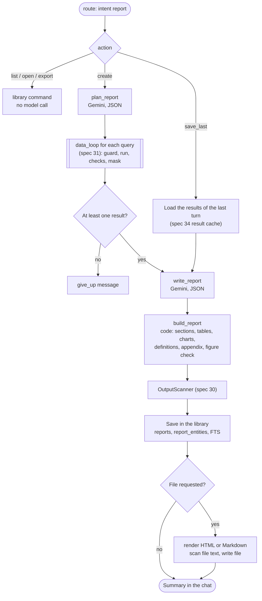

# Spec 32: Reports

- **Status:** Done (2026-11-12)
- **Phase and stream:** Phase 2, stream C
- **Depends on:** 00, 30, 31. Spec 33 uses the library tables of this spec.
- **Requirements covered:** the "report with action items" capability of the brief. The base for Req 3 (the Saved Reports library). Part of Req 2 (PII scan of files).

---

## Part A — Product (review this part)

### A1. Goal

The user asks for a report, for example "Create a report for Q1 with insights and action items for Q2". The assistant builds it from real query results and saves it in the user's personal library. On request, it also writes an HTML or Markdown file with charts. Each figure and each chart comes from the data. The model cannot invent a chart value.

### A2. Behavior the user sees

1. **Create a report.** Maya asks "Create a report for Q1 with insights and action items for Q2". After 30–90 s, the terminal shows the title, the summary, the action items and the line "Saved as R-7K2PQ."
2. **Same sections every time.** Each report has these sections in this order: summary, findings with numbers, reasons, action items, date range and definitions, method and SQL appendix.
3. **A file on request.** "Create a report for Q1 as an HTML file" also writes `data/reports/maya/R-7K2PQ.html`. The terminal shows the path. The file opens in a browser without internet access. It contains up to 3 charts.
4. **Markdown.** "… as a Markdown file" writes a `.md` file. Its charts are Mermaid diagrams, and a small table with the figures follows each chart.
5. **Save the last answer.** After an answer, Maya says "Save this as a report". The assistant makes a report from the results of the last answer. It runs no new query.
6. **The library.** `/reports` shows Maya's reports: ID, title, period, date and files. "Show my reports" in the chat gives the same list.
7. **Open and export.** `/open R-7K2PQ` shows the report in the terminal. `/export R-7K2PQ --format md` writes the Markdown file.
8. **Only own reports.** Maya types `/open` with the ID of Daniel's report. She gets "Report R-… not found." She gets the same text for an ID that does not exist.
9. **A part fails.** One of the 4 queries fails after 3 attempts. The report still appears. The findings say which part is missing and why.
10. **Too slow.** A report takes more than 150 s. The assistant stops, saves nothing, and suggests a shorter period or fewer topics.
11. **Calculated figures.** A finding needs a percentage change of two figures. The model does not calculate it. The SQL query computes it, or code computes it from a calculation placeholder (spec 31). The method section states how many figures came from code calculations. A number that the system cannot trace to a result or a calculation does not appear in the report.

### A3. Scope

- **In scope:**
  - the report flow: plan, queries, writing, checks, save,
  - "save the last answer as a report",
  - the library table, list, open, export,
  - the HTML file with inline SVG charts and the Markdown file with Mermaid charts,
  - the PII scan of the report and the files,
  - ownership and file paths.
- **Out of scope:**
  - delete, undo and purge (spec 33),
  - the CLI output of the commands (spec 37),
  - charts in plain chat answers, email of reports, PDF (design only),
  - edits of a saved report. The user creates a new report.

### A4. Limits the user sees

| Limit | Value | Message or behavior |
|---|---|---|
| Time for each report | 150 s (spec 00) | "The report took longer than 150 s. Please ask for a shorter period or fewer topics." Nothing is saved. |
| Planned queries | 4 | The plan keeps the first 4. |
| Queries in total, with corrections | 6 (spec 00) | A part without a result is marked as missing. |
| Charts | 3 | Extra charts are not drawn. |
| Chart types | Bar, line, pie | Other types become a bar chart or a table. |
| Text length | About 1,200 words | Longer text is cut at a section end, with a note. |
| Findings | 6 | — |
| Action items | 3 to 7 | — |
| Rows in a table | 15 | The table shows the top 15 rows and a note. |
| Reports in `/reports` | The newest 50 | "Showing the newest 50 of N reports." |

### A5. Done when

- [ ] A report request gives a report with the 6 sections in the order of A2.2.
- [ ] Each chart value equals a value in the query result. A unit test compares the SVG data with the result rows.
- [ ] The HTML file has no `<script>`, no external URL, and a Content-Security-Policy that blocks network loads. It opens offline.
- [ ] The Markdown file renders its Mermaid charts on GitHub, and each chart has a data table.
- [ ] A user cannot list, open or export a report of another user. The message is the same as for a missing ID.
- [ ] The output scanner runs on the report body and on each file before the save.
- [ ] A report over 150 s stops with the message and saves nothing.
- [ ] "Save this as a report" runs 0 queries.
- [ ] The library row has all fields of B3, including the entities that spec 33 uses.
- [ ] A report costs at most 8 model calls and 6 queries (spec 00).

---

## Part B — Technical

### B1. Key decisions

| | Decision | Choice | Alternatives | Reason |
|---|---|---|---|---|
| ⚑ | Report limits | 4 planned queries, 3 charts (bar, line, pie), about 1,200 words, 150 s | More queries with a higher budget | The limits fit the spec 00 budget (8 calls, 6 queries) and the 1–2 minute target. |
| ⚑ | Calculated figures | The model never calculates a figure. A derived figure comes from the SQL query, or from a calculation placeholder that code computes from stored result values (spec 31). The figure check accepts only traceable numbers. | Let the model calculate simple differences and percentages | A language model can make arithmetic errors. Code computes every derived figure from real values, so each number in a report is traceable. (Owner's decision, 2026-11-11.) |
| ⚑ | When the report is saved and when a file is written | The library always saves a created report. A file only on request or with `/export`. | Always write a file | Gap analysis B4: save only on a report request. A file is a second copy that the user moves and shares. |
| | What the model decides | The queries, the title, the text, which results become tables and charts, the chart type and the columns | The model also draws charts | Code draws each chart from the stored result, so a chart cannot show an invented value. |
| | Sections that code writes | Date range and definitions, and the method and SQL appendix | The model writes all sections | These facts come from the plan, the glossary and the real SQL. The model cannot change them. |
| | HTML | One file from a Jinja2 template with autoescape, inline CSS and inline SVG from matplotlib. No JavaScript. | Vega-Lite with a CDN | Fixed in the architecture: offline and no JavaScript. |
| | Model text in files | Markdown without links, images or raw HTML | Full Markdown | A link or an image in a file can send data out when the file opens. |
| | Chart data | Stored in the report row (at most 60 points for each chart) | Read the result cache at export | An export works after the result cache expires (spec 34). |
| | Report IDs | `R-` and 5 characters of Crockford base32, for example `R-7K2PQ`. Case does not matter. | UUID | Users type the ID in commands. |

### B2. Design

#### B2.1 Report flow



Model calls: route (1), `plan_report` (1), `write_report` (1). Corrections use the remaining calls of the spec 00 budget (8 in total).

#### B2.2 Plan

`plan_report` gets the safety rules, the report rules (`plan_report.md`), the schema without PII, the definitions, the data date range, the pinned facts and the request. It returns:

```json
{
  "title": "Q1 2026 sales review: Calvin Klein and Carhartt",
  "period": {"start": "2026-01-01", "end": "2026-03-31"},
  "compare_period": {"start": "2025-10-01", "end": "2025-12-31"},
  "queries": [
    {"id": "q1", "purpose": "Revenue by month", "sql": "SELECT …"},
    {"id": "q2", "purpose": "Revenue by category, Q1 vs Q4", "sql": "SELECT …"}
  ]
}
```

Code checks the plan:

- At most 4 queries. Code keeps the first 4 and writes a note to the trace.
- `start <= end`, and `end` is not after today (UTC, gap analysis N4). Code moves `end` to today when necessary, and the report states it.
- Each query goes through `data_loop` (spec 31). So each query passes the guard, the brand scope and the masker.

#### B2.3 Write

`write_report` gets the safety rules, the persona, the user format, the report writing rules (`write_report.md`), the definitions, and the masked results as data blocks with their IDs. It returns:

```json
{
  "summary": ["…", "…"],
  "findings": [
    {"text": "Revenue fell 12% from Q4 to Q1, from $412,300 to $362,800.",
     "table": {"ref": "q2", "columns": ["category", "revenue_q1", "revenue_q4"]}}
  ],
  "reasons": ["The data shows …"],
  "action_items": [
    {"action": "…", "why": "…", "metric_to_watch": "…"}
  ],
  "charts": [
    {"ref": "q1", "type": "line", "x": "month", "y": ["revenue"], "title": "Revenue by month"}
  ]
}
```

#### B2.4 Build (code)

1. **Text.** Code strips links, images and HTML tags from all model text. It cuts the text at about 1,200 words, at a section end.
2. **Tables.** Code takes the columns from the stored result `ref`. It shows at most 15 rows.
3. **Charts.** Code checks each chart spec against the result:

   | Check | Action on failure |
   |---|---|
   | `ref` exists, `x` and `y` columns exist | Drop the chart |
   | `y` columns are numbers, at most 3 | Drop the chart, or keep the first 3 |
   | `line`: `x` is a date or an ordered period, at most 60 points | Become a bar chart |
   | `bar`: at most 20 categories | Keep the top 20, with a note |
   | `pie`: at most 6 slices, all values 0 or more, one `y` column | Become a bar chart |
   | More than 3 charts | Keep the first 3 |

   Code copies the chart data (at most 60 points) into the report row.
4. **Date range and definitions.** Code writes this section from the plan period, today's date, the brand scope, and the glossary text of the keys in `definitions_used`.
5. **Method and SQL appendix.** Code writes the purpose of each query, the SQL as the model wrote it, the BigQuery job ID and the bytes billed. A sentence says that the system added the brand scope.
6. **Calculations and figure check.**
   - Code first replaces each calculation placeholder with its computed value (spec 31).
   - Then code finds each number in the text. It compares the number with the values in the results and with the computed values. The comparison allows rounding to 0, 1 or 2 decimals, and the "K" and "M" forms. Years, dates and numbers from the user's request do not count.
   - If a number does not match, code sends the model one request to rewrite the sentence with traceable figures. This counts in the turn budget.
   - A number that still does not match is replaced by `[figure removed: not traceable]`. The trace records the count as `unverified_figures`.
   - The method section states: "N figures in the text are code calculations from the query results."
7. **Entities.** Code fills `report_entities` (B3) from:
   - the literals of the guard filters on `brand`, `category`, `department`, `name`, `state` and `country`,
   - the values of result columns with these names (at most 50 for each kind),
   - the user's brands that appear in the results,
   - exact brand names (from the value cache) in the title.
8. **Scan.** The output scanner (spec 30) runs on the full Markdown body.

#### B2.5 Files

- **Path.** `data/reports/<owner_id>/<report_id>.html` or `.md`. Code builds the path from the owner ID and the report ID only. `owner_id` must match `[a-z0-9_-]+`. Code checks that the resolved path is inside `data/reports/<owner_id>/`.
- **HTML.**
  - Template `reports/templates/report.html.j2`, Jinja2 with autoescape.
  - Markdown text becomes HTML with `markdown-it-py` with raw HTML turned off.
  - Charts are inline SVG from matplotlib (Agg backend, `svg.fonttype = none`, a fixed `svg.hashsalt`, no date in the metadata). The same data gives the same file.
  - The `<head>` has `<meta http-equiv="Content-Security-Policy" content="default-src 'none'; style-src 'unsafe-inline'; img-src data:">`.
  - Maximum file size: 2 MB.
- **Markdown.** The same body. A line or bar chart becomes a Mermaid `xychart-beta` block. A pie chart becomes a Mermaid `pie` block. Code escapes quotes in labels and cuts labels to 30 characters. A data table follows each chart.
- **Scan.** The output scanner runs on the file text before the write. For HTML, it scans the text content and the attribute values.
- **Overwrite.** A new export of the same report and format replaces the file.
- **Library link.** The row stores the relative path in `file_html` or `file_md`.

#### B2.6 Library commands

All functions take the `UserContext`. Each SQL statement has `owner_id = ?`. A report of another user and a missing report give the same result: `ReportNotFound`.

| Function | Use |
|---|---|
| `create(report) -> report_id` | Report flow |
| `list(user, limit=50) -> list[ReportSummary]` | `/reports`, "show my reports" |
| `get(user, report_id) -> Report` | `/open` |
| `export(user, report_id, fmt) -> Path` | `/export`, a file request in the chat |
| `find(user, matcher) -> list[ReportSummary]` | Spec 33 |

`list`, `get` and `find` never return reports with `deleted_at` set. Spec 33 adds `soft_delete`, `undo` and `purge`.

### B3. Files and interfaces

```text
src/opsfleet_agent/reports/
  __init__.py
  flow.py               # report_flow subgraph: plan_report, write_report, build_report, save, render
  models.py             # ReportPlan, ReportDraft, ChartSpec, Report, ReportSummary
  build.py              # sections, tables, chart checks, figure check, entities
  library.py            # ReportLibrary: create, list, get, export, find
  render_html.py        # Jinja2 + matplotlib SVG
  render_md.py          # Markdown + Mermaid
  charts.py             # draw_svg(spec, data) -> str, to_mermaid(spec, data) -> str
  templates/report.html.j2
src/opsfleet_agent/agent/prompts/
  plan_report.md  write_report.md
```

New dependencies: `jinja2`, `matplotlib`, `markdown-it-py`.

**Table `reports`** (in `data/app.db`, the table that spec 00 leaves to this spec):

| Column | Type | Content |
|---|---|---|
| `report_id` | TEXT PK | `R-7K2PQ` |
| `owner_id` | TEXT NOT NULL | `UserContext.id` |
| `conversation_id` | TEXT NOT NULL | The conversation of the request |
| `title` | TEXT | From the plan |
| `question` | TEXT | The user request, after the scanner |
| `created_at` | TEXT | UTC, ISO 8601 |
| `period_start`, `period_end` | TEXT | Dates |
| `scope_brands` | JSON | The owner's brands at creation. Empty for `ceo`. |
| `sql` | JSON | A list: `id`, `purpose`, `sql`, `job_id`, `bytes_billed` |
| `body_markdown` | TEXT | The full report body |
| `sections` | JSON | The structured content (B2.3 after the build) |
| `charts` | JSON | Chart specs with their data |
| `definitions` | JSON | Glossary keys |
| `entities` | JSON | `{"brand": […], "category": […], "state": […], …}` |
| `calculated_figures` | INTEGER | The count from the figure check |
| `file_html`, `file_md` | TEXT NULL | Relative paths |
| `model`, `prompt_version`, `trace_id` | TEXT | For the trace |
| `deleted_at`, `delete_batch_id` | TEXT NULL | Spec 33 |

**Table `report_entities`:** `report_id`, `kind` (`brand`, `category`, `department`, `product`, `state`, `country`), `value`, `value_norm` (lower case, trimmed, single spaces). Index on `(value_norm)`.

**Virtual table `reports_fts`:** SQLite FTS5 on `title` and `body_markdown`, with `content='reports'`. Triggers keep it in step with `reports`.

**Settings:**

```yaml
reports:
  max_planned_queries: 4
  max_charts: 3
  chart_types: [bar, line, pie]
  max_words: 1200
  max_findings: 6
  max_action_items: 7
  max_table_rows: 15
  max_chart_points: 60
  max_file_bytes: 2000000
  dir: data/reports
```

**Change to spec 31:** the route JSON gets `report_request.action` and `report_request.report_id`.

### B4. Tests

Unit tests with a fake Gemini, a fake BigQuery and a temporary `data/` folder:

| # | Case | Expected |
|---|---|---|
| 1 | A normal report request | 6 sections in order, a library row, 3 model calls, the planned queries |
| 2 | A plan with 6 queries | The first 4 run |
| 3 | A plan with `end` after today | `end` moved to today, the report states it |
| 4 | One query fails 3 times | Report saved, the finding marks the missing part |
| 5 | All queries fail | No report, the `give_up` message |
| 6 | Fake clock passes 150 s | Message, no row, no file |
| 7 | "Save this as a report" | 0 queries, 2 model calls (route, write) |
| 8 | Chart checks of B2.4 | Each row of the table, one test each |
| 9 | Chart values in the SVG | Equal to the result values |
| 10 | Same report rendered twice | The same SVG bytes |
| 11 | HTML file | No `<script>`, no `http`, the CSP meta tag, autoescaped model text |
| 12 | Model text with a link, an image and `` | Stripped from the body and the files |
| 13 | Markdown with a label that contains `"` | Valid Mermaid (checked with a fixture of expected text) |
| 14 | Model text with an email | `[removed]` in the body and the files |
| 15 | Figure check: 3 result values and 1 calculation placeholder | `calculated_figures = 1`, `unverified_figures = 0` |
| 15a | Model text with a percentage that is not in the results and not a placeholder | One rewrite request. If the number stays: `[figure removed: not traceable]`, `unverified_figures = 1` |
| 16 | Entities from filters, results and the title | The expected rows in `report_entities` |
| 17 | `/open` and `/export` with the ID of another user | `ReportNotFound`, the same text as a missing ID |
| 18 | Owner ID `../x` in a test config | Rejected before any file write |
| 19 | A report with `deleted_at` set | Not in `list`, `get`, `find` |
| 20 | 60 reports | `list` returns 50 and the total |

Live test (marker `live`): one report for the manager `maya`, with an HTML file. About 3–5 model calls and 4 queries (about 100–200 MB billed). The runner prints the planned calls first.

### B5. Cost

- Unit tests: 0 Gemini calls, 0 queries.
- Live test: about 5 Gemini calls, about 4 queries, about 200 MB billed.
- Manual check of A2: about 15 Gemini calls and 10 queries.
- List, open and export make no model call and no query.

### B6. Risks and open points

- The figure check compares numbers with rounding, so a rounded number can match a wrong value by chance. Spec 23 evaluates the report quality.
- Mermaid `xychart-beta` is a beta feature. Some viewers do not render it. The data table under each chart keeps the figures readable.
- matplotlib adds about 30 MB to the Docker image. Spec 53 checks the image size.
- A report can need more than 150 s on a slow day. The user then asks for a shorter period. The limit stays (spec 00).
- Spec 33 must run after this spec, because it uses the tables of this spec. The roadmap order (30, 31, 33, 32) puts spec 33 first.

### B7. Implementation notes (2026-11-12)

#### Deviations from this spec

| # | Spec text | Implementation | Reason |
|---|---|---|---|
| 1 | B3: `reports_fts` with `content='reports'` | `reports_fts` keeps its own copy of `title` and `body_markdown`, with the column `report_id` (not indexed). Three triggers keep it in step with `reports`. | An external-content FTS table needs a stable integer `rowid`. `reports` has a text key, and `VACUUM` can change its `rowid` values. |
| 2 | B3: `reports.dir: data/reports` | `reports.dir: reports` is a folder inside `paths.data_dir`. The row stores the path relative to `data/`, for example `reports/maya/R-7K2PQ.html`. The chat shows `data/reports/maya/R-7K2PQ.html`. | The tests use a temporary data folder. A second setting for the same folder could point to the real `data/` folder by mistake. |
| 3 | B3: the columns of `reports` | Extra column `unverified_figures`. | The statistics of spec 35 can count removed figures without a trace search. |
| 4 | B2.4 step 1: "cut at a section end" | Code removes items from the end of a section. Each section keeps its first item, so the 6 sections always appear. The method section has the note. | A cut of a full section can remove the action items. |
| 5 | B2.2: the queries go through `data_loop` | The loop starts at the guard with the planned SQL (`turn.next = "guard"`, `turn.single_step = true`). The planned SQL is attempt 1. A correction goes back to `write_sql` with the feedback, so each query has at most 2 corrections. | The plan already has the SQL. A new `write_sql` call for each query costs 4 more model calls. |
| 6 | B2.1: "Corrections use the remaining calls" | Two model calls stay reserved for `write_report` and the rewrite request (`TurnBudget.reserve_llm_calls`). A correction that needs a reserved call fails, and the part is missing. | Without the reserve, corrections can use all 8 calls, and the report cannot be written. |
| 7 | A2.9: a part fails after 3 attempts | A part is also missing after a policy block of the guard, a `cannot_answer`, a non-retryable BigQuery error, or the query or call limit. The time limit stops the full report. | The spec does not say what happens in these cases. The report keeps the parts that have data. |
| 8 | B2.1: `save_last` reads the result cache of spec 34 | `finish` keeps the masked results of the last data answer in `AgentState.last_data`. Spec 34 replaces it with the result cache. Done on 2026-11-12: `save_last` reads `pinned.last_results` and `result_cache` (spec 34, B7 #6). | Spec 34 is not built yet. |
| 9 | B4 case 9: the SVG data equals the result | Each bar, point and pie slice has an element ID with the drawn value, for example `bar_s0_i2_v900.0`. The test reads the IDs. The SVG also has `role="img"` and `aria-label` with the title. | Coordinates in the SVG are pixels. The ID gives the drawn value, and screen readers get the title. |
| 10 | A4: "Other types become a bar chart or a table" | Other types become a bar chart. | One rule is simpler to test. |
| 11 | B2.5: the scan of the HTML file | Code scans the text nodes and the readable attribute values (`aria-label`, `title`, `alt`, `content`). A hit stops the write of the HTML file (fail closed). The Markdown file gets `[removed]`. | Code scans all report text before the render. A hit in the HTML file means a bug. The SVG path data can look like a phone number. |
| 12 | B2.4 step 6: "rewrite the sentence" | The rewrite request (`fix_figures.md`) sends the full text of each item with an untraceable number: a summary bullet, a finding, a reason or an action item field. | An item is short. A sentence split is not reliable with figures such as `$1,300.25`. |
| 13 | B2.4 step 7: brand names in the title | The longest brand name wins: "Calvin Klein Jeans" in a title does not also give "Calvin Klein". | Spec 33, A2.3: a report about "Calvin Klein Jeans" must not match "Calvin Klein". |
| 14 | B2.2: `start <= end` | Code swaps the dates when `start` is after `end`. The compare period also ends at today at the latest. | A swap keeps the report. The compare period has the same rule. |
| 15 | B1: report IDs | The letters O, I and L read as 0, 1 and 1. | Crockford base32 does this, so a typing error still finds the report. |
| 16 | B2.6: `ReportNotFound` | It has the error type `tool_error`. The chat and the commands show its text as a normal message, not as an error. | A wrong ID is a user error, not a failure of the system. |
| 17 | B3: settings | Extra settings: `min_action_items`, `max_bar_categories`, `max_pie_slices`, `max_listed`. | The limits of A4 are all in `settings.yaml`. |

#### Changes outside this spec

- Spec 31: `route.md` describes `report_request` and `delete_request`. The `data_loop` subgraph can start at the guard. The guard step records the filter values of the report entities (`entities`). `run_query` records `job_id` and `bytes_billed` in the step. `mask_result` ends after one step when `single_step` is set. `write_sql` tells the model that a correction is one report query.
- Spec 00: `TurnBudget.use_report_limits()` switches to the report time limit after the route. The time counts from the start of the turn. `TurnBudget.reserve_llm_calls()` and `llm_calls_left()` are new. The time message of a report is the message of A4.
- `TurnContext.store` gives the nodes the connection to `data/app.db`. `Services.clock` gives the UTC time (a fake clock in the tests).
- `TurnResult` has the new fields `calculated_figures`, `report_id` and `report_files`. `AssistantSession.command(name, args) -> CommandOutcome` runs `/reports`, `/open` and `/export`. The CLI sends these commands to the session (spec 37 builds the full CLI).
- New dependencies: `matplotlib` and `markdown-it-py`. `MPLCONFIGDIR` is a folder in the temporary directory when it is not set.

#### Interfaces for spec 33

- `ReportLibrary.find(user, Matcher)` with the matcher kinds `all`, `conversation`, `ids`, `entity` and `text` (an FTS5 phrase). `ReportLibrary.entity_values(user)` gives the entity values for the close names.
- `reports/files.py`: `owner_dir()`, `report_file()`, `trash_dir()` and `display_path()`.

#### Tests

- 390 unit tests pass (325 before this spec). They cover each case of B4 with a fake Gemini, a fake BigQuery and a temporary data folder: `tests/test_reports_flow.py`, `tests/test_report_charts.py`, `tests/test_report_library.py`, and `tests/fixtures/mermaid_quote.md` for case 13.
- `tests/test_reports_live.py` (marker `live`) creates one report for `maya` with an HTML file.

#### Live check

The live check of this spec ran in one session with spec 33 (2026-11-12, as `maya`). See the implementation notes of spec 33 for the full session.

- "Create a report for Q1 2026 with action items for Q2, as an HTML file": 3 Gemini calls, 4 queries, 83.9 MB billed, 18 s. The HTML file has the 6 sections in order and 2 charts (revenue by month, top 10 categories). The chart values equal the query values. No figure was removed, and the model used only figures that the SQL computed.
- A first try stopped at `plan_report` with the Gemini error `504 DEADLINE_EXCEEDED` (2 calls). Nothing was saved.

#### Round 1 of spec 50: plans without queries (2026-11-12)

In the accuracy baseline, 3 of 5 report cases (RP-01, RP-02, RP-03) ended with the reply `reports.no_plan`. The plan had a title and a period, but no `queries` field. `ReportPlan.queries` had a default (an empty list), so the JSON schema did not require it, and the model could leave it out. RP-04 and RP-05 got a plan with the same prompt.

Changes:

- `ReportPlan.queries` is required in the schema.
- When the plan has no query, or the output does not match the schema, `plan_report` asks one more time with a `<retry>` note (`reports.plan_retry`). Only after the second empty plan does the turn end with `reports.no_plan`. The span attribute `plan_attempts` shows the number of calls. The extra call counts in the turn budget.
- Rule 4 of `plan_report.md`: "Write 2 to N queries".

Tests: `tests/test_reports_flow.py` (one more call, two empty plans, the schema).

#### Round 2 of spec 50: the definition check

- **RP-05.** A report query now gets the definition check of spec 31 (B7, round 2). The period check stays off for report queries.
