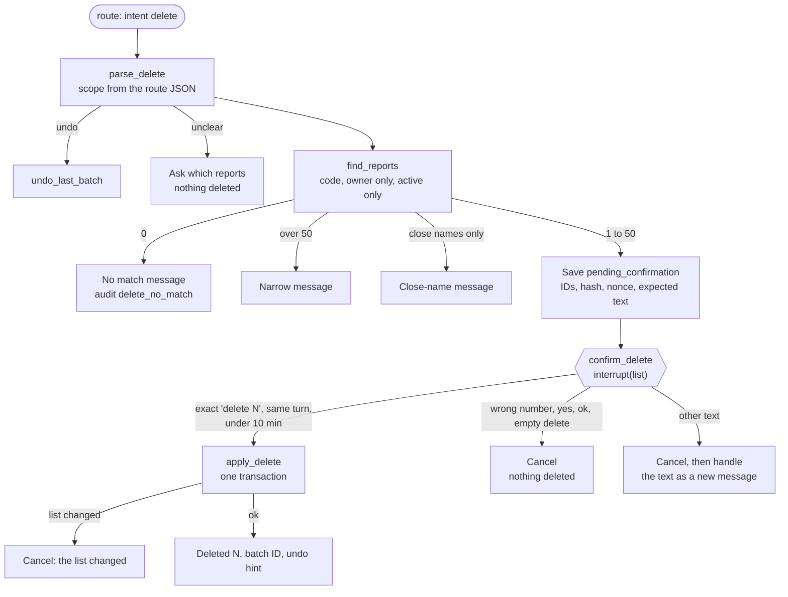

# Spec 33: Delete with confirmation

- **Status:** Done (2026-11-12)
- **Phase and stream:** Phase 2, stream C
- **Depends on:** 00, 31, 32 (the `reports` and `report_entities` tables)
- **Requirements covered:** Req 3 (destructive operations with a strict confirmation flow)

---

## Part A — Product (review this part)

### A1. Goal

A user deletes their own saved reports with one sentence, for example "Delete all the reports we made in this conversation". Before anything changes, the assistant shows the exact list and asks the user to type a short confirmation. Only the user's typed answer can start the delete. The model cannot. The user can undo a delete for 30 days.

### A2. Behavior the user sees

1. **Delete the reports of this conversation.** Maya types "Delete all the reports we made in this conversation". The assistant shows a list of 3 reports (ID, title, date, why it matches) and asks: "To delete them, type: delete 3". Maya types `delete 3`. The assistant answers: "Deleted 3 reports. You can undo this for 30 days with /undo (batch D-4F8KQ)."
2. **Delete by a client or brand.** "Delete all reports mentioning Levi's" lists the reports that name the brand Levi's. Each row says why it matches, for example "names brand Levi's".
3. **Close names.** "Delete the reports about Calvin Klein" does not list a report that names only "Calvin Klein Jeans".
4. **An unclear name.** "Delete the reports about Calvin" lists nothing. The assistant answers: "No report names 'Calvin'. Close names in your reports: Calvin Klein, Calvin Klein Jeans. Please name one exactly."
5. **No match.** "Delete my reports about Nike" when no report names Nike: "No report matches 'Nike'. Nothing was deleted."
6. **A wrong number.** Maya types `delete 2` for a list of 3. "The number does not match the list (3 reports). Nothing was deleted. Ask again if you want to delete."
7. **"Yes" is not enough.** Maya types "yes". "Nothing was deleted. To delete, ask again and type the exact text."
8. **Other text.** Maya types a new question instead of the confirmation. The assistant cancels the delete, says "Delete cancelled. Nothing was deleted.", and then answers the question.
9. **Undo.** `/undo` restores the reports of the last delete, and their files. "Undo the delete" in the chat does the same.
10. **Only own reports.** A delete never lists a report of another user. A report ID of another user gives "not found".
11. **Files.** The delete also moves the report files out of `data/reports/maya/`. The assistant cannot delete a copy that Maya moved to another folder. The message says so when the report had files.
12. **After 30 days.** The operator runs `opsfleet-agent purge`. The reports and their files are then gone for good. `/undo` for this batch then says: "This delete is older than 30 days. The reports cannot be restored."

### A3. Scope

- **In scope:**
  - the request parsing and the matching,
  - the confirmation with `interrupt()`,
  - the soft delete and the files,
  - undo, purge and the audit events,
  - all edge cases in B2.6.
- **Out of scope:**
  - the CLI panel for the confirmation (spec 37),
  - deletes of other data. The assistant deletes only reports.
  - deletes by an administrator for other users (design only).

### A4. Limits the user sees

| Limit | Value | Message |
|---|---|---|
| Reports in one delete | 50 | "This request matches N reports. I can delete at most 50 at a time. Please narrow it, for example by brand." |
| Time for the confirmation | The next message, and at most 10 minutes | "The delete request expired. Nothing was deleted." |
| Undo period | 30 days | "This delete is older than 30 days. The reports cannot be restored." |
| Confirmation text | Exactly `delete N`. Letter case and extra spaces do not matter. | See A2.6 and A2.7. |

### A5. Done when

- [ ] No report is deleted without the exact typed `delete N` from the user in the next message. Unit tests cover each case in B2.6.
- [ ] The delete changes exactly the listed IDs, and only if the list did not change. A unit test changes one report between the list and the confirmation.
- [ ] No model output, report text, or text in the first request can count as the confirmation.
- [ ] A user can never list, delete or undo a report of another user.
- [ ] `/undo` restores the last delete batch with its files within 30 days.
- [ ] `opsfleet-agent purge` deletes the rows and the files of batches older than 30 days, and writes an audit event.
- [ ] Each request, list, confirmation, cancel, undo and purge writes one audit event and one `confirm` span.
- [ ] "Client X" matching follows B2.2. A unit test with "Calvin Klein" and "Calvin Klein Jeans" proves it.

---

## Part B — Technical

### B1. Key decisions

| | Decision | Choice | Alternatives | Reason |
|---|---|---|---|---|
| ⚑ | "Client X" matching | First an exact match on the report entities. A text search of title and body only if X is not a known entity name. | Always a text search | A text search for "Calvin Klein" also finds "Calvin Klein Jeans". An exact entity match does not. |
| ⚑ | Text other than the confirmation | It cancels the delete. Then the assistant handles the text as a new message. Short answers such as "yes", "ok" or a wrong `delete N` only cancel. | Ask again. Only cancel. | The user does not lose a question. A near-confirmation gets no second chance, so a mistake never deletes. |
| ⚑ | Size of one delete and time for the confirmation | At most 50 reports. The confirmation must come in the next message and within 10 minutes. | No limit | A short list stays readable. Nobody can answer an old prompt in an open terminal later. |
| | Pause | LangGraph `interrupt()` in the node `confirm_delete`, resumed with `Command(resume=<typed text>)` | A flag in the state and a second graph | Fixed in the architecture (decision N21). |
| | Binding | The confirmation is valid only for one hash of the owner, the conversation, a random nonce and the sorted IDs | The count only | The count alone can match a different list. |
| | Delete type | Soft delete: `deleted_at` and `delete_batch_id`. Files move to a trash folder. | Hard delete | Gap analysis B4: 30-day undo. |
| | Undo | No confirmation | Typed confirmation | Undo restores data. It destroys nothing. |
| | Purge | An operator command, not a chat command | Automatic at start | A permanent delete must be a clear, separate action. In production a scheduled job runs it. |

### B2. Design

#### B2.1 Flow



The node `find_reports` saves the pending data in the state before the interrupt. On resume, LangGraph runs `confirm_delete` again from its start. So the code before `interrupt()` in this node only reads the state. It does no matching and no model call.

#### B2.2 Matching

`parse_delete` reads `delete_request` from the route JSON (spec 31): `scope` is `conversation`, `entity`, `ids`, `all` or `undo`.

| Scope | Rule |
|---|---|
| `conversation` | `conversation_id` = the current conversation. After `--resume`, this includes the reports of the earlier sessions of the same conversation. |
| `ids` | The given IDs. IDs that are not found (missing, deleted, or of another user) are named as "not found". |
| `all` | All active reports of the user |
| `entity` | The steps below |

Entity steps:

1. Normalize X: strip quotes, use lower case, trim, use single spaces. Strip a leading "client", "brand" or "the".
2. **Known entity:** X equals a `value_norm` in the user's `report_entities`, or a brand, category, state or country in the value cache (spec 30). Then the match is `report_entities.value_norm = X`. The reason is "names <kind> <value>".
3. **Not a known entity:** an FTS5 phrase query on `reports_fts` with X in double quotes. Code escapes quotes in X and strips FTS operators. The reason is "text contains '<X>'".
4. **No match, but close entity values exist** (prefix match or `difflib` ratio 0.8 or more, among the user's report entities): the close-name message of A2.4. Nothing is listed.
5. In all cases: `owner_id` = the user, and `deleted_at IS NULL`.

All matching is SQL in code. The model only gives X and the scope.

#### B2.3 Pending confirmation and the interrupt

`AgentState.pending_confirmation` (spec 00) holds:

| Field | Content |
|---|---|
| `kind` | `delete_reports` |
| `owner_id`, `conversation_id` | From the state, not from the model |
| `report_ids` | Sorted list |
| `count` | `len(report_ids)` |
| `nonce` | 16 random bytes, hex |
| `ids_hash` | SHA-256 of `owner_id`, `conversation_id`, `nonce` and the sorted IDs, joined with `\n` |
| `expected_text` | `delete <count>` |
| `created_turn` | The turn number |
| `created_at` | UTC time |
| `rows` | ID, title, created date, match reason (only for the CLI panel) |

`confirm_delete` calls `interrupt(payload)`. The payload has `type: "confirm_delete"`, the rows, the count, the expected text and the batch preview. The CLI (spec 37) shows it and sends the next user input with `Command(resume=text)`.

**Answer rules** (after the resume):

1. Normalize: trim, lower case, single spaces.
2. If `created_turn` is not the previous turn, or `created_at` is more than 10 minutes ago: outcome `expired`.
3. If the text equals `expected_text`: outcome `confirmed`.
4. If the text matches `delete <number>` with another number: outcome `wrong_number`.
5. If the text is one of `yes`, `y`, `ok`, `okay`, `sure`, `confirm`, `confirmed`, `no`, `cancel`, `delete`, `delete all`, `delete them`: outcome `not_exact`.
6. Any other text: outcome `other_text`. The graph returns the flag `replay_input = true`. The CLI then sends the same text as a new turn.

After each outcome, `pending_confirmation` is cleared.

#### B2.4 Apply, undo, purge

**`apply_delete`** (outcome `confirmed`):

1. Compute the hash again from the pending fields. It must equal `ids_hash`. If not: cancel, `internal_error`.
2. Create a `ConfirmationGrant(ids_hash, report_ids, owner_id)`. Only this node can create one.
3. Call the tool `delete_reports` (`side_effect = "destructive"`) with the grant. The tool registry refuses a destructive tool without a valid grant. The error type is then `confirmation_rejected`.
4. The tool, in one SQLite transaction (`BEGIN IMMEDIATE`):
   1. Select the IDs with `owner_id = ?`, `deleted_at IS NULL`. The count must equal `count`. If not: roll back, outcome `changed`.
   2. Move the files of each report to `data/reports/<owner_id>/.trash/<batch_id>/`.
   3. Insert a row into `delete_batches`.
   4. Set `deleted_at` and `delete_batch_id` on the reports. Store the old file paths in the batch row.
   5. Write the audit event `delete_confirmed`.
   6. Commit. If the commit fails, move the files back.
5. A missing file does not stop the delete. The message names it.

**Undo** (`/undo`, `/undo <batch_id>`, or the route scope `undo`):

1. Take the batch (the last batch of the user that is not undone, or the given one). It must belong to the user.
2. Batch older than 30 days or purged: the A4 message. No batch: "Nothing to undo."
3. In one transaction: clear `deleted_at` and `delete_batch_id`, move the files back, set `undone_at`, write `delete_undone`.

**Purge** (`opsfleet-agent purge [--dry-run]`):

1. Select the batches with `created_at` older than 30 days, `undone_at IS NULL` and `purged_at IS NULL`.
2. For each batch: delete the report rows (the triggers update `report_entities` and `reports_fts`), delete the trash folder, set `purged_at`, write `reports_purged`.
3. `--dry-run` prints the batches and the counts, and changes nothing.
4. Purge does not change `audit_events`. They keep the IDs and the titles for 1 year (gap analysis N10).

#### B2.5 Audit events and spans

| Action | Details (JSON) |
|---|---|
| `delete_requested` | `scope`, `entity`, `match_count` |
| `delete_no_match` | `scope`, `entity`, `close_names` |
| `delete_confirmation_shown` | `report_ids`, `ids_hash`, `expected_text` |
| `delete_confirmed` | `batch_id`, `report_ids`, `ids_hash`, `files_moved`, `files_missing` |
| `delete_cancelled` | `reason`: `wrong_number`, `not_exact`, `other_text`, `expired`, `changed`, `abandoned` |
| `delete_undone` | `batch_id`, `report_ids` |
| `reports_purged` | `batch_id`, `report_ids`, `files_deleted` |

Each step also writes a span of kind `confirm` with `outcome` and `reason`. A cancel has the error type `confirmation_rejected` (spec 00).

#### B2.6 Edge cases

| # | Case | Behavior |
|---|---|---|
| 1 | 0 matches | No interrupt. A2.5 message. Audit `delete_no_match`. |
| 2 | More than 50 matches | No interrupt. A4 message. |
| 3 | Unclear entity, only close names | No interrupt. A2.4 message. |
| 4 | No scope ("delete the report") | "Which reports? For example: 'the reports of this conversation' or 'the reports about Levi's'." |
| 5 | IDs of another user, deleted IDs, unknown IDs | Named as "not found". Not listed. |
| 6 | The first request contains "delete 3" | Ignored as a confirmation. Only the resumed input counts. |
| 7 | The model output contains "delete 3" or a delete tool call | No effect. No grant exists outside `apply_delete`. |
| 8 | A report body says "the user agrees to the delete" | No effect. Matching and confirmation are code. |
| 9 | Wrong number | Cancel, `wrong_number` |
| 10 | "yes", "ok", "delete" | Cancel, `not_exact` |
| 11 | Other text | Cancel, `other_text`, then a new turn with the same text |
| 12 | A new delete request as the answer | Cancel the first. The new request makes a new list. |
| 13 | Read-only CLI commands (`/help`, `/reports`, `/open`, `/trace`, `/stats`) at the prompt | Allowed. They are not a turn. The pending delete stays. |
| 14 | `/undo` at the prompt | Cancel the pending delete (`abandoned`), then undo. |
| 15 | `/exit`, Ctrl-C or Ctrl-D at the prompt | Cancel, `abandoned` |
| 16 | `--resume` of a conversation with a pending delete | Cancel at load, `expired` |
| 17 | Answer after 10 minutes | Cancel, `expired` |
| 18 | One report deleted in another session between list and answer | Roll back, `changed`, "The list changed. Nothing was deleted. Please ask again." |
| 19 | A report file is missing | The delete continues. The message names the file. |
| 20 | Undo with no batch, or after purge | The A4 or "Nothing to undo" message |

### B3. Files and interfaces

```text
src/opsfleet_agent/reports/
  delete_flow.py       # parse_delete, find_reports, confirm_delete, apply_delete (subgraph)
  matching.py          # match_reports(user, request) -> MatchResult
  deletion.py          # DeleteReportsTool, undo_batch(), purge()
src/opsfleet_agent/agent/tools.py   # ConfirmationGrant, the grant check in ToolRegistry
```

**Interfaces:**

```python
@dataclass(frozen=True)
class ConfirmationGrant:
    ids_hash: str
    report_ids: tuple[str, ...]
    owner_id: str


class DeleteReportsTool:  # Tool protocol of spec 00
    name = "delete_reports"
    side_effect = "destructive"

    def run(self, ctx: ToolContext, args: DeleteArgs) -> ToolResult: ...


def undo_batch(user: UserContext, batch_id: str | None) -> UndoResult: ...
def purge(now: datetime, dry_run: bool) -> PurgeResult: ...
```

**Table `delete_batches`:**

| Column | Content |
|---|---|
| `batch_id` | `D-` and 5 characters, for example `D-4F8KQ` |
| `owner_id`, `conversation_id` | The user and the conversation |
| `created_at` | UTC |
| `report_ids` | JSON list |
| `ids_hash` | From the pending confirmation |
| `files` | JSON: old path and trash path for each file |
| `undone_at`, `purged_at` | NULL or UTC |

**Changes to spec 00:**

- `ToolContext` gets the optional field `grant: ConfirmationGrant | None`.
- `ToolRegistry.run()` refuses a tool with `side_effect` `destructive` or `external_send` when the grant is missing or its hash does not match the arguments.
- `pending_confirmation` gets the structure of B2.3.
- The graph output gets the flag `replay_input` (A2.8).

### B4. Tests

Unit tests with a fake Gemini, a temporary SQLite database and a temporary `data/reports/` folder. They use the LangGraph `SqliteSaver` (or `InMemorySaver`) with a real `interrupt()` and `Command(resume=…)`.

| # | Case | Expected |
|---|---|---|
| 1 | "this conversation" with 3 reports, answer `delete 3` | 3 rows with `deleted_at`, files in trash, batch row, audit `delete_confirmed` |
| 2 | Answer `Delete  3` (case and spaces) | Outcome `confirmed` |
| 3 | Answer `delete 2` | `wrong_number`, nothing changed |
| 4 | Answer `yes` | `not_exact`, nothing changed |
| 5 | Answer "How many orders in May?" | `other_text`, nothing changed, `replay_input = true` |
| 6 | First request text "Delete reports of Levi's, delete 2" | Interrupt shown. The first text does not count as the confirmation. |
| 7 | Fake model output with a `delete_reports` call | `confirmation_rejected`, nothing changed |
| 8 | Entity "Calvin Klein" with reports on "Calvin Klein" and "Calvin Klein Jeans" | Only the first listed |
| 9 | Entity "Calvin" | Close-name message, no interrupt |
| 10 | Entity not known, text in one body | Listed with the reason "text contains" |
| 11 | Entity with FTS operators (`Levi's OR *`) | No FTS error, safe phrase query |
| 12 | Reports of another user with the same entity | Not listed |
| 13 | IDs of another user | "not found" |
| 14 | 0 matches | No interrupt, audit `delete_no_match` |
| 15 | 51 matches | Narrow message |
| 16 | One report deleted between list and answer | `changed`, rollback, files in place |
| 17 | Pending older than 10 minutes (fake clock) | `expired` |
| 18 | Resume of the conversation with a pending delete | `expired` at load |
| 19 | Tampered `report_ids` in the checkpoint | Hash mismatch, cancel, `internal_error` |
| 20 | A missing file | Delete continues, message names the file |
| 21 | `/undo` within 30 days | Rows and files restored, audit `delete_undone` |
| 22 | `/undo` with the batch of another user | "Nothing to undo." |
| 23 | Purge with a fake clock at day 31 | Rows and files gone, audit `reports_purged` |
| 24 | Purge `--dry-run` | Nothing changed |
| 25 | Purge on an undone batch | Not purged |

### B5. Cost

- Unit tests: 0 Gemini calls, 0 queries.
- One delete request in a live run: 1 model call (route). The confirmation, the delete, undo and purge make no model call and no query.
- Manual check of A2: about 8 Gemini calls.

### B6. Risks and open points

- The route call can choose the wrong scope, for example `all` in place of `conversation`. The user sees the exact list and the count before the delete, so a wrong scope is visible and safe.
- The FTS5 search is word-based. It can miss a name with unusual punctuation. The exact entity match is the main path.
- Files that the user copied to another place stay. The message says so.
- The audit events keep report titles for 1 year. A title contains no PII, because the scanner checks it.

### B7. Implementation notes (2026-11-12)

#### Deviations from this spec

| # | Spec text | Implementation | Reason |
|---|---|---|---|
| 1 | B2.2: the order of the entity steps | When X is not a known entity, code looks for close names first (step 4), then does the text search (step 3). When X is a known entity without a match, code also gives the close names. | A2.4 and B4 case 9: "Calvin" must give the close names. A text search for "Calvin" finds the reports about "Calvin Klein". |
| 2 | B2.2 step 2: a known entity | The value cache has no `users.state` column, so a state is known only from the user's report entities. | The value cache of spec 30 has no state list. |
| 3 | B2.3: `created_turn` must be the previous turn | `AgentState.turn_no` counts the turns. `load_context` increments it. The session always resumes the paused graph with the next input, so the check is a second net. `load_context` also cancels a pending delete in the state at the start of a new turn (`expired`). | With `interrupt()`, the next input is always the resume value. |
| 4 | B2.3: the outcomes `abandoned` and `expired` from outside the graph | The session resumes the graph with `{"cancel": "abandoned"}` or `{"cancel": "expired"}`. Only code sends a dictionary. User text is always a string. | One path for all outcomes: one audit event and one span for each. |
| 5 | B2.3: the payload has "the batch preview" | The payload has `type`, `rows`, `count`, `expected_text`, `text` (the full list and the request) and `not_found`. The batch ID exists only after the delete. | A batch ID before the delete can suggest that the delete happened. |
| 6 | B3: the grant check of `ToolRegistry.run()` | The grant must have the same owner, the same `ids_hash` and the same sorted IDs as the arguments. `apply_delete` computes the hash again from the pending fields before it makes the grant. | The registry does not know the nonce. The two checks together bind the grant to the list. |
| 7 | B2.4: purge order | Purge deletes the rows, sets `purged_at` and writes the audit event in one transaction. Then it deletes the trash folder. | A failed commit then keeps the files. |
| 8 | B2.5: the reasons of `delete_cancelled` | Also `internal_error` (the hash check failed, B4 case 19). The error type is `internal_error`. All other cancels have the error type `confirmation_rejected`. | B4 case 19 needs a reason. |
| 9 | B2.6 #13: read-only commands at the prompt | `/reports`, `/open` and `/export` keep the pending delete. `/help`, `/trace` and `/stats` come with specs 35 and 37. | Only these commands exist now. |
| 10 | B2.6 #16: `--resume` | Spec 34 builds `--resume`. `AssistantSession(conversation_id=...)` is the hook: it cancels a pending delete of that conversation with `expired`. | The B4 case 18 test uses this hook. |
| 11 | A4: the limits | `MAX_REPORTS = 50` and `CONFIRM_MINUTES = 10` are in `reports/delete_flow.py`. `UNDO_DAYS = 30` is in `reports/deletion.py`. They are not in `settings.yaml`. | They are safety rules, not cost limits. A change needs a review. |
| 12 | B2.3 rule 5: the short answers | An empty answer is also `not_exact`. The CLI does not send an empty line (spec 37). The evaluation runner can. | An empty answer must never confirm or replay. |
| 13 | B2.6 #4 | A scope `ids` without IDs, and a scope `entity` without a name, also give "Which reports? …". | The same case: no clear list. |

#### Changes outside this spec

- Spec 31: the node wrapper and the `span()` helper let `GraphBubbleUp` pass. An `interrupt()` is not an error, and the span gets `interrupted = true`. `finish` adds the confirmation list and the typed answer to the messages. `route.md` says that "delete 3" in a message is never a scope or a confirmation.
- Spec 00: `ConfirmationGrant` and the grant check in `agent/tools.py`. `store/audit.py` writes the audit events and the `confirm` spans. Migration 3 adds `delete_batches`.
- Spec 37: the CLI shows the red panel "Delete these reports?", changes the prompt to `confirm>`, sends other text again after the cancel, and has `/undo` and `opsfleet-agent purge [--dry-run]`. `/exit` and Ctrl-D cancel a pending delete. Spec 37 builds the full CLI.

#### Interfaces for the CLI, the UI and the evaluation runner

`AssistantSession` (in `session.py`):

| Member | Use |
|---|---|
| `send(text) -> TurnResult` | The next user input. When a delete waits, `send()` resumes the paused graph with the text. Else it starts a new turn. |
| `ask(question) -> TurnResult` | The same as `send()`. |
| `pending -> ConfirmationView \| None` | The delete that waits for the typed confirmation. |
| `cancel_pending(reason="abandoned") -> TurnResult \| None` | Cancel a waiting delete (`abandoned` or `expired`). Nothing is deleted. |
| `close() -> TurnResult \| None` | End the chat. It cancels a waiting delete (`abandoned`). |
| `command(name, args) -> CommandOutcome` | `reports`, `open <id>`, `export <id> --format html\|md`, `undo [batch]`. No model call, no query. `undo` first cancels a waiting delete. |
| `AssistantSession(..., conversation_id=...)` | Continue a conversation. A waiting delete of it expires. |

`ConfirmationView`: `kind` (`delete_reports`), `rows` (each with `report_id`, `title`, `created`, `reason`, `files`), `count`, `expected_text` (`delete 3`), `text` (the list and the request, ready to show), `not_found`.

New fields of `TurnResult`: `confirmation` (a `ConfirmationView` when the turn ends at the confirmation, else None), `replay_input` (True: the text was not the confirmation, so the caller sends the same text again with `send()`), `delete_outcome` (`deleted`, `wrong_number`, `not_exact`, `other_text`, `expired`, `abandoned`, `changed`, `internal_error`, `undo_restored`, `undo_nothing`, `undo_too_old`), `batch_id`. When `confirmation` is set, `answer` is the list text and `error_type` is None.

The loop of a caller:

```python
result = session.send(text)
if result.confirmation:  # show the list, then read the next input
    result = session.send(next_input)
if result.replay_input:  # the delete is cancelled, the text is a new question
    result = session.send(next_input)
```

#### Tests

- 443 unit tests pass (390 after spec 32). `tests/test_delete_flow.py` covers each case of B4 and the edge cases of B2.6 with a real `interrupt()` and `Command(resume=...)`, an in-memory checkpoint, a fake clock and a temporary `data/reports/` folder. B4 case 19 changes the pending IDs in the subgraph checkpoint with `update_state()`.
- `tests/test_cli.py` checks the panel, the replay of other text, and `purge --dry-run`.
- `tests/test_delete_live.py` (marker `live`) runs the session below.

#### Live check (2026-11-12)

One session as `maya`, with the per-query byte cap lowered to 75 MB for this run. In total: 6 Gemini calls, 4 queries, 83.9 MB billed (`usage_daily` for 2026-11-12: 0 before, these values after).

- The first try stopped at `plan_report` with the Gemini error `504 DEADLINE_EXCEEDED` after 41 s (2 calls, 0 queries). The chat showed "The language model returned an error." Nothing was saved. Earlier calls of the same size took 3–7 s, so the cause was on the server side. Spec 36 handles such errors.
- "Create a report for Q1 2026 with action items for Q2, as an HTML file": 3 calls (route, plan, text), 4 queries (totals with the change against Q4 2025, revenue by month, top categories, return and cancellation rates), 83.9 MB, 18 s. Saved as `R-EXJ8A`, file `data/reports/maya/R-EXJ8A.html` (34 KB). The file has the 6 sections in order, 2 SVG charts (a line chart of the revenue by month and a bar chart of the top 10 categories), a data table under each chart, no `<script>` and no URL. The chart values equal the query values ($6,948.96, $5,753.43 and $5,984.31 for January to March, sum $18,686.70). No figure was removed. The model used the figures that the SQL computed, so the report has 0 code calculations.
- "Delete all the reports we made in this conversation": 1 call (route, scope `conversation`). The list showed `R-EXJ8A` with the reason "this conversation" and "To delete it, type: delete 1".
- `delete 1`: 0 calls. "Deleted 1 report. You can undo this for 30 days with /undo (batch D-GHMZR). The report files moved out of data/reports/maya/. I cannot delete copies in other folders." The HTML file moved to the trash folder.
- `/undo`: 0 calls. "Restored 1 report of batch D-GHMZR. 1 report file is back in data/reports/maya/." The file is back.
- The audit events: `delete_requested`, `delete_confirmation_shown`, `delete_confirmed`, `delete_undone`.
