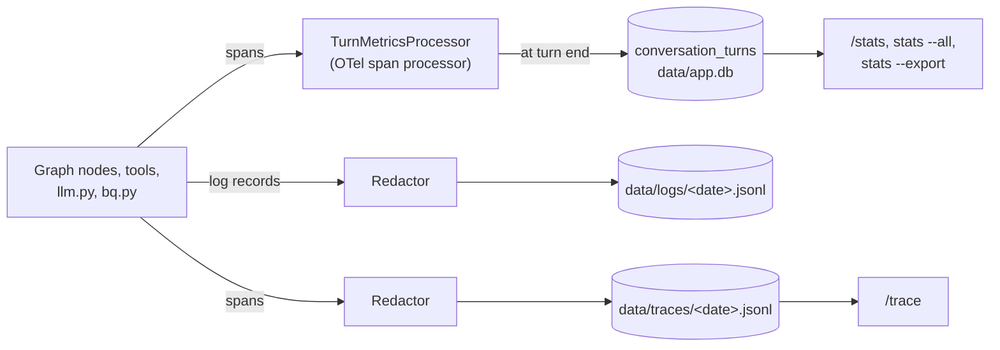

# Spec 35: Observability and statistics

- **Status:** Draft
- **Phase and stream:** Phase 2, stream C
- **Depends on:** 00 (trace format, error types), 30 (output scanner), 31 (nodes), 34 (`conversation_turns`), 36 (retry and breaker events)
- **Requirements covered:** Req 7 (observability). Part of Req 2 (no PII in logs and traces).

---

## Part A — Product (review this part)

### A1. Goal

The product owner and the support team can see when the assistant fails and why. Each turn leaves a full, masked record of its steps. A local view shows the last turn step by step. A statistics view shows the speed, the size, the cost and the failures over a period. No personal data goes into a log or a trace.

### A2. Behavior the user sees

1. **The last turn.** After an answer, the user types `/trace`. The terminal shows each step of the turn, with its time and tokens. The steps are the routing, the SQL with masked values, the guard decision, the BigQuery job and the answer.
2. **A failed turn.** An error message ends with "Trace: 4f2a9c1e". Support types `/trace 4f2a9c1e` and sees which step failed and the error type.
3. **Statistics.** `/stats` shows the user's own figures for the last 7 days:
   - the number of questions, the median and p95 time, the answer length,
   - the tokens, the queries and the bytes billed,
   - the failures by type and the self-correction success,
   - the guard blocks and the delete confirmations.
4. **All users.** The operator runs `opsfleet-agent stats --all --days 30` outside the chat. It shows the same figures for all users.
5. **Export.** `opsfleet-agent stats --export csv` writes one row for each turn to `data/exports/stats-2026-11-12.csv`. The file has figures only, no question or answer text.
6. **No PII.** A blocked query with `WHERE email = 'anna@example.com'` appears in the trace as `WHERE email = '<s:16>'`. An email address that the user types appears in the log as `[removed]`.
7. **Old data goes away.** Traces and logs older than 30 days, and the question and answer texts older than 90 days, are deleted at the start of the CLI.

### A3. Scope

- **In scope:**
  - the span attributes of each step, and the turn record,
  - structured JSON logs,
  - the masking of SQL text, free text and prompts in logs and traces,
  - the statistics and their definitions,
  - `/trace`, `/stats`, `opsfleet-agent stats`, the export,
  - the retention of local data,
  - the decision about LangSmith.
- **Out of scope:**
  - dashboards and alerts in production (design only, Cloud Monitoring),
  - user feedback ratings (design only),
  - the evaluation runs (specs 20–23).

### A4. Limits the user sees

| Item | Value |
|---|---|
| `/stats` default period | 7 days. `--days N` up to 90. |
| `/trace` | The current user's traces only. Other trace IDs give "Trace not found." |
| Trace and log retention | 30 days |
| Question and answer text retention | 90 days. The figures of a turn stay for 1 year. |
| Attribute value length in a trace | 2,000 characters |

### A5. Done when

- [ ] Each turn writes one row in `conversation_turns` with the metric columns, also for a refusal, a limit, a cancel and an internal error.
- [ ] Each turn writes one trace with the spans of B2.2.
- [ ] `/trace` shows the last turn as a tree in less than 1 s.
- [ ] `/stats` shows each figure of B2.4. A unit test with a fixture database checks each value.
- [ ] The export has no text column and no PII.
- [ ] The redaction tests in B4 pass: no email, phone, address or PII literal in any log line or span.
- [ ] Retention deletes old files and texts at start. A test with a fake clock proves it.
- [ ] No data leaves the machine. No external service receives traces.

---

## Part B — Technical

### B1. Key decisions

| | Decision | Choice | Alternatives | Reason |
|---|---|---|---|---|
| ⚑ | LangSmith | Not in the prototype. Local OpenTelemetry spans to JSONL, and the turn table in SQLite. An optional OTLP exporter setting stays off. | LangSmith (SaaS, free tier). Langfuse (self-hosted). | See B2.6. LangSmith sends questions, SQL and figures to an outside service and needs a key for each reviewer. The OTLP setting keeps LangSmith or Langfuse possible later. |
| ⚑ | Prompts in traces | Captured in masked form: data blocks become references, the system text becomes its `prompt_version`, free text goes through the scanner. On by default. | Off. Full prompts. | Req 7 asks for "the message correspondence". Masked prompts show it without rows or PII. |
| ⚑ | Who sees which statistics | `/stats` in the chat: own turns only. `opsfleet-agent stats --all`: all users, for the operator on the machine. | All users in `/stats` | A manager does not see the questions or the figures of other users. |
| | Turn figures | One row for each turn in `conversation_turns` (spec 34), filled from the spans of the turn | Compute from the JSONL files each time | SQL on one table is fast and simple. The JSONL files stay for the deep dive. |
| | Percentiles | Nearest-rank method, computed in Python | SQLite extensions | No extension needed. The method is stated in the output. |
| | Logs | Python `logging` with a JSON formatter to `data/logs/<UTC date>.jsonl`. `trace_id` and `span_id` in each line. | Plain text logs | A JSON line is searchable and links to the trace. |

### B2. Design

#### B2.1 Data flow



- The `Redactor` runs in the exporter, before any write. So no code path can write an unmasked span.
- `TurnMetricsProcessor` collects the attributes of all spans of one `trace_id` in memory. The `finish` node (spec 31) reads them and writes the turn row.
- If the turn ends with an exception, the CLI (spec 37) calls the same writer with status `failed` and type `internal_error`.

#### B2.2 Spans and attributes

The trace record format of spec 00 stays. This spec defines the attributes. The exporter drops any attribute that is not in this list.

| Span kind | Name examples | Attributes |
|---|---|---|
| `turn` | `turn` | `user_id`, `conversation_id`, `turn_no`, `intent`, `status`, `error_type`, `model`, `prompt_version` |
| `node` | `node.route`, `node.write_sql` | `node`, `attempt`, `step_index`, `error_type` |
| `llm` | `llm.generate` | `model`, `fallback_used`, `tokens_in`, `tokens_out`, `tokens_estimated`, `retries`, `finish_reason`, `prompt_masked`, `output_masked`, `error_type` |
| `tool` | `tool.delete_reports`, `tool.export_report` | `tool`, `side_effect`, `report_ids`, `error_type` |
| `sql` | `sql.dry_run`, `sql.query`, `sql.empty_check` | `sql_masked`, `job_id`, `bytes_processed`, `bytes_billed`, `row_count`, `truncated`, `retries`, `error_type` |
| `guard` | `guard.check`, `guard.mask`, `guard.scan` | `outcome`, `reason_code`, `tables`, `rewritten`, `masker_hit`, `scan_hits`, `scan_patterns` |
| `limit` | `limit.exceeded` | `limit_name`, `value`, `max` |
| `confirm` | `confirm.delete` | `outcome`, `reason`, `count`, `ids_hash` |

Spec 36 adds the events `retry` and `circuit_open` on `llm` and `sql` spans.

**Change to spec 00:** each span with `status` = `error` has the attribute `error_type` (a value of the spec 00 list).

#### B2.3 Masking

`Redactor` in `observability/redact.py`:

1. **SQL text.** `mask_sql(sql)` parses the SQL with sqlglot.
   - A string literal stays only if it is compared to a column in this list: `products.brand`, `products.category`, `products.department`, `products.name`, `orders.status`, `order_items.status`, `users.state`, `users.city`, `users.country`, `users.gender`, `orders.gender`, `users.traffic_source`.
   - Each other string literal becomes `'<s:N>'`, with N = the length.
   - A number compared to a PII column becomes `<n>`.
   - SQL that does not parse: each quoted string becomes `'<s:N>'`, and each number of 5 or more digits becomes `<n>`.
2. **Free text** (user message, answer, model output, error messages): the `OutputScanner` of spec 30. Each hit becomes `[removed]`.
3. **Prompts** (`prompt_masked`):
   - each data block becomes `<data ref="res_…" rows="N"/>`,
   - the system instruction becomes `<system version="…"/>`,
   - the rest goes through rule 2.
4. **Attributes.** Only the attributes of B2.2. Each value has at most 2,000 characters.
5. **Logs.** The same rules on the message and on each extra field. Loggers of other libraries (`google`, `urllib3`, `httpx`) log at `WARNING` and above only.

#### B2.4 Statistics

`conversation_turns` (spec 34) gets these columns:

| Column | Content |
|---|---|
| `kind` | `question`, `report`, `delete`, `other` |
| `status` | `answered`, `true_zero`, `refused`, `blocked`, `failed`, `limit`, `confirmation_shown`, `confirmed`, `cancelled` |
| `duration_ms` | From the `turn` span |
| `answer_words`, `answer_chars` | Of the final text |
| `llm_calls`, `tokens_in`, `tokens_out` | Sums of the `llm` spans |
| `bq_queries`, `bq_bytes_billed` | Sums of the `sql` spans, with the empty-result checks |
| `attempts_total`, `retried` | From the `node.write_sql` spans |
| `errors` | JSON: error type and count, for all spans of the turn |
| `guard_block_reason` | The reason code of a policy block |
| `empty_result_kind` | `error`, `true_zero`, `unknown`, or NULL |
| `confirmation_outcome` | From the `confirm` span |
| `tools_used` | JSON: tool or node name and count |
| `model`, `fallback_used`, `circuit_open` | From the `llm` spans and spec 36 |
| `prompt_version` | From the `turn` span |

**Figures in `/stats`:**

| Group | Figures |
|---|---|
| Volume | Turns, questions, reports, deletes, by status |
| Time | Median and p95 of `duration_ms`, separately for questions and reports |
| Answer length | Median and p95 of `answer_words` |
| Tokens | Median `tokens_in` and `tokens_out` for each turn, total for the period. Average model calls for each turn. |
| Tools | Count for each tool and node in `tools_used` |
| Failures | Turns by final `error_type`. All errors by type, also the errors that self-correction resolved. |
| Self-correction | Turns with a retry, the share of them that ended `answered` or `true_zero`, the average attempts |
| Guard | Policy blocks by reason code. Masker hits. Scanner hits. |
| Empty results | Count by `empty_result_kind` |
| Confirmations | Count of each outcome: shown, `confirmed`, cancelled by reason |
| BigQuery | Total bytes billed, median and p95 for each query, the 5 turns with the most bytes |
| Resilience | Retries, fallback model use, circuit opens (spec 36) |

The percentile method is nearest-rank. The output says "p95 (nearest rank, n = …)". With fewer than 20 turns, it shows "p95: not enough data".

#### B2.5 Retention

`prune(now)` runs at the start of `chat` and in `opsfleet-agent purge`:

- It deletes the files in `data/traces/` and `data/logs/` that are older than 30 days.
- It sets `user_text` and `answer_text` to NULL in `conversation_turns` rows older than 90 days.
- It deletes `conversation_turns` rows older than 1 year.
- It deletes `result_cache` rows after their `expires_at` (spec 34).

#### B2.6 LangSmith: the comparison

| Point | LangSmith | Local OpenTelemetry (chosen) |
|---|---|---|
| Where the data goes | An outside SaaS. Questions, SQL, figures and model outputs leave the machine. | The local `data/` folder only |
| Setup for a reviewer | An account and an API key | Nothing |
| Cost | Free tier with a monthly trace limit | Free |
| Capture of our model calls | Automatic for LangChain models. Our nodes call `google-genai` directly, so each call needs a wrapper. | The spans of spec 00 already exist |
| UI | A full trace UI and evaluation tools | `/trace` and `/stats` in the terminal |
| Production path | Another vendor next to Google Cloud | The same spans go to Cloud Trace (architecture section 7) |
| Later change | — | LangSmith and Langfuse both accept OpenTelemetry data (OTLP). The setting `tracing.otlp_endpoint` can send the masked spans there. |

Recommendation: local only for the prototype. The setting `tracing.otlp_endpoint` exists, is `null` by default, and requires the user's approval before any use.

### B3. Files and interfaces

```text
src/opsfleet_agent/observability/
  __init__.py
  redact.py            # Redactor, mask_sql(), mask_text(), ATTRIBUTE_ALLOWLIST
  turn_metrics.py      # TurnMetricsProcessor, write_turn_record()
  logging_setup.py     # JSON formatter, file handler, library log levels
  stats.py             # compute_stats(period, user | all) -> Stats, export()
  trace_view.py        # load_trace(trace_id, user) -> TraceTree
  retention.py         # prune(now)
src/opsfleet_agent/tracing.py   # spec 00: the exporter calls the Redactor
```

**Settings:**

```yaml
tracing:
  capture_prompts: true
  attribute_max_chars: 2000
  otlp_endpoint: null        # off. Needs the user's approval before any use.
retention:
  traces_days: 30
  logs_days: 30
  turn_text_days: 90
  turn_metrics_days: 365
stats:
  default_days: 7
  max_days: 90
  export_dir: data/exports
```

**Changes to spec 00:** the attribute `error_type` on error spans. The new folders `data/logs/` and `data/exports/`.

### B4. Tests

| # | Case | Expected |
|---|---|---|
| 1 | `mask_sql("… WHERE email = 'anna@example.com'")` | `'<s:16>'` |
| 2 | `mask_sql("… WHERE p.brand = 'Levi''s'")` | The brand stays |
| 3 | `mask_sql` on SQL that does not parse | All strings masked |
| 4 | `mask_sql("… WHERE postal_code = 94107")` | `<n>` |
| 5 | A user message with a phone number, logged | `[removed]` in the log line |
| 6 | A BigQuery error that quotes a literal | Masked in the span |
| 7 | A prompt with a data block | `<data ref=… rows=…/>` in `prompt_masked` |
| 8 | A span with an unknown attribute | Attribute dropped |
| 9 | Each turn status (answered, refused, blocked, limit, cancelled, internal error) | One `conversation_turns` row each |
| 10 | Fixture database with 40 turns | Each figure of B2.4 equals the expected value |
| 11 | Fixture with 10 turns | "p95: not enough data" |
| 12 | `/stats` as a manager | Own turns only |
| 13 | `/trace` with a trace ID of another user | "Trace not found." |
| 14 | `/trace` on a fixture JSONL | The expected tree text |
| 15 | Export | No `user_text`, no `answer_text`, the expected columns |
| 16 | `prune` with a fake clock | Old files deleted, old texts NULL |
| 17 | `otlp_endpoint` is `null` | No exporter other than the JSONL exporter |
| 18 | A scan of all files in `data/traces/` and `data/logs/` after the unit test suite | No match of the scanner patterns, and no PII column value of the fixtures |

### B5. Cost

- Unit tests: 0 Gemini calls, 0 queries.
- `/trace`, `/stats` and the export read local files only. They make no model call and no query.
- Manual check of A2: the turns of other manual checks, plus 0 extra calls.

### B6. Risks and open points

- The masking keeps brand, category and region literals. These are business data, not PII. If OpsFleet sees them as sensitive, the allowlist can become shorter.
- Masked prompts still contain the user's questions (after the scanner). This is necessary for the deep dive of Req 7.
- The JSONL files grow with long debugging sessions. At the expected use (about 10 questions each day on one machine), 30 days stay under 100 MB.
- The statistics are local to one machine. Production uses Cloud Logging, a BigQuery log sink and Cloud Monitoring (architecture section 7).
