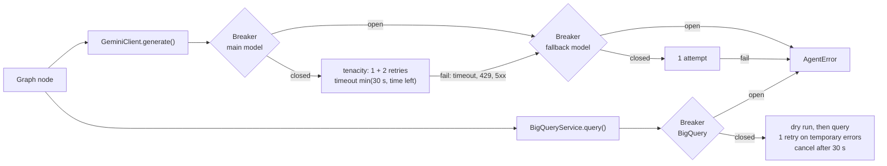
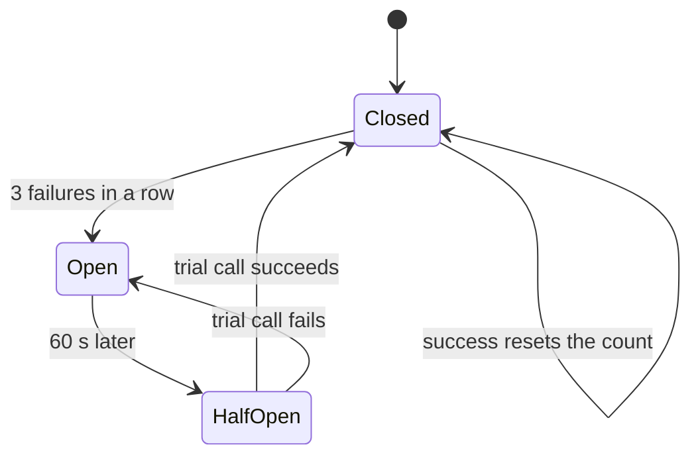

# Spec 36: Resilience

- **Status:** Draft
- **Phase and stream:** Phase 2, stream C
- **Depends on:** 00 (clients, budget, error types), 31 (graph), 35 (spans and statistics)
- **Requirements covered:** Req 5 (resilience to failures of outside services, no crash of the interface, no cost growth)

---

## Part A — Product (review this part)

### A1. Goal

Sometimes Gemini or BigQuery is slow or not available. Then the assistant tries again a fixed number of times, and uses a second model when that helps. If the service still fails, the assistant gives a clear message. The CLI never stops with an error. Retries never break the cost and time limits of spec 00.

### A2. Behavior the user sees

1. **A short failure.** Gemini returns "busy" once. The assistant waits 1–2 s and tries again. The user sees only a slightly slower answer.
2. **The main model is busy.** The main model fails 3 times. The assistant asks the fallback model once. The answer comes, and `/trace` shows "fallback model".
3. **Gemini is down.** Both models fail. The message is: "The AI service is not available now. Your saved reports still work: /reports, /open, /export, /undo. Please try again in a minute. Trace: 4f2a9c1e." The chat continues.
4. **Fast failure after repeated errors.** After 3 failures in a row, the assistant stops calls to that service for 60 s. Questions in that time get the message at once, without a wait.
5. **BigQuery is down.** A data question gets: "BigQuery is not available now. You can still use /reports, /open and /export. Please try again in a minute." The assistant does not spend model calls on SQL in that time. Schema questions still work from the cache.
6. **The daily free-tier limit of Gemini.** "The daily Gemini free-tier limit is reached. Please try again tomorrow." No retry.
7. **Expired login.** "BigQuery refused access. Run `gcloud auth application-default login` and check GOOGLE_CLOUD_PROJECT."
8. **A wrong API key.** "The Gemini API key is not valid. Check GOOGLE_API_KEY in the .env file."
9. **A slow query.** A query runs longer than 30 s. The assistant stops the BigQuery job and suggests a shorter period.
10. **Ctrl-C during an answer.** The assistant stops the current question and stops the running BigQuery job. It shows "Stopped." The chat continues. A second Ctrl-C at the empty prompt ends the CLI.
11. **An unexpected error.** "Something went wrong on my side. The chat continues. Trace: 4f2a9c1e." The details go to the log file, not to the screen.

### A3. Scope

- **In scope:**
  - the retry policy for each service, and the timeouts,
  - the fallback model and the circuit breaker,
  - the error mapping, and the user message for each error type,
  - the behavior when a service is down,
  - the protection of the CLI against crashes, and Ctrl-C.
- **Out of scope:**
  - the self-correction of SQL errors (spec 31),
  - high availability in production (design only: Cloud Run, Vertex AI quotas),
  - automatic changes of the limits.

### A4. Limits the user sees

| Item | Value |
|---|---|
| Gemini retries for each call | 2 (spec 00), then 1 attempt with the fallback model |
| BigQuery retries for each query | 1, only for temporary errors |
| Wait between retries | 1 s, then 2 s (plus a random part). A `Retry-After` up to 10 s. |
| Stop after repeated failures | 3 failures in a row stop the calls to that service for 60 s |
| Query time | 30 s, then the job stops |
| Time for each answer | Spec 00: 60 s for a question, 150 s for a report. Retries and waits count in this time. |

### A5. Done when

- [ ] Each error type of spec 00 has one user message (B2.5). A unit test checks each one.
- [ ] Each retry rule in B2.2 has a unit test with a fake service and a fake clock.
- [ ] No retry starts when the turn time cannot cover the call. The turn then ends with the time limit message.
- [ ] The fallback model runs at most once for each call, and only for the errors in B2.3.
- [ ] The circuit breaker opens after 3 failures, rejects calls for 60 s without network, and closes after one good trial call.
- [ ] When BigQuery is down, a data question makes at most 1 model call (the route).
- [ ] A BigQuery job that passes 30 s is cancelled. A unit test checks the cancel call.
- [ ] An exception in any node gives a message and the chat continues. A parametrized test raises an exception in each node.
- [ ] The library retries of `google-genai` and `google-cloud-bigquery` are off. Only the policies of this spec retry.

---

## Part B — Technical

### B1. Key decisions

| | Decision | Choice | Alternatives | Reason |
|---|---|---|---|---|
| ⚑ | Fallback model | `gemini-3.8-flash` on the same free-tier key, one attempt for each failed call. Spec 51 makes the final choice. | No fallback. A paid model. | The free-tier limits are for each model, so another model often still has capacity. The free tier adds no cost. |
| ⚑ | Circuit breaker | One breaker for each model and one for BigQuery. 3 failures in a row open it for 60 s. One trial call then decides. | No breaker. A breaker on an error rate. | A simple counter is easy to test. 60 s matches the per-minute limits of the free tier. |
| ⚑ | BigQuery retries | 1 retry, only for temporary errors. The library default retries are off. | The library defaults | The library defaults retry for several minutes. That breaks the 60 s limit. |
| | Retry library | `tenacity`, inside `llm.py` and `bq.py` | LangGraph `RetryPolicy` on nodes | A node retry repeats the whole node and adds to the client retries. One layer of retries keeps the limits clear. |
| | Breaker state | In memory, for each CLI process | A shared store | One process serves one user in the prototype. |
| | Gemini SDK retries | Off (`HttpOptions` retry attempts = 1) | SDK defaults | A test call hung on 2026-11-11 because the SDK repeated the call (spec 00). |

### B2. Design

#### B2.1 Where the parts sit



Before each attempt, the client calls `budget.charge()` (spec 00). The budget checks the daily ledger and the turn time.

#### B2.2 Retry policies

| Service and call | Timeout | Retries | Retry on | Do not retry on |
|---|---|---|---|---|
| Gemini `generate` (main model) | `min(30 s, time left − 2 s)` | 2 | HTTP 429 with `Retry-After` of 10 s or less, 500, 502, 503, 504, timeout, connection error | 400, 401, 402, 403, 404, a 429 for a daily quota, a safety block |
| Gemini `generate` (fallback model) | The same | 0 | — | — |
| BigQuery dry run | 10 s | 1 | Temporary errors (below) | All other errors |
| BigQuery query | `job_timeout_ms` = 30,000, result wait 30 s, both capped by the time left | 1 | Temporary errors | `invalidQuery`, `notFound`, `accessDenied`, `bytesBilledLimitExceeded`, `quotaExceeded`, timeout |
| Schema and value cache build | 10 s | 1 | Temporary errors | All other errors. An existing cache is used. |
| SQLite | Busy timeout 5 s | 1 | `database is locked` | All other errors |

- **Wait:** 1 s before the first retry, 2 s before the second. Each wait gets a random part of up to 50%. A `Retry-After` header of 10 s or less replaces the wait.
- **Temporary BigQuery errors:** `backendError`, `internalError`, `rateLimitExceeded`, HTTP 500 and 503, and connection errors.
- **Time:** the client does not start an attempt when the time left is less than 5 s. It raises `LimitExceeded("time")`.
- **Counting:** each attempt counts as one Gemini call in the daily ledger, because the free tier counts each request. The turn limit of 8 model calls counts each logical call once.
- **Library retries off:** `google-genai` with `HttpOptions(timeout=…, retry_options=HttpRetryOptions(attempts=1))`. `client.query(…, retry=<10 s policy>, job_retry=None)` and `job.result(timeout=…)` in `bq.py`. The names follow the installed SDK versions.
- **Cancel:** on a query timeout or on Ctrl-C, `bq.py` calls `job.cancel()`. The error type is `bq_timeout`.

#### B2.3 Fallback model

- It runs when the main model fails with `llm_timeout`, `llm_rate_limited` (not daily) or a 5xx after all retries, or when the main model's breaker is open.
- It does not run for 400, 401, 402, 403, a safety block or a daily quota.
- It gets the same request and the same JSON schema.
- The span gets `fallback_used = true`. The turn row gets the same flag (spec 35).
- `models.fallback` in `config/settings.yaml` holds the name. `null` turns the fallback off.

#### B2.4 Circuit breaker



- A failure here means a temporary failure after all retries: timeout, 429 (not daily), 5xx, connection error. A 400 or a SQL error does not count.
- A daily-quota 429 from Gemini opens that model's breaker until the next midnight UTC.
- While the breaker is open, a call fails at once with the service's error type and the attribute `circuit_open = true`.
- Before `write_sql`, the graph (spec 31) checks the BigQuery breaker. If it is open, the turn ends with the BigQuery message. This saves model calls.

#### B2.5 Error mapping and user messages

| Error type | Source | User message |
|---|---|---|
| `llm_timeout` | Timeout, also after the fallback | "The AI service did not answer in time. Please try again." |
| `llm_rate_limited` | 429 | "The AI service is busy. Please wait a minute and try again." Daily quota: "The daily Gemini free-tier limit is reached. Please try again tomorrow." |
| `llm_error` | 401, 403, invalid key | "The Gemini API key is not valid. Check GOOGLE_API_KEY in the .env file." |
| `llm_error` | 402 | "The Gemini key belongs to a project with billing and no credit. Use a key from a project without billing (see the setup guide)." |
| `llm_error` | Safety block | "The AI service refused to answer this message. Please rephrase the question." |
| `llm_error` | Other, and both models down | The message of A2.3 |
| `bq_syntax`, `bq_not_found` | After 3 attempts (spec 31) | The `give_up` message of spec 31 |
| `bq_permission` | `accessDenied`, a credential refresh error | The message of A2.7 |
| `bq_timeout` | Job over 30 s | "The query took longer than 30 s. Please ask for a shorter period or fewer details." |
| `bq_bytes_cap` | Dry run over 1 GB | The spec 00 message |
| `bq_error` | Temporary errors after retries, open breaker | The message of A2.5 |
| `guard_policy_block`, `guard_parse_error` | Spec 30 | Spec 30 and spec 31 |
| `empty_result` | Spec 30 | Not an error message. The answer explains the zero. |
| `limit_exceeded` | Spec 00 | The spec 00 messages |
| `confirmation_rejected` | Spec 33 | The spec 33 messages |
| `tool_error` | A tool fails, for example a file write | "The action '<tool>' failed: <short reason>." |
| `internal_error` | Any other exception | The message of A2.11 |

Each failure message ends with "Trace: <first 8 characters of the trace ID>". The messages are in `agent/prompts/replies.yaml`, next to the other prepared texts.

#### B2.6 No crash

1. **Node wrapper.** `safe_node(fn)` wraps each graph node. It turns an `AgentError` into the state fields `turn.error_type` and the message. It turns any other exception into `internal_error`, writes the stack trace to the log file, and sets the span status to `error`. The graph then goes to `finish`.
2. **Graph limit.** `recursion_limit = 60`. A `GraphRecursionError` becomes `internal_error`.
3. **CLI loop.** The CLI (spec 37) catches every exception around one turn. It shows the `internal_error` message and writes the turn row (spec 35).
4. **Ctrl-C.** During a turn: cancel the running BigQuery job, end the turn with status `cancelled`, and show "Stopped.". At an empty prompt: a second Ctrl-C within 2 s ends the CLI.
5. **Checkpoint errors.** If the checkpoint write fails, the answer still shows, with the note "This turn is not saved."
6. **Start errors.** A missing schema cache with BigQuery down stops the start with a clear message. A missing `.env` value stops the start and names the variable.

### B3. Files and interfaces

```text
src/opsfleet_agent/resilience/
  __init__.py
  policies.py      # RetryPolicySpec for each service, is_temporary(), wait rules
  breaker.py       # CircuitBreaker(name, threshold, open_seconds, clock)
  errors_map.py    # map_gemini_error(exc) -> ErrorType, map_bq_error(exc) -> ErrorType
  safe_node.py     # safe_node decorator
src/opsfleet_agent/llm.py   # spec 00: policies, breaker, fallback
src/opsfleet_agent/bq.py    # spec 00: policies, breaker, cancel, library retries off
```

**Interfaces:**

```python
class CircuitBreaker:
    def __init__(self, name: str, threshold: int, open_seconds: float, clock: Clock) -> None: ...
    def allow(self) -> bool: ...
    def record_success(self) -> None: ...
    def record_failure(self, until: datetime | None = None) -> None: ...
    state: Literal["closed", "open", "half_open"]

# spec 00 signature, extended with keyword arguments:
GeminiClient.generate(request, *, schema=None, allow_fallback=True) -> LlmResponse   # LlmResponse.model, .fallback_used
```

**Settings:**

```yaml
models:
  main: gemini-3.5-flash-lite
  fallback: gemini-3.8-flash        # null turns the fallback off. Spec 51 decides.
resilience:
  gemini_timeout_s: 30
  gemini_retries: 2
  bq_dry_run_timeout_s: 10
  bq_query_timeout_s: 30
  bq_retries: 1
  retry_waits_s: [1, 2]
  retry_after_max_s: 10
  min_time_left_s: 5
  breaker_threshold: 3
  breaker_open_s: 60
  graph_recursion_limit: 60
```

**Changes to spec 00:** `GeminiClient.generate()` gets `allow_fallback`. The response has `model` and `fallback_used`. `bq.py` cancels jobs on timeout. The `llm` and `sql` spans get the events `retry` and `circuit_open` (spec 35).

### B4. Tests

All unit tests use fake clients and a fake clock. No real wait happens.

| # | Case | Expected |
|---|---|---|
| 1 | Gemini 503, then success | 2 attempts, wait about 1 s on the fake clock |
| 2 | Gemini 429 with `Retry-After: 4` | Wait 4 s, then retry |
| 3 | Gemini 429 with `Retry-After: 30` | No retry, fallback once |
| 4 | Gemini 429 for a daily quota | No retry, no fallback, daily message, breaker open until midnight UTC |
| 5 | Gemini 503 three times, fallback succeeds | Answer, `fallback_used = true` |
| 6 | Gemini 503 three times, fallback fails | Message of A2.3, `llm_error` |
| 7 | Gemini 400, 401, 402, 403, safety block | No retry, no fallback, the B2.5 message for each |
| 8 | Time left 4 s before an attempt | `LimitExceeded("time")`, no call |
| 9 | Retries and the daily ledger | Each attempt counted |
| 10 | Breaker: 3 failures | Open. The fourth call makes no network call. |
| 11 | Breaker: 60 s later, a good trial | Closed |
| 12 | Breaker: 60 s later, a bad trial | Open again |
| 13 | A SQL error | Not counted by the breaker |
| 14 | BigQuery `backendError`, then success | 2 attempts |
| 15 | BigQuery `invalidQuery` | No retry, `bq_syntax` |
| 16 | BigQuery job over 30 s | `job.cancel()` called, `bq_timeout` |
| 17 | BigQuery breaker open, data question | 1 model call (route), BigQuery message |
| 18 | BigQuery breaker open, schema question | Answer from the cache |
| 19 | `client.query` arguments | `job_retry=None` and the 10 s `retry` |
| 20 | `google-genai` client options | Retry attempts = 1 |
| 21 | An exception in each node (parametrized) | `internal_error` message, turn row written, the next turn works |
| 22 | `GraphRecursionError` | `internal_error` message |
| 23 | Ctrl-C during `run_query` | Job cancelled, "Stopped.", the chat continues |
| 24 | Checkpoint write fails | Answer shown, "This turn is not saved." |
| 25 | SQLite locked once | One retry, success |

**Manual checks** (before the submission, inside Docker): a wrong API key, no network, an expired ADC login. Each gives its message, and the CLI stays open.

### B5. Cost

- Unit tests: 0 Gemini calls, 0 queries.
- Manual checks: about 3 Gemini calls that fail at once (wrong key, no network), and 0 queries billed. Failed jobs bill 0 bytes.
- The fallback model on the free tier costs nothing. On a paid tier it costs more than the main model. Spec 51 checks this.

### B6. Risks and open points

- Spec 00 gives Gemini a 30 s timeout and 2 retries, which is more than 60 s in total. This spec caps each attempt by the time left, so the 60 s limit wins.
- The SDK option names for the retries can change between versions. A unit test checks the options on the client object.
- The detection of a daily quota reads the error details of the Gemini API. If the format changes, the error counts as a normal 429. The breaker then still stops the calls.
- Breakers live in one process. A second CLI on the same machine has its own breakers. This is fine for the prototype.
