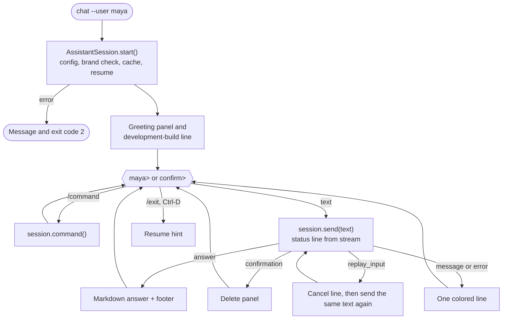

# Spec 37: CLI

- **Status:** Approved (owner review, 2026-11-11)
- **Phase and stream:** Phase 2, stream C (last part of the stream)
- **Depends on:** 00, 01, 31, 32, 33, 34, 35, 36
- **Requirements covered:** Deliverable 4 (CLI-based chat). The user side of Req 3 (the confirmation panel), Req 5 (no crash, clear errors) and Req 7 (`/trace`, `/stats`).

---

## Part A — Product (review this part)

### A1. Goal

The final terminal interface. A user starts a chat with one command, asks questions, reads answers as formatted text and tables, and manages the saved reports with short commands. Errors and confirmations are clear, and the CLI never stops with a crash.

### A2. Behavior the user sees

1. **Start.** `opsfleet-agent chat --user maya` shows a greeting panel. It contains the name, the role, the brands, the date range of the data and the conversation ID. It ends with the hint "Type a question, or /help."
2. **Development build.** A part of the prototype is not ready yet. Then a line under the greeting names it, for example: "Development build: delete with confirmation is not active yet." When all parts are ready, the line does not appear.
3. **A question.** Maya types a question. A status line shows the current step and the seconds, for example "Running the query (BigQuery) … 4 s". The answer appears as formatted text, with tables where useful. A short grey line follows: "12.4 s · 3 model calls · 2 queries · 34 MB · trace 4f2a9c1e".
4. **Commands.** Commands start with `/`. They never call the AI model or BigQuery.

   | Command | Result |
   |---|---|
   | `/help` | The list of commands and 3 example questions |
   | `/reports` | A table of the user's reports: ID, title, period, date, files |
   | `/open <id>` | The report in the terminal. Charts show as a line with their title. |
   | `/export <id> --format html` or `--format md` | Writes the file and shows its path |
   | `/undo [batch]` | Restores the last deleted reports (spec 33) |
   | `/trace [trace]` | The steps of the last turn, or of the given trace (spec 35) |
   | `/stats [--days N]` | The user's statistics (spec 35) |
   | `/exit` | Ends the chat |

5. **Delete confirmation.** Maya asks to delete reports. A red-bordered panel "Delete these reports?" lists the reports (ID, title, date, why it matches). Under it: "To delete these 3 reports, type: delete 3. Any other answer cancels. You can undo for 30 days with /undo." The prompt changes from `maya>` to `confirm>`.
6. **After the confirmation.** A green line: "Deleted 3 reports. Undo with /undo (batch D-4F8KQ)." Or a yellow line: "Delete cancelled. Nothing was deleted."
7. **Refusals and blocks.** A refusal, a guard block or a limit appears as one yellow line that starts with "Not possible:" or "Limit:".
8. **Errors.** A service error or an internal error appears as one red line that starts with "Error:" and ends with the trace ID. No Python traceback appears.
9. **End.** `/exit` or Ctrl-D shows: "Conversation C-8M2QX saved. Continue it with: opsfleet-agent chat --user maya --resume C-8M2QX".
10. **Other commands of the program.**

    | Command | Result |
    |---|---|
    | `opsfleet-agent conversations --user maya` | Maya's conversations of the last 90 days (spec 34) |
    | `opsfleet-agent stats [--all] [--days N] [--export csv\|json]` | Statistics and export (spec 35) |
    | `opsfleet-agent purge [--dry-run]` | Permanent delete of reports deleted more than 30 days ago (spec 33), and the retention cleanup (spec 35) |

11. **Scripted input.** `printf "How many orders in 2024?\n/exit\n" | opsfleet-agent chat --user maya` works. Without a terminal, the CLI prints plain text without colors and without the status line.

### A3. Scope

- **In scope:**
  - the Typer commands and options,
  - the chat loop and the slash commands,
  - the output of answers, tables, reports, confirmations, errors and progress,
  - the development-build line,
  - the plain mode without a terminal,
  - the session interface between the CLI and the assistant core.
- **Out of scope:**
  - the logic behind each command (specs 32–36),
  - the local web UI (specs 40 and 52),
  - a user switch inside a chat (gap analysis B1: restart with another `--user`),
  - command history saved to disk.

### A4. Limits the user sees

| Item | Value | Message |
|---|---|---|
| Message length | 4,000 characters (spec 31) | "Your message is too long. Please keep it under 4,000 characters." |
| Unknown command | — | "Unknown command '/x'. Type /help." |
| Wrong command arguments | — | The usage line of the command, for example "Usage: /export <id> --format html\|md" |
| Terminal width | 80 columns or more | Narrower terminals wrap the tables |

### A5. Done when

- [ ] `opsfleet-agent --help` and `opsfleet-agent chat --help` list all commands and options.
- [ ] Each slash command in A2.4 works, and makes no model call and no query. A unit test with a fake session checks each one.
- [ ] The delete panel, the `confirm>` prompt and both outcomes look as in B2.4.
- [ ] Text that is not the confirmation cancels the delete, and the CLI sends the same text as a new question.
- [ ] Each error type of spec 00 appears as one line with the right prefix and color, and with the trace ID for failures.
- [ ] No traceback appears on the screen without `--debug`.
- [ ] The development-build line names the missing parts, and disappears when all parts are ready.
- [ ] The scripted input of A2.11 works, and its output has no color codes.
- [ ] The output fits an 80-column terminal. Snapshot tests check the main screens.

---

## Part B — Technical

### B1. Key decisions

| | Decision | Choice | Alternatives | Reason |
|---|---|---|---|---|
| ⚑ | Interface between the CLI and the core | A small `AssistantSession` class (B3). The CLI only shows the results. The session holds the graph, the pending confirmation and the commands. | The CLI calls the graph directly (spec 01) | The local web UI (spec 52) and the evaluation runner (spec 23) can use the same session. No safety rule lives in the CLI. |
| ⚑ | Footer line with time, calls, queries, bytes and trace ID | On by default in the prototype. `cli.show_footer: false` turns it off. | Off | Reviewers and testers see the cost and speed of each answer. Executives in production do not use this CLI. |
| | Libraries | Typer for commands, Rich for output | `argparse`, plain text | Decided in the architecture. |
| | Line input | Python `input()` through Rich. `readline` history in memory only. | `prompt_toolkit` | No extra dependency. A history file can store personal text. |
| | Progress | LangGraph `stream(..., stream_mode="updates")`. Each node name maps to a status text. | No progress | A 20–90 s wait needs a visible step. |
| | Answer timing | The CLI prints the answer when `scan_output` ends. The memory update (spec 34) runs after that, under the status "Updating the conversation memory". | Print at the graph end | The user reads the answer earlier. |
| | Plain mode | When stdin or stdout is not a terminal: no colors, no status line, the same texts | Always rich output | Scripted demos and tests get clean text. Rich also respects `NO_COLOR`. |

### B2. Design

#### B2.1 The chat loop



The CLI wraps each `send()` and `command()` call in `try/except`. Any exception there becomes the `internal_error` line (spec 36).

#### B2.2 Status texts

| Node | Status text |
|---|---|
| `route` | Reading the question |
| `write_sql` | Writing the query |
| `guard` | Checking the query |
| `run_query` | Running the query (BigQuery) |
| `check_empty` | Checking why the result is empty |
| `write_answer` | Writing the answer |
| `plan_report` | Planning the report |
| `write_report` | Writing the report |
| `render` | Drawing the charts |
| `summarize` | Updating the conversation memory |
| Other | Working |

The status line also shows the attempt number on a retry, for example "Writing the query (attempt 2 of 3)".

#### B2.3 Output formats

- **Answer.** `rich.markdown.Markdown(text)`. Rich markup in the model text is not interpreted. Tables in the answer become Rich tables.
- **Footer.** `<seconds> s · <model calls> model calls · <queries> queries · <MB billed> MB · trace <8 characters>`. Grey. Only after answers and reports.
- **`/reports`.** A Rich table: `ID`, `Title` (at most 50 characters), `Period`, `Created` (local date), `Files` (`HTML`, `MD` or empty). Under it: "Showing the newest 50 of N reports" when necessary. No reports: "You have no saved reports."
- **`/open`.** A panel with the title. The body as Markdown. Each chart as one line: "[Chart: Revenue by month (line). Export as HTML to see it.]".
- **`/export`.** "Saved: data/reports/maya/R-7K2PQ.html", as a `file://` link when the terminal supports links.
- **`/trace`, `/stats`.** The views of spec 35 (a Rich tree and Rich tables).
- **Message lines:**

  | Kind | Prefix | Color | Trace ID |
  |---|---|---|---|
  | Refusal (off-topic, unsafe) | none | default | no |
  | Guard policy block, empty-result note | "Not possible:" | yellow | no |
  | `limit_exceeded` | "Limit:" | yellow | yes |
  | Delete cancelled | none | yellow | no |
  | Delete done, undo done, export done | none | green | no |
  | `llm_*`, `bq_*`, `tool_error`, `internal_error`, `give_up` | "Error:" | red | yes |

#### B2.4 Delete confirmation panel

```text
╭─ Delete these reports? ──────────────────────────────────────────────╮
│ ID       Title                                Created     Why        │
│ R-7K2PQ  Q1 2026 sales review                 2026-11-12  this conv. │
│ R-3M9XA  Levi's returns, October              2026-11-12  this conv. │
│ R-9QF2D  Calvin Klein vs Carhartt, Q3         2026-11-12  this conv. │
│                                                                      │
│ To delete these 3 reports, type: delete 3                            │
│ Any other answer cancels. You can undo for 30 days with /undo.       │
╰──────────────────────────────────────────────────────────────────────╯
confirm>
```

- The border is red. The expected text is bold.
- The rows and the expected text come from the `interrupt()` payload (spec 33). The CLI does not build them.
- At `confirm>`, the commands `/help`, `/reports`, `/open`, `/trace` and `/stats` work and keep the pending delete. `/undo`, `/exit`, Ctrl-C and Ctrl-D cancel it (spec 33).
- An empty line at `confirm>` does nothing and shows the prompt again.

#### B2.5 Development-build line

- Each part registers a capability when its module loads: `guard_full` (30), `agent_core` (31), `reports` (32), `delete` (33), `memory` (34), `observability` (35), `resilience` (36).
- `AssistantSession.missing_capabilities()` returns the parts that are not registered.
- The CLI prints "Development build: <names> not active yet." when the list is not empty. Each name has a plain text, for example `delete` = "delete with confirmation".
- The line of spec 01 ("brand scope and PII protection are not active") becomes the case `guard_full` missing.

#### B2.6 Options, start and exit codes

Options of `chat`: `--user <id>` (required), `--resume <conversation_id>` (spec 34), `--refresh-cache` (spec 30), `--debug` (tracebacks on the screen).

| Situation | Message | Exit code |
|---|---|---|
| Normal end | Resume hint | 0 |
| Unknown user | "User 'x' is not in config/users.yaml." | 2 |
| Wrong brand of the user (spec 30) | The spec 30 message | 2 |
| Resume not found or too old (spec 34) | The spec 34 message | 2 |
| Missing `.env` value | "GOOGLE_API_KEY is not set. See the setup guide." | 2 |
| No schema cache and BigQuery down (spec 36) | The spec 36 message | 3 |

### B3. Files and interfaces

```text
src/opsfleet_agent/
  session.py            # AssistantSession, TurnOutcome, CommandOutcome, capabilities
  cli/
    main.py             # Typer app: chat, conversations, stats, purge (replaces the spec 01 version)
    chat_loop.py        # the loop of B2.1
    commands.py         # slash command parsing (shlex) and dispatch to the session
    render.py           # Rich output: answers, tables, panels, lines, footer
    status.py           # node name to status text
```

**`AssistantSession`:**

```python
class AssistantSession:
    @classmethod
    def start(
        cls, user_id: str, resume: str | None, settings: Settings
    ) -> "AssistantSession": ...

    user: UserContext
    conversation_id: str
    pending: ConfirmationView | None

    def greeting(self) -> Greeting: ...
    def missing_capabilities(self) -> list[str]: ...
    def send(
        self, text: str, on_progress: Callable[[ProgressEvent], None] | None = None
    ) -> TurnOutcome: ...
    def command(self, name: str, args: list[str]) -> CommandOutcome: ...
    def close(self) -> CloseInfo: ...


@dataclass
class TurnOutcome:
    kind: Literal["answer", "confirmation", "message", "error"]
    text: str
    error_type: ErrorType | None
    confirmation: ConfirmationView | None  # rows, count, expected text
    replay_input: bool  # spec 33, other text at confirm>
    footer: FooterInfo | None  # seconds, calls, queries, bytes, trace_id
```

- When `pending` is set, `send(text)` resumes the graph with `Command(resume=text)`. Otherwise it starts a new turn with the text as input.
- The session writes the turn row for an exception (spec 35).

**Settings:**

```yaml
cli:
  show_footer: true
  status_line: true
```

**New dependencies:** `typer`, `rich`.

**Changes to spec 01:** `cli/main.py` becomes a thin Typer app over `AssistantSession`. The spec 01 development note becomes the capability line of B2.5.

### B4. Tests

Unit tests use Typer's `CliRunner` and a fake `AssistantSession`. Snapshot tests use `rich.console.Console(width=80, record=True)`.

| # | Case | Expected |
|---|---|---|
| 1 | `--help` of each command | All options listed |
| 2 | Start with all capabilities | No development-build line |
| 3 | Start without `delete` and `memory` | The line names both |
| 4 | Each slash command | The expected output. The fake session records 0 model calls and 0 queries. |
| 5 | `/export R-1 --format pdf` | The usage line |
| 6 | `/nothing` | "Unknown command '/nothing'. Type /help." |
| 7 | Answer with a Markdown table | Snapshot at 80 columns |
| 8 | Confirmation outcome | The panel snapshot, prompt `confirm>` |
| 9 | `/reports` at `confirm>` | The list. The pending delete stays. |
| 10 | Other text at `confirm>` with `replay_input` | The cancel line, then a second `send()` with the same text |
| 11 | Each error type | One line, the right prefix, the trace ID for failures |
| 12 | Exception in `send()` | The `internal_error` line, no traceback, the loop continues |
| 13 | `--debug` and an exception | The traceback appears |
| 14 | Piped input (no terminal) | Plain text, no ANSI codes, no status line |
| 15 | Ctrl-D | The resume hint, exit code 0 |
| 16 | Each start error in B2.6 | The message and the exit code |
| 17 | Progress events | The status texts of B2.2 in order |

**Manual demo** (before the submission, inside Docker): the user journey of the product definition (section 2.2), with Maya and with the CEO. About 25 Gemini calls and 12 queries. The runner of the demo states the count first.

### B5. Cost

- Unit tests: 0 Gemini calls, 0 queries.
- Manual demo: about 25 Gemini calls and 12 queries (about 400 MB billed).
- Slash commands: 0 calls and 0 queries.

### B6. Risks and open points

- `input()` on Windows has no line editing. The main way to run the prototype is Docker (Linux), where `readline` works.
- Some terminals do not render the box characters or the links. Rich falls back to plain characters.
- The CLI depends on all specs of stream C. It is the last part, so its snapshot tests change when the texts of other specs change.
- `/stats` and `/trace` read local files. In the Docker image, these files are in the `data/` volume.
