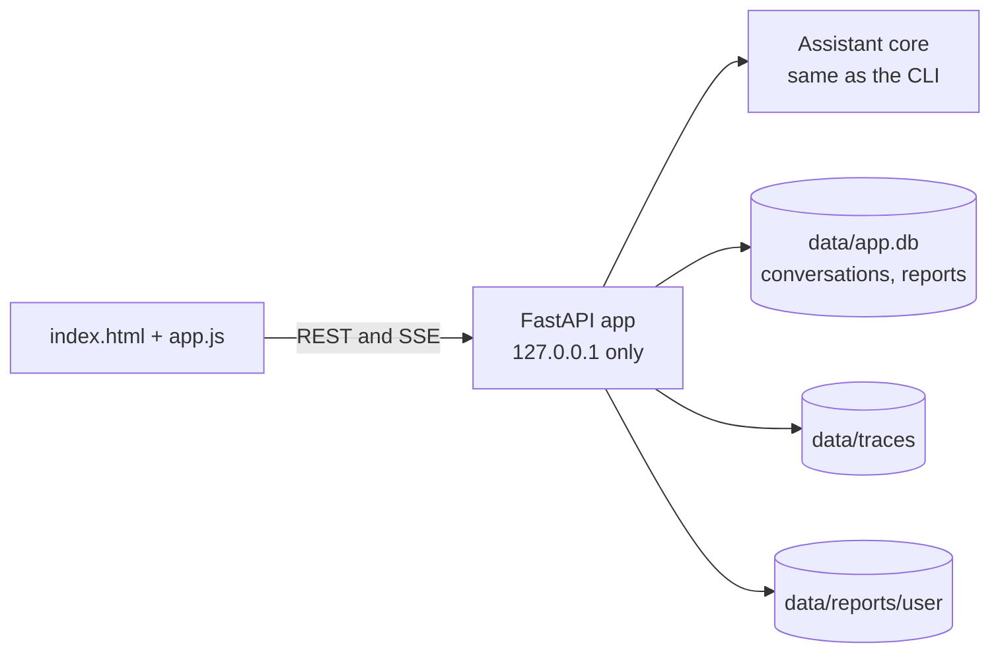

# Spec 40: Local test UI — screens and behavior

- **Status:** Draft
- **Phase and stream:** Phase 2, stream A (spec and sketches). Phase 3 builds it (spec 52).
- **Depends on:** 00, 31, 32, 33, 35
- **Requirements covered:** none from OpsFleet. This is our own tool for manual testing (product definition, section 3.3).

---

## Part A — Product (review this part)

### A1. Goal

A small web page on the developer's computer makes manual tests faster than the CLI. The tester selects a user, chats, opens earlier conversations, sees the steps and the cost of each answer, and opens the report files. The page uses the same assistant as the CLI, so every safety rule stays the same.

### A2. Behavior the user sees

The sketches show each screen. The `.excalidraw` files are editable in [excalidraw.com](https://excalidraw.com). All figures in the sketches are examples, not real data.

**1. Start: choose the test user.** The page lists the users from `config/users.yaml` with their role and brands. The tester selects one and starts a new conversation. To test another user, the tester starts a new conversation.


**2. Chat.** Three panes:
- The left pane holds the history of conversations. A click opens an earlier conversation again.
- The center pane holds the conversation.
- The right pane shows the steps of the selected answer: route, SQL, guard, BigQuery, answer, and the totals (tokens, model calls, queries, time). These are the same data as the CLI command `/trace`.

Each answer shows its time, model calls, queries and bytes billed. A refusal has an amber label.


**3. A long answer in progress.** The page shows the current stage and a clock. The input is locked until the answer is ready. At the time limit, the answer stops with a clear message.


**4. Delete with a typed confirmation.** The assistant shows the exact list of reports. The Confirm button works only when the typed text is exactly `delete N`. A new message cancels the confirmation. After a delete, an Undo link works for 30 days.


**5. A report and its files.** The report shows in the chat with its sections, a chart and the action items. The tester opens the HTML file or downloads the Markdown file. The Reports tab lists the reports of this user only.


### A3. Scope

- **In scope:** the five screens above, on `http://127.0.0.1` only.
- **Out of scope:**
  - A sign-in, because this is a local test tool.
  - Use by executives. That is the production channel in the design.
  - A delete button outside the chat.
  - A Stop button for a running answer.
  - Mobile layouts.

### A4. Limits the user sees

The limits of spec 00 apply without change. The page shows the limits of each answer in the steps pane, for example "Model calls: 2 of 8".

### A5. Done when

- [ ] The five screens work as in the sketches with the real assistant.
- [ ] A user from the start screen sees only the data of their brands. The same safety tests as in the CLI pass through the UI API.
- [ ] Confirm stays disabled for any text other than the exact `delete N`.
- [ ] The page works without internet access, except the calls to Gemini and BigQuery: no CDN, no external fonts.
- [ ] The server listens only on `127.0.0.1`.
- [ ] Biome checks the JavaScript and CSS files without errors.

---

## Part B — Technical

### B1. Key decisions

| | Decision | Choice | Alternatives | Reason |
|---|---|---|---|---|
| ⚑ | UI technology | One static page with plain HTML, CSS and JavaScript, served by FastAPI. No npm, no build step. | Streamlit, Chainlit, React | The user does not want Streamlit. Plain JS needs no build and no `node_modules` in the image. FastAPI can become the production API. |
| ⚑ | Progress of a long answer | Server-Sent Events (SSE) stream the stages and the final answer | Polling every second, WebSocket | SSE is one-way and simple. The browser supports it without a library. |
| | Who sets the user | The start screen sends the user ID once. The server keeps it in the session of the conversation. The model never sets it. | A user field in each message | Same rule as `--user` in the CLI. |

### B2. Design



API endpoints:

| Method and path | Purpose |
|---|---|
| `GET /api/users` | The users from `users.yaml` (ID, name, role, brands) |
| `POST /api/conversations` | Start a conversation for a user. Returns the conversation ID. |
| `GET /api/conversations?user=<id>` | The history of a user |
| `GET /api/conversations/<id>` | The messages of one conversation |
| `POST /api/conversations/<id>/messages` | Send a question. The response is an SSE stream: stages, then the answer or a confirmation request. |
| `POST /api/conversations/<id>/confirm` | Send the typed confirmation text |
| `GET /api/turns/<trace_id>` | The steps and the totals of one answer |
| `GET /api/reports?user=<id>` | The reports of a user |
| `GET /api/reports/<id>/file?format=html|md` | The report file, only for its owner |

### B3. Files and interfaces

```text
src/opsfleet_agent/ui/
  server.py            # FastAPI app and endpoints
  static/index.html
  static/app.js        # plain JavaScript, no framework
  static/styles.css
docs/specs/40-local-ui/mocks/
  0N-*.excalidraw      # editable sketches
  0N-*.svg             # previews for this spec
```

Start: `uv run opsfleet-agent ui` opens the server on `127.0.0.1:8000`.

### B4. Tests

- API tests with the FastAPI `TestClient` and a fake assistant core: users, conversations, the SSE stream, the confirmation, report ownership.
- A Playwright check of the five screens takes the screenshots for the PR description.

### B5. Cost

API tests: 0 Gemini calls. A manual check of the five screens: about 15 Gemini calls and 5 small queries.

### B6. Risks and open points

- The UI adds work at the end of the project. If time is short, the CLI stays the only interface, and the sketches stay as a design.
